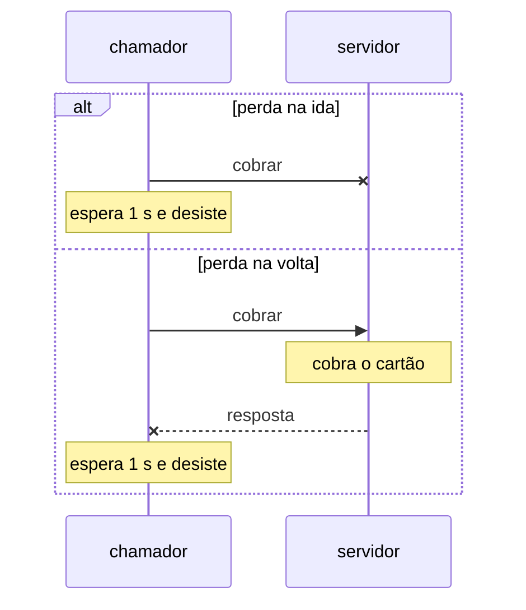
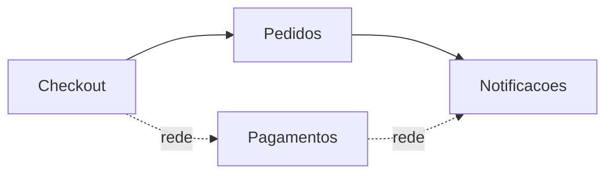

# Aula 16 — Falácias da computação distribuída

## Objetivo e competências

Ao fechar esta aula, conseguimos:

- listar os desfechos de uma chamada local e os de uma chamada remota, e dizer qual deles a assinatura do método esconde;
- explicar por que um *timeout* não informa se a operação aconteceu, distinguindo a perda do pedido da perda da resposta;
- decidir se uma operação pode ser repetida, e o que ela precisa ter para aguentar a repetição (idempotência, chave);
- enumerar as oito falácias da computação distribuída e dizer, de cada uma, o que o código de um único processo supõe e o que a rede desfaz;
- ler a latência de uma operação em percentis (mediana, p95, p99) sem confundir com a média;
- contar quantas arestas do grafo do Orion passam a atravessar a rede quando um módulo é extraído, usando $C_a$ e $C_e$;
- separar o que uma simulação ensina (consequência do desenho do código) do que ela só supõe (consequência dos parâmetros), e dizer como cada número supostamente seria medido de verdade;
- rodar o `07-remoto`, reproduzir o ensaio e ler os testes que mostram a cobrança duplicada e a que não duplica.

## Quando separar um módulo vira uma opção

Um sistema modular guarda todos os seus módulos no mesmo processo, e um módulo chama o outro como quem chama uma função. Em algum momento alguém propõe extrair um deles para um serviço próprio: porque uma equipe quer implantá-lo sozinha, porque ele precisa escalar de outro jeito, porque muda em outro ritmo. No Orion, a Aula 14 deixou `Pagamentos` registrado como candidato a essa extração.

A extração troca chamadas de função por chamadas através de uma rede, e essa troca tem um custo que não aparece no diagrama de componentes. Esta aula examina esse custo antes de qualquer decisão. O caminho tem quatro passos: primeiro, as oito suposições que valem dentro de um processo e deixam de valer fora dele, conhecidas como falácias da computação distribuída; depois, um estudo simulado que verifica o que elas fazem com o Orion; em seguida, a defesa que o estudo sugere; por fim, a decisão sobre `Pagamentos`.

## As oito falácias da computação distribuída

Em meados dos anos 1990, engenheiros da Sun Microsystems, com Peter Deutsch à frente, reuniram as suposições falsas que programadores costumam fazer ao passar de um processo para vários. A lista ficou conhecida como as falácias da computação distribuída, e tem oito itens: a rede é confiável; a latência é zero; a largura de banda é infinita; a rede é segura; a topologia não muda; existe um único administrador; o custo de transporte é zero; a rede é homogênea.

Nenhuma delas é difícil de entender. A dificuldade é que, dentro de um processo, todas são verdadeiras, e o código escrito para esse mundo as carrega sem declarar. Cada uma é apresentada abaixo da mesma forma: a suposição como um programador a faria, a razão de ela deixar de valer e, ao final, a consequência para o projeto.

### Ponto de partida: o que uma chamada local garante

Considere uma função `cobrar(valor, cartao)`. Quem a chama é o **chamador**; o código que a executa é o **servidor**. Dentro de um processo o servidor é só a função, mas o papel existe e é útil nomeá-lo. Ao chamar, o chamador pode esperar um de dois desfechos, e sabe qual ocorreu: a função devolve um valor, ou levanta uma exceção. As duas coisas acontecem na hora. Se voltou, a cobrança ocorreu; se levantou, não ocorreu. Essa certeza não está escrita em lugar nenhum. É uma propriedade do processo, e ninguém a pediu porque nunca faltou.

Entre dois processos, o chamador passa a esperar com um limite de tempo, o ***timeout***: o tempo máximo que aceita esperar antes de desistir. A tabela compara o que ele observa e o que pode concluir:

| O que o chamador observa | Chamada local | Chamada remota |
|---|---|---|
| Uma resposta de sucesso | a cobrança ocorreu | a cobrança ocorreu |
| Uma resposta de erro | a cobrança não ocorreu | a cobrança não ocorreu, se o erro foi devolvido pelo servidor |
| Nada, até o limite de tempo | não existe | a cobrança **pode ou não** ter ocorrido |

A última linha não tem análoga na chamada local. Uma chamada remota pode terminar em **não saber**, e boa parte da aula decorre disso. Quem vem de POO costuma tratar a chamada remota como uma chamada de método com mais latência; a tabela mostra por que essa equivalência falha. O que muda não se resume ao tempo: muda o conjunto de coisas que o chamador pode concluir.

### 1. A rede é confiável

*"Chamei o servidor, então a chamada chegou, foi executada e a resposta voltou."* É assim que se escreve `resultado = servidor.cobrar(...)`: a linha seguinte pressupõe que a anterior terminou.

Na rede, mensagens se perdem: um cabo, um balanceador que reinicia, um processo que cai no meio da operação. O problema maior não é a perda, e sim o que o chamador consegue saber dela. Duas coisas diferentes podem acontecer quando a resposta não chega. O pedido pode ter se perdido na ida, e então o servidor nunca soube da cobrança. Ou o pedido chegou, o cartão foi cobrado, e a resposta se perdeu na volta.



O diagrama responde a uma pergunta: o que o chamador consegue observar em cada caso? Nada que os distinga. Nos dois, ele espera o limite e recebe um erro de *timeout*. Num deles o cliente não foi cobrado, no outro foi. Há ainda uma terceira causa de *timeout*: uma resposta que demora mais que o limite e que, por isso, também deixa o chamador sem resposta embora o servidor tenha executado a operação.

!!! question "Pausa"

    O chamador espera um segundo e não obtém resposta. Ele deve repetir a cobrança, tratá-la como recusada, ou emitir o pedido e conferir depois? Cada uma dessas respostas é correta para um dos dois casos do diagrama e errada para o outro. O que o chamador teria de saber para escolher?

!!! tip "Consequência para o projeto"

    Toda chamada remota tem um terceiro desfecho, "não sei", e a assinatura da operação precisa declará-lo. Operações que mudam o mundo (cobrar, enviar, reservar) precisam aguentar ser repetidas; a seção "Defesa: repetir com segurança" mostra como.

### 2. A latência é zero

*"Chamar o servidor custa o mesmo que chamar uma função, então posso chamar quantas vezes precisar."*

Uma chamada local custa microssegundos. Uma chamada remota custa milissegundos, e o custo varia de chamada para chamada: a maioria é rápida e algumas são muito mais lentas, por fila, retransmissão ou pausa do servidor. Por isso a latência não é um número, é uma distribuição, e se descreve por **percentis**. A **mediana** (p50) é o valor abaixo do qual está metade das chamadas. O **percentil 95** (p95) é o valor abaixo do qual estão 95% delas, e o **p99**, 99%. A média engana: poucas chamadas muito lentas puxam a média para cima sem que a maioria perceba, e escondem-se atrás da mediana.

A cauda também compõe. Se uma operação faz $n$ chamadas remotas em série e cada uma falha com probabilidade $p$, a chance de pelo menos uma falhar é

$$P = 1 - (1 - p)^n$$

onde $(1-p)$ é a chance de uma chamada dar certo e o expoente $n$ diz que todas as $n$ precisam dar certo. Com $p = 0{,}02$ e $n = 2$ (valores de exemplo), $P \approx 0{,}04$: duas chamadas que falham 2% cada uma falham juntas 4% das vezes, quase o dobro. Cada chamada que atravessa a rede soma sua cauda à da operação.

!!! tip "Consequência para o projeto"

    Metas de tempo devem ser escritas em percentil, não em média, e o número de chamadas remotas em série no caminho principal de uma operação é uma decisão de projeto, não um detalhe.

### 3. A largura de banda é infinita

*"Passar o dado ao outro componente é passar uma referência; o tamanho não importa."*

Dentro do processo, entregar uma lista de dez mil produtos a quem só queria um preço custa o mesmo que entregar um produto: passa-se um ponteiro. Na rede, cada chamada copia o que atravessa a fronteira. O custo de transferir cresce com o volume do dado, não com o número de chamadas, e a banda é compartilhada com todo o resto que trafega por ali.

!!! tip "Consequência para o projeto"

    O que atravessa a fronteira deve ser desenhado: pedir só o necessário, devolver só o pedido. O tamanho típico de cada carga é um dado a levantar com o registro de requisições reais; nada neste estudo o mede.

### 4. A rede é segura

*"Quem me chama é quem o código diz que é."*

Dentro de um processo, só chama quem foi compilado junto. Na rede, qualquer coisa que alcance o endereço do servidor pode fazer uma chamada, e o que trafega pode ser lido no caminho. Passa a ser preciso autenticar quem chama, autorizar o que ele pode pedir e proteger o conteúdo em trânsito. No Orion, a cobrança leva o número do cartão do cliente: o que era uma variável em memória vira um dado sensível em trânsito, e `pagamentos` passaria a aceitar cobranças de quem soubesse o endereço dele.

!!! tip "Consequência para o projeto"

    Segurança entre serviços é um requisito a declarar antes de extrair. A Aula 18 a conta entre as forças que justificam separar um serviço do resto. A rede simulada deste estudo não tem atacante e não exercita esta falácia.

### 5. A topologia não muda

*"O outro componente está sempre no mesmo lugar."*

Dentro de um processo está: é o mesmo programa. Na rede, serviços sobem, caem, mudam de máquina e de endereço, e instâncias são acrescentadas ou retiradas conforme a carga. O chamador precisa de uma forma de descobrir o destino e de lidar com o destino que, naquele momento, não existe. O transporte do Mini-Orion mostra a menor versão do problema: os destinos são registrados por nome, e chamar um nome não registrado levanta `DestinoDesconhecido`.

!!! tip "Consequência para o projeto"

    O chamador deve conhecer um nome lógico, não um endereço, e tolerar a ausência do destino. Descoberta de serviço e implantação gradual são assuntos de operação, tratados na Aula 23.

### 6. Existe um único administrador

*"Quem muda um lado muda o outro junto."*

Dentro de um artefato é verdade: os dois componentes saem na mesma entrega. Na rede, cada lado tem o próprio calendário de mudanças, o próprio ambiente e, às vezes, outra equipe ou outra empresa. Uma versão nova de um lado chega enquanto o outro ainda roda a anterior, e ninguém decide sozinho quando reiniciar, trocar de versão ou descontinuar uma função. É o que acontece quando um provedor de pagamento externo atualiza sua interface: quem o chama não escolhe o dia.

!!! tip "Consequência para o projeto"

    O que protege os dois lados é um contrato que continue válido enquanto as versões se alternam. É o tema central da Aula 19.

### 7. O custo de transporte é zero

*"Passar um objeto ao outro componente é passar um ponteiro."*

Na rede o objeto não viaja: seus dados precisam ser escritos em um formato, transportados e lidos do outro lado. Cada passo tem custo de tempo, de código e de manutenção, e o formato escolhido passa a ser, ele mesmo, um contrato entre os dois lados. No Mini-Orion, o pedido de cobrança é escrito como carga de dados em um lado e lido no outro: duas implementações do mesmo formato, que precisam mudar juntas.

!!! tip "Consequência para o projeto"

    O formato das mensagens é uma interface pública e merece o cuidado de uma. A Aula 19 trata do que ele cobra de quem o muda.

### 8. A rede é homogênea

*"Os dois lados falam a mesma linguagem, com os mesmos tipos."*

Não necessariamente. Os dois lados podem estar escritos em linguagens diferentes, rodar em sistemas diferentes e representar um número, uma data ou um texto de maneiras diferentes. Um tipo de Python não atravessa a rede como tipo de Python: atravessa como bytes que o outro lado interpreta.

!!! tip "Consequência para o projeto"

    A mensagem deve usar valores simples (textos e números), sem tipos próprios de uma linguagem. É o que o Mini-Orion faz: a carga da cobrança é montada com valores simples, e um serviço escrito em outra linguagem poderia substituir `pagamentos` sem que `compra` notasse.

### O que o estudo seguinte cobre

Das oito, o estudo a seguir exercita três: a 1, a 2 e a 7. A rede simulada não tem como representar as outras cinco (3, 4, 5, 6 e 8), que ficam como riscos de projeto, sem medição, e a aula diz em que ponto o curso volta a cada uma.

## Um estudo para verificar: `Pagamentos` atrás de uma rede simulada

### A pergunta

Se `Pagamentos` fosse extraído para um serviço próprio, o fechamento de compra do Orion sofreria o que as falácias 1, 2 e 7 descrevem? E, se sofresse, em que medida? A pergunta é feita antes da extração, porque depois dela a resposta custaria dinheiro a clientes de verdade.

### Como o estudo foi montado

O que rodamos **não é uma medição do Orion**. É uma simulação: o código de `compra` e de `pagamentos` do Mini-Orion executa de verdade, mas a rede entre os dois é um programa que sorteia atrasos e falhas segundo parâmetros escolhidos por nós. Esse recorte executável é o checkpoint `07-remoto`. A extração de `Pagamentos` ainda não aconteceu, e não existe nenhum dado de produção sobre essa fronteira.

O estudo executa 2000 fechamentos de compra, em uma configuração de **campanha** (um período de promoção, com volume de acesso e taxa de falha acima do normal). Para cada fechamento, registra o tempo total e o que aconteceu com a cobrança. Os 2000 fechamentos, a semente do sorteio e os parâmetros são fixos, de modo que a mesma rodada dá sempre o mesmo resultado. A seção "Reproduzindo o ensaio", mais adiante, mostra o passo a passo. O script que o executa se chama `ensaio.py`, e por isso "ensaio" e "estudo" designam, daqui em diante, a mesma coisa.

### O que supomos

Uma simulação só é tão boa quanto os parâmetros que recebe, e os nossos são suposições. A tabela os lista, junto com a origem de cada um, para que o leitor saiba o que é dado e o que é hipótese:

| Parâmetro | Valor | Origem |
|---|---|---|
| Latência de uma chamada remota | mediana de 20 ms, percentil 99 de 400 ms | hipótese de trabalho |
| *Timeout* | 1 s por chamada; 3 s para o fechamento inteiro | o de 3 s é o limite do `Checkout` mostrado na Aula 6 |
| Falha transitória por chamada, em campanha | 2% (0,2% fora de campanha) | hipótese de trabalho |
| Parcela dessas falhas em que a resposta se perde | 50% (nas demais, é o pedido que se perde) | hipótese de trabalho |
| Meta do fechamento | percentil 95 em até 2 s | meta combinada com o negócio, não medição |

As falhas saem de um sorteio independente por chamada. A simulação reproduz a **forma** do problema: tempo que não é zero, falha que não é exceção local, estado ambíguo. Ela não reproduz a física de uma rede de verdade.

### Por que uma distribuição lognormal

Falta dizer de onde saem os atrasos de 20 ms e 400 ms. O simulador sorteia cada latência de uma distribuição **lognormal**, e a escolha tem uma justificativa estatística que cabe explicar.

Uma latência nunca é negativa; a maioria das chamadas fica perto de um valor típico; e uma minoria é muito mais lenta. Isso dá um histograma assimétrico, com cauda longa à direita, no qual a média é maior que a mediana. A distribuição normal (o sino simétrico) não serve: ela admitiria latências negativas e não teria cauda assim.

Uma variável é lognormal quando o seu **logaritmo** é normal. A razão de ela aparecer em latências é parecida com a da normal para somas: a normal surge quando muitos efeitos pequenos se **somam**; a lognormal surge quando muitos efeitos pequenos se **multiplicam**. Uma chamada passa por várias etapas (fila, processamento, rede), e uma etapa lenta tende a atrasar as seguintes em proporção, não por uma quantidade fixa.

Dois parâmetros bastam, e correspondem ao que uma equipe mede: a mediana e o p99. Se a mediana é $m$ e o p99 é $q$, o logaritmo da latência é normal com média $\mu = \ln m$ e desvio-padrão

$$\sigma = \frac{\ln(q / m)}{z_{0{,}99}}$$

onde $z_{0{,}99} \approx 2{,}326$ é o ponto da normal padrão que deixa 99% da área abaixo dele. Com $m = 20$ ms e $q = 400$ ms, $\sigma \approx 1{,}29$. Uma consequência: a chance de uma latência passar de 1 s, o *timeout*, é de cerca de 0,1%, o que corresponde à "terceira causa de *timeout*" da falácia 1.

Isso é aceitável para o cenário, e não uma lei da rede. Latências reais costumam ter vários picos (acerto e erro de cache, por exemplo) e caudas ainda mais pesadas. A lognormal captura o que importa para o argumento, que é a assimetria e a cauda longa, e permite ajustar os dois parâmetros com dados reais quando eles existirem. O resultado qualitativo do estudo não depende dessa escolha.

### Como esses números seriam medidos de verdade

Se a simulação não mede, o que mediria? A resposta depende do ponto da história em que estamos, e tem três partes.

**Antes de extrair, parte já pode ser lida do que existe.** `Pagamentos` já fala por rede hoje: a cobrança chega a um provedor externo (no Mini-Orion, `GatewayPagamentoX`). Os registros dessas chamadas mostram a latência e a taxa de *timeout* de uma chamada remota real do Orion. Não são os números da fronteira entre `compra` e `pagamentos`, mas são a melhor estimativa disponível de como uma chamada remota se comporta na nossa infraestrutura, e é de lá que sairiam, por exemplo, os 2% e os 400 ms. O defeito que vamos estudar também já existe nessa fronteira: uma repetição depois de um *timeout* pode cobrar de novo no provedor. É um dos motivos pelos quais muitos provedores de pagamento oferecem chave de idempotência em suas interfaces.

**Antes de extrair, também se pode ensaiar de forma mais realista.** Em ambiente de homologação, `pagamentos` sobe como processo separado, com um intermediário que atrasa e derruba uma fração das chamadas (a técnica se chama injeção de falhas, e há ferramentas para isso, como o Toxiproxy), e uma ferramenta de teste de carga reproduz o volume de campanha. É o equivalente real do nosso simulador. Continua sendo hipótese sobre a rede, mas o código que roda é o de produção, com serialização, *pool* de conexões e sistema operacional, e por isso encontra defeitos que o simulador não encontra.

**Só depois de extrair, em produção, a fronteira real pode ser medida.** Cada número do ensaio tem um equivalente a instrumentar:

| O que o ensaio supõe | Como se mediria em produção |
|---|---|
| latência de 20 ms (mediana) e 400 ms (p99) | histograma da duração de cada chamada de `compra` a `pagamentos`, lido em percentis, não em média |
| 2% de falha transitória | contagem de *timeouts* por destino dividida pelo total de chamadas, por janela de tempo |
| repetição | fechamentos que precisaram de mais de uma tentativa, e quantas chaves repetidas `pagamentos` recebeu |
| 50% das falhas perdem a resposta | cruzar o registro de `compra` ("estourei o tempo na chamada X") com o de `pagamentos` ("executei a chamada X") |
| cobrança duplicada | **conciliação**: comparar o extrato do provedor com os pedidos emitidos e contar cobranças sem par |

Duas linhas dessa tabela merecem atenção. A parcela de respostas perdidas é a medida mais difícil: sem um identificador comum nos dois lados, não há como saber, para cada *timeout*, se o servidor chegou a executar. A chave de idempotência já serve a esse papel, e a Aula 23 trata disso como correlação. E a cobrança duplicada não aparece em nenhum relatório de latência: só a conciliação a enxerga, e é por isso que o cliente costuma ser o primeiro a avisar.

Daí a razão de o ensaio vir antes da extração. Ele não substitui a medição. Ele diz o que medir e quais defesas desenhar antes que a primeira cobrança duplicada custe dinheiro a um cliente de verdade. E o ADR desta aula, mais abaixo, é escrito para que a medição possa derrubá-lo.

### O que o estudo encontra

Os 2000 fechamentos simulados foram resumidos de duas maneiras. A primeira é a que uma equipe costuma acompanhar: o tempo do fechamento, lido em mediana e em p95, e comparado com a meta combinada com o negócio (p95 em até 2 s).

| Medida | Valor |
|---|---|
| Mediana | 21 ms |
| Percentil 95 | 214 ms |
| Meta do fechamento (percentil 95) | 2 s |

O p95 simulado é 214 ms, contra uma meta de 2000 ms: a meta é cumprida com folga, e a razão é $2000 / 214 \approx 9{,}3$, quase dez vezes. Quem olhasse só esse indicador concluiria que a extração é barata. Acontece que o p95 só diz algo sobre os 95% de fechamentos mais rápidos. A segunda maneira olha para o resto:

| Medida | Valor |
|---|---|
| Fechamentos que esperaram um *timeout* inteiro (1 s ou mais) | 39 (1,95%) |
| Percentil 99 | 1021 ms |
| Clientes cobrados duas vezes | 22 (1,1%) |
| Fechamentos terminados em "não sei se cobrou" | 2 |

Os 39 fechamentos da primeira linha ficam acima do percentil 98, e por isso o p95 não os alcança. A terceira linha é um erro que não existia no checkpoint anterior: em `06-microkernel`, a cobrança acontecia uma vez ou não acontecia. As falácias 1 e 2 aparecem aqui com números: a rede perde mensagens, e a perda produz tanto espera quanto cobrança em dobro.

### O que o estudo ensina e o que apenas supõe

Dois tipos de resultado saem de uma simulação assim, e é importante não os misturar.

O primeiro tipo é consequência do **desenho** do código e vale quase independentemente dos números. Com repetição e sem chave de idempotência, existe um caminho em que o cliente é cobrado duas vezes. Esse caminho existiria com 2% de falha e existiria com 0,1%; só a frequência muda. Aprendemos algo verdadeiro sobre o código, e o teste que o reproduz (mais adiante) não depende de sorteio nenhum.

O segundo tipo é consequência dos **parâmetros**: 1,1% de cobranças duplicadas, 39 fechamentos na cauda, p95 de 214 ms. Esses números valem tanto quanto as hipóteses que os produziram. Afirmar que "o Orion cobraria 1% dos clientes em dobro" seria dizer o que não sabemos. O que podemos dizer é: se a rede se comportar como supomos, o desenho atual produz cerca de 1%.

## Defesa: repetir com segurança

O estudo mostrou o problema da falácia 1: quando a resposta não chega, o chamador não sabe se deve repetir. As duas subseções a seguir tratam do que fazer com isso e de como declarar o desfecho "não sei" no código sem mudar a assinatura da operação.

### Repetir só é seguro quando a operação aguenta ser repetida

A reação comum a um *timeout* é tentar de novo. Para uma consulta ao `Catalogo`, funciona: perguntar duas vezes o preço de um produto devolve a mesma resposta e não muda nada. Uma operação assim é **idempotente**: executá-la uma vez ou várias produz o mesmo estado.

Cobrar um cartão não é. Se a primeira tentativa ocorreu e só a resposta se perdeu, a repetição cobra de novo. Em campanha, isso acontece em cerca de 1% dos fechamentos, que é a metade (as perdas na volta) dos 2% de falha:

$$P_{\text{duplicada}} \approx 0{,}02 \times 0{,}5 = 0{,}01$$

onde $0{,}02$ é a taxa de falha por chamada e $0{,}5$ é a parcela das falhas em que o pedido chega e a resposta se perde. Lendo: de cada cem fechamentos, dois falham, e em um deles o cliente já tinha sido cobrado quando `compra` repete. O ensaio mediu 22 em 2000, ou seja, 1,1%. A diferença para 1% vem das respostas lentas demais, que também executam o servidor e perdem a resposta.

A saída conhecida é tornar a operação idempotente por construção, com uma **chave de idempotência**: um identificador gerado por quem decide cobrar, uma vez por intenção, e enviado em todas as tentativas. O lado que cobra guarda as chaves que já viu e, diante de uma repetida, devolve o resultado anterior sem cobrar de novo. A chave não elimina a ambiguidade. Ela torna a repetição segura, e é isso que se pede dela.

Duas propriedades precisam valer, e as duas custam:

- a chave nasce **antes** da primeira tentativa e é gerada **por quem decide**, não por quem transporta. Uma chave nova a cada tentativa não protege de nada;
- o lado que cobra passa a ter estado. Uma tabela de chaves vistas cresce, precisa expirar, e é um novo ponto de falha.

### A assinatura que continua igual

`ClientePagamentos` satisfaz o `Gateway` do `05-modular`. `ServicoCheckout` não foi alterado para falar com ele, e esse é o ganho de ter a fronteira como `Protocol`. É também o risco: `cobrar(pedido) -> ResultadoCobranca` tem a mesma cara de antes e esconde o terceiro desfecho.

Há duas formas de declará-lo. Uma é acrescentar `INDETERMINADA` ao enum `ResultadoCobranca`; a outra é levantar uma exceção própria, `CobrancaIndeterminada`. Escolhemos a exceção por um motivo de significado: o enum descreve o que o provedor respondeu, e "indeterminada" é justamente a ausência de resposta. Há também um motivo de custo. Com um valor no enum, `deve_tentar_outro_provedor` teria de decidir se ele conta, e a resposta errada sai cara: o provedor de contingência, acionado depois de um *timeout*, cobraria o cliente de novo num provedor que nunca viu a chave. Com a exceção, a chamada à contingência é pulada, porque o fluxo sai antes dela.

A escolha tem preço. Python não tem exceção verificada, então nada obriga um novo consumidor a tratar `CobrancaIndeterminada`. Quem chamar `Gateway.cobrar` e esquecer o `except` deixa a exceção subir até o topo do fechamento. Com o valor no enum, o esquecimento seria mais silencioso: caía em "não aprovada" e seguia como recusa, o pior tratamento para um cliente que possivelmente foi cobrado. Cada forma falha de um jeito, a exceção alto e o enum quieto, e escolhemos falhar alto. Um time cujos consumidores já usam `match` exaustivo poderia escolher o enum, e teria razão.

## Decisão sobre o Orion: Pagamentos atrás da rede

### Quantas arestas cruzam a rede

Extrair `Pagamentos` corta exatamente as arestas que entram e saem dele, em número $C_a + C_e = 1 + 1 = 2$, valores que o Módulo 1 mediu para `Pagamentos`:



Leitura das setas: `A --> B` significa que A depende de B. A linha tracejada é a dependência que passa a atravessar a rede.

O diagrama responde a uma pergunta de contagem: das 17 arestas do grafo, quantas mudam de natureza? Duas, e as outras 15 continuam sendo chamadas no mesmo processo ($17 - 2 = 15$).

Ele omite as outras 13 arestas e os demais componentes. Também não mostra que `Pagamentos --> Notificacoes` pode sair do caminho crítico, enquanto `Checkout --> Pagamentos` não pode: a cobrança precisa terminar antes de o pedido ser emitido. No Mini-Orion a conta é menor, porque `pagamentos` e `notificacoes` não se conhecem (contrato `independence`) e só a aresta `compra --> pagamentos.api` atravessa a rede.

### Três políticas de repetição

Os mesmos 2000 fechamentos de campanha, com a mesma semente, sob três políticas:

| Alternativa | O que resolve | O que custa | Quando não vale |
|---|---|---|---|
| Não repetir (1 tentativa) | pior fechamento em 1 s; nenhuma cobrança duplicada | 41 fechamentos sem resposta (2,05%), 24 deles com o cliente já cobrado e sem pedido | quando "cobrado sem pedido" custa mais ao negócio que um segundo de espera |
| Repetir sem chave (2 tentativas) | só 2 fechamentos sem resposta | 22 clientes cobrados em dobro (1,1%); pior fechamento em 2 s | quando cobrar duas vezes é inaceitável, o que vale para cobrança de cartão |
| Repetir com chave (2 tentativas) | 2 sem resposta, nenhuma duplicação | `pagamentos` guarda estado; `compra` gera a chave; pior fechamento em 2 s | quando o lado que cobra não pode guardar estado, ou quando o chamador não controla a chave |

A segunda linha parece a melhor se olharmos só a coluna "o que resolve", e é a pior. Sem os 22 clientes cobrados em dobro, o relatório de erros mostraria dois fechamentos sem resposta, e a duplicação só apareceria na reclamação do cliente.

Uma variante testada: com três tentativas e chave, o ensaio fecha com 1 fechamento sem resposta, e o pior caso vai a 3,00 s. Isso consome todo o *timeout* de 3 s do fechamento. A terceira tentativa compra pouco e tira a folga.

### 📐 ADR — Cobrança remota com repetição única e chave de idempotência

| Campo | Conteúdo |
|---|---|
| **Identificador** | ADR — Cobrança remota com repetição única e chave de idempotência |
| **Status** | Aceito para o `07-remoto`. Vale para a rede simulada; reabre com medição real. |
| **Contexto** | `Pagamentos` atrás de rede, em ensaio de campanha com 2000 fechamentos: sem repetição, 41 fechamentos sem resposta, 24 deles com cliente cobrado e sem pedido; repetindo sem chave, 22 cobranças duplicadas. |
| **Decisão** | `ClientePagamentos` repete a cobrança uma vez (2 tentativas, 1 s cada). `compra` gera uma `ChaveIdempotencia` por fechamento, antes da primeira tentativa, e `pagamentos` guarda as chaves vistas. Esgotadas as tentativas, `fechar_pedido` devolve `cobranca_indeterminada`: não devolve `recusada` e não aciona o provedor de contingência. |
| **Alternativas** | (a) Não repetir: simples, mas deixa 2,05% dos fechamentos sem resposta e 1,2% com o cliente cobrado sem pedido. (b) Repetir sem chave: pouco código, e 1,1% de clientes cobrados em dobro. (c) Três tentativas com chave: reduz os sem resposta a 1 em 2000, ao custo de consumir os 3 s do *timeout* total. |
| **Consequências positivas** | Nenhuma cobrança duplicada nos 2000 fechamentos. Os fechamentos sem resposta caem de 41 para 2. |
| **Consequências negativas** | `pagamentos` passa a guardar estado: a tabela de chaves cresce e precisa de prazo de expiração, que o Mini-Orion não implementa. A responsabilidade pela chave é de `compra`: um chamador que a esqueça reintroduz a duplicação sem erro nenhum. Os 2 fechamentos sem resposta continuam, com cliente possivelmente cobrado e sem pedido, e ficam sem tratamento até as Aulas 21 e 22. O pior fechamento passa de 1 s para 2 s. |
| **Reversão** | Barata enquanto só `compra` consumir `pagamentos`: tirar a chave devolve a duplicação, e evitá-la exigiria desligar também a repetição, voltando à primeira linha da tabela. Cara depois que um segundo consumidor depender do comportamento idempotente. |
| **Condição de falseamento** | Este ADR estaria errado se, com os parâmetros reais de campanha, houvesse cobrança duplicada mesmo com a chave (a chave não chega, ou expirou cedo), ou se os fechamentos sem resposta não ficassem pelo menos dez vezes abaixo dos da política sem repetição. |

### Na prática: Python

O código do Mini-Orion está em um repositório próprio, <https://github.com/eduardo-da-silva/fundamentos-arquitetura-code>, com um checkpoint por pasta na raiz. O checkpoint `07-remoto/` parte de `06-microkernel/`. Os 17 testes herdados seguem verdes, e o `setup.cfg` ganha um contrato. O transporte simulado é o coração do que acontece com `compra`:

```python title="07-remoto/mini_orion/rede/_simulada.py (recorte)" hl_lines="12 13"
    def chamar(
        self, destino: str, operacao: str, carga: Carga, timeout: float
    ) -> Carga:
        tratador = self._tratadores.get((destino, operacao))
        if tratador is None:
            raise DestinoDesconhecido(f"{destino}/{operacao}")
        self.chamadas += 1
        falha = self._proximo_desfecho()
        latencia = self._sortear_latencia()
        if falha is Falha.PERDA_NA_IDA:
            self._esgotar(timeout)
        resposta = tratador(carga)  # o servidor fez o trabalho
        if falha is Falha.PERDA_NA_VOLTA or latencia > timeout:
            self._esgotar(timeout)
        self._relogio.avancar(latencia)
        return resposta
```

Na perda na ida, o tratador nunca roda. Na perda na volta, ele roda e o chamador só vê o *timeout*. Tudo o que está entre `tratador(carga)` e `_esgotar` é a diferença entre os dois cenários do diagrama, e ela é invisível do lado de fora. O relógio é injetado e só avança quando alguém o faz avançar: nenhum teste dorme e a semente fixa torna cada rodada reproduzível.

O cliente transforma o *timeout* em repetição e, esgotada, em `CobrancaIndeterminada`:

```python title="07-remoto/mini_orion/pagamentos/cliente.py (recorte)" hl_lines="6 7 9"
    def cobrar(self, pedido: PedidoCobranca) -> ResultadoCobranca:
        carga = self._escrever(pedido)
        for _ in range(self._tentativas):
            try:
                resposta = self._transporte.chamar(DESTINO, "cobrar", carga, self._timeout)
            except TimeoutDeRede:
                continue  # repetir e seguro? Depende de a cobranca ser idempotente.
            return ResultadoCobranca(resposta["resultado"])
        raise CobrancaIndeterminada(f"{self._tentativas} tentativas sem resposta")
```

Do lado de `compra`, a chave nasce antes da primeira tentativa, e o novo desfecho tem nome próprio:

```python title="07-remoto/mini_orion/compra/api.py (recorte)" hl_lines="5 12"
    def fechar_pedido(self, carrinho: Carrinho, cliente: Cliente) -> str:
        # A chave nasce aqui, uma vez por fechamento: toda repeticao da
        # mesma cobranca, em qualquer camada abaixo, leva a mesma chave.
        cobranca = PedidoCobranca(
            valor=carrinho.total, cartao=cliente.cartao, chave=self._gerar_chave()
        )

        try:
            resultado = self._cobrar(cobranca)
        except CobrancaIndeterminada:
            # Nao sabemos se cobrou. Nao emitimos, e nao dizemos "recusada".
            return "cobranca_indeterminada"
```

O "antes" e o "depois" da chave são comparáveis: o mesmo fechamento, a mesma falha forçada (resposta perdida na primeira tentativa e sucesso na segunda), e só a presença da chave muda:

```python title="07-remoto/tests/test_remoto.py (recorte)"
def test_repeticao_sem_chave_cobra_duas_vezes(carrinho: Carrinho, cliente: Cliente) -> None:
    cenario = montar_remoto(gerar_chave=sem_chave)
    cenario.rede.forcar(Falha.PERDA_NA_VOLTA, None)

    resultado = cenario.checkout.fechar_pedido(carrinho, cliente)

    assert resultado == "confirmado"
    assert len(cenario.pagamentos.cobrancas_aprovadas) == 2  # o cliente pagou em dobro


def test_repeticao_com_chave_cobra_uma_vez(carrinho: Carrinho, cliente: Cliente) -> None:
    cenario = montar_remoto()  # gera a chave por padrao
    cenario.rede.forcar(Falha.PERDA_NA_VOLTA, None)

    resultado = cenario.checkout.fechar_pedido(carrinho, cliente)

    assert resultado == "confirmado"
    assert len(cenario.pagamentos.cobrancas_aprovadas) == 1
```

Nos dois, `fechar_pedido` devolve `confirmado`. Nada na resposta de `compra` distingue o fechamento que cobrou uma vez do que cobrou duas, e a única evidência do erro está do lado de `pagamentos`. O teste que lê o extrato do provedor é o que enxerga o problema.

O contrato novo do `setup.cfg` mantém a rede como infraestrutura, sem conhecer nenhum módulo de domínio:

```ini title="07-remoto/setup.cfg (recorte)"
[importlinter:contract:rede-nao-conhece-dominio]
type = forbidden
source_modules =
    mini_orion.rede
forbidden_modules =
    mini_orion.compra
    mini_orion.pagamentos
    mini_orion.notificacoes
    mini_orion.promocoes
```

Para ver o contrato falhar, acrescente `import mini_orion.pagamentos.api` ao fim de `rede/api.py` e rode `lint-imports`: ele aponta a aresta proibida. O sistema continuaria funcionando, e é por isso que o contrato existe.

### Reproduzindo o ensaio

Tudo o que a aula apresentou como resultado sai de um script do próprio checkpoint. Com Python 3.12 ou superior:

```bash
git clone https://github.com/eduardo-da-silva/fundamentos-arquitetura-code.git
cd fundamentos-arquitetura-code
python -m venv .venv && source .venv/bin/activate   # no Windows: .venv\Scripts\activate
pip install -r requirements-dev.txt

cd 07-remoto
pytest              # 40 testes
lint-imports        # 5 contratos
python ensaio.py    # as tabelas desta aula
```

A saída do último comando, com os valores desta aula (2000 fechamentos, semente 42):

```text
== O ensaio: 2000 fechamentos, repetir uma vez, SEM chave ==
  mediana                             21 ms
  percentil 95                       214 ms   (meta: 2000 ms)
  percentil 99                      1021 ms
  esperaram um timeout inteiro        39      (1,95%)
  cobrados duas vezes                 22      (1,10%)
  terminaram em 'nao sei'              2

== Tres politicas de repeticao, 2000 fechamentos, semente 42 ==
  politica                      sem resposta  duplicadas  cobrado s/ pedido    pior
  nao repetir (1 tentativa)               41           0                 24   1.00s
  repetir sem chave (2)                    2          22                  2   2.00s
  repetir com chave (2)                    2           0                  2   2.00s
  repetir com chave (3)                    1           0                  1   3.00s
```

O que vale experimentar a partir daí:

- **Mudar a rodada.** `python ensaio.py --semente 7` sorteia outra sequência de falhas, e `--fechamentos 10000` roda mais fechamentos. O número 22 não é uma constante: é um sorteio. `python ensaio.py --varrer` repete a política "repetir sem chave" em dez sementes:

    | Medida | Semente 42 (a da aula) | Faixa nas sementes 1 a 10 |
    |---|---|---|
    | Percentil 95 | 214 ms | 195 a 226 ms |
    | Esperaram um *timeout* inteiro | 1,95% | 1,80% a 2,50% |
    | Cobrados em dobro | 1,10% | 0,85% a 1,35% |

    A leitura honesta é "cerca de 1%", e é assim que a aula o escreve. Dizer "22 em 2000" como se fosse uma propriedade do sistema seria tratar um sorteio como medida.

- **Mudar as hipóteses.** Em `mini_orion/rede/api.py`, os parâmetros `CAMPANHA` e `NORMAL` são as hipóteses da tabela "O que supomos". Troque `CAMPANHA` por `NORMAL` em `ensaio.py` e observe que a duplicação cai, mas não vai a zero: uma resposta mais lenta que o *timeout* também executa o servidor, e isso acontece mesmo com a rede saudável.
- **Ver o desenho, sem sorteio.** Os testes `test_repeticao_sem_chave_cobra_duas_vezes` e `test_repeticao_com_chave_cobra_uma_vez`, vistos acima, forçam a falha exata com `rede.forcar(...)` e dão o mesmo resultado com qualquer parâmetro. São a prova de que a duplicação é consequência do desenho, não da hipótese.

O arquivo `tests/test_ensaio.py` fixa os números que esta aula cita. Se o código mudar e os números mudarem, o teste falha, e a aula precisa ser revista junto.

## Trabalho do aluno

O trabalho das Aulas 16 e 17 é um só: o [projeto "Extrair ou não extrair"](projeto-extrair-ou-nao-extrair.md), individual ou em dupla. A **parte 1** usa o `ensaio.py` desta aula, para medir o custo da rede num cenário escolhido por você, e a **parte 3** é a leitura de um artigo (dois dos quatro propostos tratam de cauda de latência e de repetição segura). A entrega é antes da Aula 18.

## O que ficou registrado e a pergunta que a Aula 17 abre

Ficou registrado que chamar `Pagamentos` por rede é uma operação diferente da chamada local, e que a diferença é de desfechos, não só de tempo. Ficou decidido que a cobrança remota repete uma vez, com chave gerada por `compra`, e que o terceiro desfecho (não saber se cobrou) tem nome próprio no retorno do fechamento, em vez de se passar por recusa. O ADR custa estado em `pagamentos`, deixa 2 fechamentos de 2000 sem resposta e depende de ninguém esquecer a chave.

Nada disso responde a quantos serviços o Orion deveria ter para pagar esse custo só onde ele compensa. Tirar apenas `Pagamentos` e manter o resto num processo é uma resposta. Um serviço por componente, que a diretoria também ouviu, é outra, e cada aresta a mais que atravessa a rede soma sua cauda e sua ambiguidade. A Aula 17 compara as duas formas pelo que cada uma otimiza e pelo que cobra.

## Leitura complementar

- Richards, Mark; Ford, Neal. *Fundamentals of Software Architecture*. Cap. 9 — Foundations (as falácias da computação distribuída e o que mudam em uma arquitetura).
- Kleppmann, Martin. *Designing Data-Intensive Applications*. Cap. 8 — The Trouble with Distributed Systems (falhas parciais, *timeouts* e relógios).

## Referências

- RICHARDS, Mark; FORD, Neal. *Fundamentals of Software Architecture: An Engineering Approach*. O'Reilly, 2020.
- KLEPPMANN, Martin. *Designing Data-Intensive Applications*. O'Reilly, 2017.
