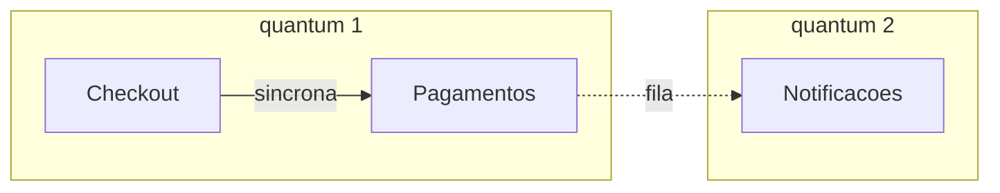

# Aula 17 — Do *service-based* aos microsserviços

## Objetivo e competências

Ao fechar esta aula, conseguimos:

- situar o monólito modular, o *service-based* e os microsserviços num espectro de granularidade, pelo que cada um entrega como unidade de deploy, de dado e de time;
- explicar o que é um *architectural quantum* e por que dez serviços que se chamam de forma síncrona formam um quantum só;
- contar, para uma forma dada, quantos artefatos ela tem, quantas arestas do grafo atravessam a rede e quantas chamadas remotas o `Checkout` faz diretamente;
- estimar o efeito de cada forma na disponibilidade do fechamento, dizendo quais premissas sustentam a conta;
- separar o que se lê do grafo e do código (estrutura) do que só a medição em produção responde (taxa de falha, disponibilidade);
- redigir um ADR sobre a forma do *deployable* com pelo menos três alternativas e um gatilho de revisão;
- rodar `quantum.py` e refazer a conta para uma divisão proposta por nós.

## Duas propostas, o mesmo nome

A Aula 14 terminou com `Pagamentos` registrado como candidato a extração e com um gatilho mensurável para decidir. O ADR circula e, na reunião de planejamento seguinte, volta à mesa com duas contrapropostas, uma de cada time.

O time de plataforma quer **um microsserviço por componente**: o Orion tem dez componentes, então dez serviços, cada um com seu dado, seu *deploy* e seu dono. O time de operações quer **só tirar `Pagamentos`** e deixar o resto onde está. As duas propostas são chamadas de "arquitetura de serviços", e nenhuma traz um número.

A Aula 16 já deixou o critério para comparar. Cada aresta do grafo que atravessa a rede soma uma cauda de latência, uma ambiguidade de *timeout* e uma decisão de repetição. A pergunta, então, não é se serviços são uma boa ideia. É **quantas arestas** o Orion deveria pagar, e o que cada artefato a mais compra em troca. Para responder, precisamos de duas coisas: um vocabulário para as formas que existem entre "um processo" e "um serviço por componente", e uma noção precisa do que significa dizer que algo é independente.

## Um espectro de granularidade

As duas propostas ocupam extremos de um espectro. O que varia ao longo dele é o tamanho da unidade que se implanta, e junto com ela o tamanho do dado e do time que cabem nessa unidade.

| Forma | Unidade de deploy | Dado | No Orion |
|---|---|---|---|
| Monólito modular | um artefato, com módulos de fronteira lógica | um banco | 1 artefato (o estado de `05-modular` e `06-microkernel`) |
| *Service-based* | poucos serviços grossos, cada um um domínio | em geral um banco compartilhado, que pode ser dividido | os 8 módulos de domínio da Aula 12 viram 8 serviços |
| Microsserviços | muitos serviços pequenos, um por capacidade de negócio | cada serviço dono do seu dado | os 10 componentes viram 10 serviços |

O *service-based* é um estilo com nome próprio no livro-base de Richards e Ford, entre o monólito e os microsserviços: na descrição deles, de quatro a doze serviços de domínio, grossos, em geral com um banco único atrás. Os microsserviços, na formulação de Newman, são serviços pequenos, implantáveis de forma independente e organizados em torno de capacidades de negócio, cada um dono do seu dado. A diferença entre os dois é de grau antes de ser de natureza: existe "microsserviço" de dez mil linhas e "serviço de domínio" de duas mil, e a conversa que perde tempo discutindo o nome costuma perder também a pergunta sobre o tamanho.

A forma do meio é a menos discutida e a mais instrutiva para o Orion, porque a Aula 12 já fez, sem rede, o agrupamento que ela exigiria: os oito módulos de domínio, com suas fronteiras verificadas por contratos de `import-linter`. Um *service-based* por domínio seria transformar cada fronteira lógica em fronteira de rede. Resta saber quanto isso custa.

### O que cada forma otimiza

O **monólito modular** otimiza simplicidade operacional: um *deploy*, uma transação local entre cobrar e emitir, um teste que roda sem rede. Cobra o que a Aula 9 nomeou: tudo sobe junto, com uma cadência e uma escala só.

O ***service-based*** otimiza autonomia de deploy por domínio sem multiplicar demais os artefatos. Como cada serviço é grosso, a maior parte das chamadas continua dentro dele, e a transação local sobrevive dentro de cada domínio. Cobra a rede em todas as arestas que cruzam domínios e, se o banco for compartilhado, um acoplamento por dado que a Aula 20 vai examinar.

Os **microsserviços** otimizam autonomia máxima: cada componente tem seu ritmo de release, sua escala e, idealmente, seu time. Cobram a rede em quase todas as arestas, a consistência entre dados separados em quase todo fluxo, e a operação de tantos artefatos quantos serviços existirem.

Nenhuma das três é a resposta em abstrato. Cada uma é a resposta sob um contexto, e o que vamos fazer a seguir é medir o contexto do Orion.

## Independente de quê? O quantum

Quando se diz que um serviço é "independente", o que se está dizendo? Há pelo menos duas leituras. Uma é a independência de **implantação**: o serviço sobe e desce sem que os outros precisem subir junto. A outra é a independência de **características**: a disponibilidade, a escala e a latência do serviço não dependem das de outro. As duas não andam juntas, e a segunda é a que o negócio sente.

Ford, Parsons e Kua nomeiam essa diferença com a ideia de *architectural quantum*: o menor artefato implantável de forma independente que tem **alta coesão funcional**, **alto acoplamento estático** e **acoplamento dinâmico síncrono**. Em português claro:

- o **acoplamento estático** é tudo o que precisa estar junto para o artefato funcionar: as bibliotecas, o banco de dados, o contrato que ele consome;
- o **acoplamento dinâmico** é como os artefatos se chamam em execução, e é **síncrono** quando quem chama espera a resposta para continuar.

A consequência é a que importa para o Orion. Se o `Checkout` chama `Pagamentos` de forma síncrona, a disponibilidade do `Checkout` passa a depender da de `Pagamentos`, e o `Checkout` só escala até onde `Pagamentos` escala. Há dois artefatos, dois *deploys*, e **um quantum só**, porque as características de um são limitadas pelas do outro.

Usamos daqui em diante uma versão operacional da definição, mais simples que a do livro, que discute casos de borda como o de uma fila entre os dois lados: dois componentes pertencem ao mesmo quantum se vivem no **mesmo artefato** ou se estão ligados por uma **chamada síncrona**. É uma simplificação nossa, e vale dizer onde ela perde precisão: não vê acoplamento por banco compartilhado nem por biblioteca comum, que aumentariam os quanta ligados.



Leitura das setas: `A --> B` significa que A depende de B. A linha cheia é uma chamada síncrona, em que A espera a resposta de B; a tracejada passa por uma fila, em que A não espera.

O diagrama responde a uma pergunta de contagem: quantos quanta há aqui? Dois. `Checkout` e `Pagamentos` estão presos pela chamada síncrona, e `Notificacoes` ficou livre porque a única aresta que chega nela passa por uma fila. Ele omite as outras catorze arestas do grafo, e também não diz nada sobre o banco, que continua fora da definição operacional.

Aplicada ao grafo inteiro, a definição dá um resultado que costuma surpreender. Com os dez componentes em dez serviços e todas as chamadas síncronas, o Orion tem **dez artefatos e um quantum**: cada serviço sobe sozinho, mas nenhum tem características próprias. É o que a literatura chama de monólito distribuído, o pior dos dois mundos: o custo da rede sem a independência que a justificaria. Só quando algumas arestas deixam de ser síncronas, por exemplo trocando por fila as quatro que chegam em `Notificacoes`, o número de quanta passa de um.

Isso reinterpreta o que a Aula 14 chamou de sinais de extração. Extrair `Pagamentos` com a cobrança ainda síncrona dá **independência de deploy**, que atende ao sinal de cadência de release própria, e não dá independência de características para a cobrança. A conciliação, que é um processamento em lote, é outra conversa: ela pode ganhar escala e janela próprias porque ninguém espera por ela.

## A conta de cada forma

Para comparar as quatro formas (o monólito modular, só `Pagamentos`, o *service-based* de oito domínios e os dez microsserviços), precisamos de números, e é importante saber de onde cada um vem.

| Dado ou parâmetro | Valor | Origem |
|---|---|---|
| Grafo | 10 componentes e 17 arestas | estrutural: o mapa das Aulas 7 e 12 |
| Agrupamento em domínios | 8 módulos | a decisão de agrupamento da Aula 12 |
| Falha transitória por chamada remota | 2% | hipótese de trabalho da Aula 16 |
| Disponibilidade mensal de cada artefato | 99,9% | hipótese de trabalho, uma meta de serviço |
| Caminho do fechamento | `Checkout` e suas dependências diretas, todas obrigatórias, todas síncronas | simplificação nossa |

As três primeiras linhas têm naturezas diferentes. O grafo e o agrupamento são **estruturais**: valem hoje, e podem ser lidos do código (veremos como na seção "Na prática"). As duas hipóteses são **suposições**, como na Aula 16, e dependem de medição em produção que o Orion ainda não tem.

Quatro contas saem daí:

- as **arestas remotas** são as arestas do grafo cujas pontas vivem em artefatos diferentes;
- as **chamadas diretas do `Checkout`** são as arestas remotas que saem dele. No grafo, ele depende de cinco componentes ($C_e = 5$), e quantas dessas viram rede depende da forma;
- a chance de pelo menos uma dessas chamadas falhar é

$$P = 1 - (1 - 0{,}02)^{n}$$

  onde $0{,}02$ é a taxa de falha por chamada remota e $n$ é o número de chamadas diretas do `Checkout` que atravessam a rede. Lendo: com cinco chamadas que falham 2% cada uma, a chance de pelo menos uma falhar é de quase 10%;

- a disponibilidade do fechamento, com todos os artefatos tocados em série, é

$$A = 0{,}999^{\,k}$$

  onde $0{,}999$ é a disponibilidade de cada artefato e $k$ é o número de artefatos que um fechamento toca (o do `Checkout` mais os que ele chama). Lendo: cada artefato a mais na cadeia multiplica a disponibilidade por 0,999, e uma cadeia de seis chega a 99,4%.

O resultado, para as quatro formas:

| Forma | Artefatos | Arestas remotas | Chamadas diretas do `Checkout` |
|---|---|---|---|
| Monólito modular | 1 | 0 | 0 |
| Só `Pagamentos` | 2 | 2 | 1 |
| *Service-based* (8 domínios) | 8 | 15 | 4 |
| Microsserviços (10) | 10 | 17 | 5 |

| Forma | Chance de falha em ao menos uma chamada | Disponibilidade do fechamento | Indisponibilidade por mês |
|---|---|---|---|
| Monólito modular | 0% | 99,9% | 43 min |
| Só `Pagamentos` | 2,0% | 99,8% | 86 min |
| *Service-based* (8 domínios) | 7,8% | 99,6% | 173 min |
| Microsserviços (10) | 9,6% | 99,4% | 259 min |

Duas leituras. A primeira é estrutural: no *service-based* por domínio, as 15 arestas remotas são **exatamente as 15 arestas inter-módulo** que a Aula 12 contou. Transformar a fronteira lógica em fronteira de rede é, literalmente, pagar uma chamada remota por aresta que cruza um módulo. Nos microsserviços, são as 17, todas.

A segunda é sobre custo: cada degrau soma cauda e tira disponibilidade. A indisponibilidade mensal vai de 43 minutos a pouco mais de quatro horas, pelas hipóteses acima. Os valores absolutos valem tanto quanto as hipóteses. A **proporção** entre as formas, não: ela vem da estrutura, e continuaria crescendo se as taxas fossem outras.

Mais um dado, agora sobre os quanta. Com todas as chamadas síncronas, **as quatro formas têm um quantum só**. Trocando por fila as quatro arestas que chegam em `Notificacoes`, o *service-based* e os microsserviços passam a dois quanta; o monólito e a forma "só `Pagamentos`" continuam com um. O monólito tem um artefato só. Na forma "só `Pagamentos`", `Notificacoes` fica no artefato do resto, que segue ligado a `Pagamentos` pela chamada síncrona do `Checkout`.

### O que a conta supõe, e o que mediria de verdade

A conta em série é o pior caso: vale quando toda dependência é obrigatória. Se `Promocoes` pudesse falhar sem derrubar o fechamento (o cliente compra sem desconto, por exemplo), ela sairia da série e o custo cairia. Isso é uma decisão de desenho, e é um dos modos de reduzir o preço de qualquer forma distribuída.

Como cada parte da conta seria medida de verdade:

- o **número de artefatos, de arestas remotas e de chamadas diretas** é lido da estrutura. As arestas do grafo saem do próprio código, por ferramentas que extraem os `import`s, como o `pydeps` e o `import-linter` da Aula 7. A natureza síncrona ou assíncrona de cada chamada também se lê do código, olhando se quem chama espera o retorno;
- a **taxa de falha** de cada aresta remota só existe depois de a aresta existir: contagem de *timeouts* por destino, como na Aula 16;
- a **disponibilidade do fechamento** mede-se na borda, como a razão entre fechamentos concluídos e tentados. É esse o número que o cliente sente, e ele pode divergir do produto das disponibilidades dos serviços, porque falhas reais são correlacionadas, repetidas e mascaradas por *fallbacks*. A Aula 23 trata de como enxergar o caminho de um fechamento de ponta a ponta.

## Decisão sobre o Orion: a forma do *deployable*

### Quatro alternativas

| Alternativa | O que resolve | O que custa | Quando não vale |
|---|---|---|---|
| Manter o monólito modular | nenhuma aresta de rede, transação local, um *deploy* | cadência e escala únicas; a conciliação de `Pagamentos` segue sem janela própria | quando o gatilho da Aula 14 disparar |
| Só `Pagamentos` (o resto, mais um) | cadência de release e janela próprias para a conciliação, com só 2 arestas remotas | 1 chamada direta do `Checkout` na rede (2,0% de falha por hipótese), cobrar e emitir sem commit único, fechamento em 99,8% | antes de o gatilho disparar: sem sinal medido, é rede sem ganho |
| *Service-based* por domínio (8) | autonomia por domínio, com a fronteira de rede coincidindo com a lógica já verificada | 15 arestas remotas, 4 chamadas diretas (7,8%), fechamento em 99,6%, 8 artefatos para operar | quando só um domínio tem sinal próprio, que é o caso hoje |
| Microsserviços por componente (10) | autonomia máxima de deploy, escala e time | 17 arestas remotas, 5 chamadas diretas (9,6%), fechamento em 99,4%, 10 artefatos, dado separado em todos os fluxos | quando o time é de porte médio e nenhum componente além de um tem sinal medido |

Cada uma tem defensores competentes. Quem escolhe os microsserviços aposta que o custo de operar muitos artefatos se paga em times que deixam de esperar uns pelos outros, e isso é verdade em organizações onde há times de sobra e os módulos mudam em ritmos muito diferentes. Quem mantém o monólito aposta que, sem sinal medido, qualquer rede é prejuízo, e isso é verdade enquanto o time for pequeno. As duas apostas podem estar certas em empresas diferentes. O Orion tem um time de plataforma de porte médio e um trimestre de orçamento (a Aula 9 registrou isso), e um único sinal operacional, o de `Pagamentos`.

### 📐 ADR — Forma do *deployable* do Orion

| Campo | Conteúdo |
|---|---|
| **Identificador** | ADR — Forma do *deployable* do Orion |
| **Status** | Aceito. Complementa o ADR-009 (único *deployable* por 12 meses) e o ADR de `Pagamentos` como candidato (Aula 14). |
| **Contexto** | Duas propostas de "arquitetura de serviços" chegam sem número: um microsserviço por componente, ou só `Pagamentos`. A conta das quatro formas, sob as hipóteses de 2% de falha por chamada e 99,9% por artefato, mostra a indisponibilidade mensal do fechamento indo de 43 minutos (um artefato) a 259 minutos (dez), e as arestas remotas indo de 0 a 17. O único sinal operacional medido do Orion é o de `Pagamentos`, ainda sem gatilho disparado. |
| **Decisão** | Manter o monólito modular como forma atual. Se o gatilho da Aula 14 disparar, a forma de destino é "o resto, mais um": dois artefatos, com `Pagamentos` fora. *Service-based* por domínio e microsserviços por componente ficam descartados para o horizonte do ADR-009, por não haver sinal medido que os sustente. |
| **Alternativas** | (a) Microsserviços por componente: autonomia máxima, a 17 arestas remotas e 259 minutos de indisponibilidade mensal por hipótese. (b) *Service-based* por domínio: 15 arestas remotas, para um sinal que só um dos oito domínios tem. (c) Só `Pagamentos` já: descartada por ora, pelo mesmo motivo do ADR de candidato. |
| **Consequências positivas** | O custo de rede só entra onde houver sinal medido. A decisão reaproveita a fronteira lógica já verificada. Mantém o fechamento em 99,9% pela conta até haver razão para pagar a rede. |
| **Consequências negativas** | Mantém a cadência única, que é a dor que a Aula 14 pretende medir; se ela for real, a decisão custa a cada trimestre de espera. "O resto, mais um" cria precedente: um segundo candidato vai pedir o mesmo caminho, e cada um soma arestas e minutos. A conta usa hipóteses, e o ADR depende de uma instrumentação de cadência que o Orion ainda não tem. |
| **Reversão** | Barata: é uma decisão de não distribuir, e reabri-la custa o levantamento que a conta já produziu. |
| **Condição de falseamento** | Este ADR estaria errado se, depois da extração de `Pagamentos`, a disponibilidade medida do fechamento ficasse abaixo de 99,8% por dois meses seguidos (a conta previa 99,8%, e abaixo disso a hipótese de 99,9% por artefato era otimista ou há um acoplamento que ela não vê); ou se, antes disso, um segundo módulo reunisse um sinal legítimo medido, o que reabre a escolha entre as alternativas (a) e (b). |

### Na prática: Python

A conta da seção anterior não está no Mini-Orion, porque o Mini-Orion tem quatro módulos e a pergunta é sobre o grafo inteiro do Orion. Ela está no script `quantum.py`, no checkpoint `07-remoto/` do repositório de código (<https://github.com/eduardo-da-silva/fundamentos-arquitetura-code>). O `07-remoto` não ganha código novo de sistema nesta aula: ganha uma ferramenta de análise.

O grafo é dado, e é o das Aulas 7 e 12:

```python title="07-remoto/quantum.py (recorte)"
ARESTAS: list[tuple[str, str]] = [
    ("Portal", "Catalogo"),
    ("Portal", "Checkout"),
    ("Portal", "Pedidos"),
    ("Portal", "Clientes"),
    ("Checkout", "Catalogo"),
    ("Checkout", "Clientes"),
    ("Checkout", "Promocoes"),
    ("Checkout", "Pagamentos"),
    ("Checkout", "Pedidos"),
    ("Promocoes", "Catalogo"),
    ("Pedidos", "Notificacoes"),
    ("Pedidos", "Logistica"),
    ("Pagamentos", "Notificacoes"),
    ("Logistica", "Notificacoes"),
    ("Integracoes", "Catalogo"),
    ("Integracoes", "Pedidos"),
    ("Integracoes", "Notificacoes"),
]
```

Em um sistema real, essa lista não se escreve à mão: sai do código, por ferramentas que extraem os `import`s. A natureza síncrona de cada aresta também. O que o script mostra é o que se faz com o grafo depois de extraído.

O coração da conta é a função que conta os quanta. Ela une os componentes que vivem no mesmo artefato e os que estão ligados por uma chamada síncrona, e conta os grupos que sobram:

```python title="07-remoto/quantum.py (recorte)" hl_lines="15 16"
def quanta(forma: Forma, assincronas: set[tuple[str, str]] | None = None) -> int:
    """Conta os quanta: componentes ligados por artefato comum OU por chamada sincrona.

    Mesmo artefato: nao se implantam separados. Chamada sincrona: a disponibilidade
    e a escala de quem chama dependem de quem e chamado.
    """
    assincronas = assincronas or set()
    pai = {c: c for c in COMPONENTES}

    def raiz(c: str) -> str:
        while pai[c] != c:
            pai[c] = pai[pai[c]]
            c = pai[c]
        return c

    ligacoes = [(a, b) for a in COMPONENTES for b in COMPONENTES if forma[a] == forma[b]]
    ligacoes += [aresta for aresta in ARESTAS if aresta not in assincronas]
    for a, b in ligacoes:
        pai[raiz(a)] = raiz(b)
    return len({raiz(c) for c in COMPONENTES})
```

A resposta do script para as quatro formas, com as hipóteses da aula:

```text
Grafo: 10 componentes, 17 arestas.
Hipoteses: falha de 2,0% por chamada remota; 99,9% de disponibilidade por artefato.

forma                      artefatos  arestas  chamadas  P(falha)  disponib.  min/mes  quanta (sinc.)
monolito modular                   1        0         0      0,0%      99,9%       43               1
so Pagamentos                      2        2         1      2,0%      99,8%       86               1
service-based (8 dominios)         8       15         4      7,8%      99,6%      173               1
microsservicos (10)               10       17         5      9,6%      99,4%      259               1

arestas = arestas remotas; chamadas = chamadas remotas diretas do Checkout;
disponib. e min/mes = artefatos tocados por um fechamento, em serie.
```

Com `--notificacoes-assincronas`, as arestas que chegam em `Notificacoes` passam por fila, e a última coluna muda: o *service-based* e os microsserviços passam a dois quanta, as outras duas formas seguem em um.

Para rodar, com Python 3.12 ou superior:

```bash
git clone https://github.com/eduardo-da-silva/fundamentos-arquitetura-code.git
cd fundamentos-arquitetura-code
python -m venv .venv && source .venv/bin/activate   # no Windows: .venv\Scripts\activate
pip install -r requirements-dev.txt

cd 07-remoto
python quantum.py
python quantum.py --notificacoes-assincronas
pytest tests/test_quantum.py
```

O que vale experimentar:

- **Propor uma divisão.** `python quantum.py --particao "Portal,Checkout,Pedidos|Catalogo,Promocoes|Pagamentos,Notificacoes,Logistica"` acrescenta uma linha com a sua forma; o que não for citado fica junto, num artefato "resto". É a conta do primeiro exercício aplicada a uma divisão que você escolher.
- **Mudar as hipóteses.** Altere `TAXA_DE_FALHA` e `DISPONIBILIDADE` no começo do arquivo e rode de novo. Os valores absolutos mudam, e a ordem entre as formas e a proporção entre os degraus não.
- **Ver o que o teste fixa.** `tests/test_quantum.py` confirma que o grafo tem 17 arestas, que os oito módulos deixam 2 internas e 15 inter-módulo (a conta da Aula 12) e que os números desta aula são os que o script produz. Se um deles mudar, o texto precisa ser revisto junto.

## Exercícios

1. **Qual é a forma?** Para cada descrição, diga se é monólito modular, *service-based* ou microsserviços, e se há um quantum ou mais.

    a. Um artefato, com módulos que só se comunicam por `api.py`, e contratos de `import-linter` que falham a CI se alguém alcança um *internal*.
    b. Oito serviços, um por domínio, todos lendo e escrevendo no mesmo banco.
    c. Dez serviços, cada um dono do seu dado, que se chamam por HTTP e esperam a resposta.
    d. Dois artefatos: `Pagamentos` e todo o resto, com o `Checkout` chamando `Pagamentos` de forma síncrona.
    e. Dez artefatos, mas o `Checkout` só funciona se os outros nove estiverem no ar.

    ??? note "Resposta comentada"

        **a — monólito modular, um quantum.** Um artefato implica um quantum, qualquer que seja a qualidade das fronteiras internas.

        **b — *service-based*, e o banco compartilhado liga os oito serviços.** Pela nossa definição operacional, só as chamadas síncronas já os ligariam; o banco comum reforça a conclusão, e a Aula 20 trata desse acoplamento por dado.

        **c — microsserviços, e um quantum.** Dez artefatos, mas cada chamada síncrona prende quem chama à disponibilidade de quem responde. É o monólito distribuído.

        **d — "o resto, mais um", e um quantum.** A chamada síncrona do `Checkout` a `Pagamentos` os mantém juntos. O que a extração compra aqui é independência de *deploy*, não de características.

        **e — um quantum.** A descrição do "só funciona se os outros estiverem no ar" é a própria definição de acoplamento dinâmico síncrono: os dez artefatos têm as características do pior deles.

2. **A conta de uma divisão.** Considere quatro artefatos: A = {`Portal`, `Checkout`, `Pedidos`}; B = {`Catalogo`, `Promocoes`}; C = {`Pagamentos`, `Notificacoes`, `Logistica`}; D = {`Clientes`, `Integracoes`}. Usando as 17 arestas do grafo:

    a. Quantas arestas ficam dentro de um artefato e quantas atravessam a rede? Elas somam 17?
    b. Quantas chamadas remotas o `Checkout` faz diretamente?
    c. Qual a chance de pelo menos uma delas falhar, e qual a disponibilidade do fechamento, sob as hipóteses da aula?

    ??? note "Resposta comentada"

        **a** — Dentro de A: `Portal → Checkout`, `Portal → Pedidos` e `Checkout → Pedidos`. Dentro de B: `Promocoes → Catalogo`. Dentro de C: `Pagamentos → Notificacoes` e `Logistica → Notificacoes`. São 6 internas e 11 remotas, e $6 + 11 = 17$.

        **b** — O `Checkout` depende de `Catalogo` e `Promocoes` (B), de `Clientes` (D), de `Pagamentos` (C) e de `Pedidos` (A, o mesmo artefato). Quatro chamadas remotas.

        **c** — $P = 1 - 0{,}98^4 \approx 0{,}078$, ou 7,8%. Um fechamento toca A, B, C e D, quatro artefatos, então $A = 0{,}999^4 \approx 99{,}6\%$. O resultado coincide com o do *service-based* de oito domínios: o fechamento toca os mesmos quatro grupos de dependências, e o que a conta enxerga é o que o `Checkout` chama, não quantos artefatos existem no total. Juntar ou separar o resto muda as arestas remotas (11 contra 15), mas não esse número. Confira com `quantum.py --particao`.

3. **Contar quanta.** Sobre os dez microsserviços: (a) com todas as chamadas síncronas, quantos quanta? (b) E se as quatro arestas que chegam em `Notificacoes` passarem por fila? (c) E se o sistema fosse o monólito modular, com as mesmas quatro arestas por fila?

    ??? note "Resposta comentada"

        **a — um.** O grafo é conexo e toda aresta é síncrona, então os dez artefatos formam um grupo só.

        **b — dois.** `Notificacoes` só é alcançada por filas; os outros nove seguem ligados entre si por chamadas síncronas.

        **c — um.** No monólito, `Notificacoes` vive no mesmo artefato dos demais, e uma fila interna a um artefato não os separa: o mesmo *deploy* os mantém juntos.

4. **Julgue: *service-based* por domínio ou só `Pagamentos`?** Os oito domínios da Aula 12 já têm fronteira verificada. Um time competente defenderia fazer o *service-based* agora, porque a fronteira lógica está pronta e a rede só a tornaria física. Outro defenderia só `Pagamentos`, porque só ele tem sinal.

    Mais de uma resposta é aceitável. O que se avalia na sua resposta: se ela nomeia o critério que decide (o sinal medido? o custo em arestas e disponibilidade? o tamanho do time?), aplica esse critério às duas colunas da conta desta aula, e reconhece o que a posição oposta tem de válido. Diga também o que você observaria em seis meses para saber se a escolha envelheceu bem.

## Atividade em grupo

Sobre o recorte do seu grupo no Orion Evolution Lab, escrevam o ADR "forma do *deployable*" no formato Contexto / Decisão / Alternativas / Consequências (positivas e negativas) / Reversão / Condição de falseamento.

1. **Pelo menos três alternativas**, uma delas "manter o monólito modular", defendida como opção real: com o gatilho que a faria envelhecer, e não como alternativa montada para perder.
2. **Tabela de contagem** para cada alternativa: artefatos, arestas remotas, chamadas remotas diretas do componente com mais saídas do mapa (o hub), e a disponibilidade do fechamento, com as premissas declaradas. O script `quantum.py` faz a conta para o grafo do Orion; para o recorte do grupo, copiem o arquivo e troquem `ARESTAS` e `MODULOS` pelos do seu mapa. O resto da conta não muda.
3. **Obrigatório.** Marquem, no mapa do grupo, quais arestas são síncronas e quais poderiam ser assíncronas, e digam quantos quanta cada alternativa tem com a sua marcação. Uma alternativa que multiplica artefatos sem multiplicar quanta precisa dizer isso.
4. **Como mediriam.** Para cada número da tabela, digam se ele é lido do código ou depende de medição em produção, e qual medição.

O item 3 é o ponto da atividade: contar artefatos é fácil, e a pergunta que separa os grupos é se os artefatos a mais compram independência. Formato e critérios em [Orion Evolution Lab](../orion/index.md).

## O que ficou decidido e o que a Aula 18 pergunta

Ficou decidido manter o monólito modular e, se o gatilho da Aula 14 disparar, cortar pouco: a forma "o resto, mais um", com dois artefatos e duas arestas na rede. As formas intermediárias e a de dez serviços ficaram descartadas pelo horizonte do ADR-009, não por serem ruins, mas por não terem sinal medido que as sustente. Ficou registrado também que "serviço" não é sinônimo de "independente": dez artefatos ligados por chamadas síncronas são um quantum só.

A decisão se apoiou em um sinal, o de `Pagamentos`. Mas na reunião seguinte alguém propõe separar `Catalogo` "porque tem quatro dependentes", e outra pessoa propõe separar `Promocoes` "porque muda todo trimestre". São argumentos de naturezas diferentes, e a reunião os trata como se fossem um só. Que critério diz **onde** cortar, e como separar as forças que empurram para a separação das que mantêm as partes juntas? A Aula 18 responde.

## Leitura complementar

- Richards, Mark; Ford, Neal. *Fundamentals of Software Architecture*. Cap. 13 — Service-Based Architecture (a forma entre o monólito e os microsserviços, com poucos serviços de domínio).
- Richards, Mark; Ford, Neal. *Fundamentals of Software Architecture*. Cap. 17 — Microservices Architecture (granularidade e o custo da independência de dado).
- Ford, Neal; Parsons, Rebecca; Kua, Patrick. *Building Evolutionary Architectures*. Cap. 4 — Architectural Coupling (*architectural quantum*, acoplamento estático e dinâmico).
- Newman, Sam. *Building Microservices*. 2. ed. Cap. 1 — What Are Microservices? (as propriedades que a definição de microsserviço exige).

## Referências

- RICHARDS, Mark; FORD, Neal. *Fundamentals of Software Architecture: An Engineering Approach*. O'Reilly, 2020.
- FORD, Neal; PARSONS, Rebecca; KUA, Patrick. *Building Evolutionary Architectures*. O'Reilly, 2017.
- NEWMAN, Sam. *Building Microservices*. 2. ed. O'Reilly, 2021.
