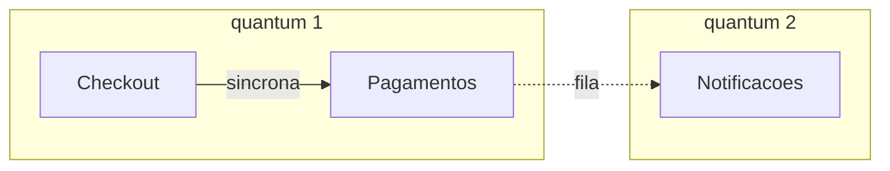

# Aula 17 — Do *service-based* aos microsserviços

## Objetivo e competências

Ao fechar esta aula, conseguimos:

- situar o monólito modular, o *service-based* e os microsserviços num espectro de granularidade, pelo que cada um entrega como unidade de deploy, de dado e de time;
- explicar o que é um *architectural quantum* e por que dez serviços que se chamam de forma síncrona formam um quantum só;
- contar, para uma forma dada, quantos artefatos ela tem, quantas arestas do grafo atravessam a rede e quantas chamadas remotas o `Checkout` faz diretamente;
- estimar o efeito de cada forma na disponibilidade do fechamento, dizendo quais premissas sustentam a conta;
- separar o que se lê do grafo e do código (estrutura) do que só a medição em produção responde (taxa de falha, disponibilidade);
- usar um guia de decisão, que parte de um **motivador de separação** comprovado, para escolher entre manter o monólito, extrair um componente, agrupar por domínio ou ir aos microsserviços;
- justificar a escolha da forma do *deployable* com pelo menos três alternativas e uma condição que a faria envelhecer;
- rodar `quantum.py` e refazer a conta para uma divisão proposta por nós, e aplicá-la a um cenário próprio no projeto das Aulas 16 e 17.

## De que tamanho deve ser o que se implanta?

Todo sistema precisa, em algum momento, ser colocado no ar. O que se coloca no ar como uma unidade, com um único procedimento de entrega, é um **artefato implantável** (em inglês, *deployable*), e o ato de colocá-lo no ar é o ***deploy***. Um monólito modular tem um artefato. Um sistema de dez serviços tem dez, cada um com o seu próprio *deploy*.

A pergunta desta aula é de granularidade: de que tamanho deve ser cada artefato? Entre "tudo junto" e "um por componente" existem muitas respostas, e cada uma troca coisas diferentes. A Aula 16 mostrou o custo de cruzar a rede: cada chamada remota carrega a falácia 1 (a resposta pode se perder) e a falácia 2 (a latência tem cauda). Cada artefato a mais cria arestas assim. Falta mostrar o que se ganha em troca e como comparar as formas com números.

Para isso precisamos de duas coisas: um vocabulário para as formas intermediárias entre "um processo" e "um serviço por componente", e uma noção precisa do que significa dizer que algo é "independente". Depois disso, vamos aplicar os conceitos no projeto Orion.

## Um espectro de granularidade

A Aula 14 terminou com `Pagamentos` registrado como candidato a extração, com um gatilho mensurável para decidir. Quando o ADR circula, voltam duas contrapropostas, uma de cada time. O time de plataforma quer **um microsserviço por componente**: o Orion tem dez componentes, então dez serviços, cada um com seu dado, seu *deploy* e seu dono. O time de operações quer **só tirar `Pagamentos`** e deixar o resto onde está, o que dá dois artefatos. As duas são chamadas de "arquitetura de serviços", e nenhuma traz um número.

Diante desse cenário, o Orion tem na mesa, no mínimo, estas opções: **manter o monólito modular**, **tirar só `Pagamentos`**, **agrupar por domínio** (o *service-based*) e **um serviço por componente** (os microsserviços). Antes de compará-las, convém situá-las num espectro. O que varia ao longo dele é o tamanho da unidade que se implanta, e junto com ela o tamanho do dado e do time que cabem nessa unidade. Três formas têm nome na literatura, e a tabela as mostra:

| Forma | Unidade de deploy | Dado | No Orion |
|---|---|---|---|
| Monólito modular | um artefato, com módulos de fronteira lógica | um banco | 1 artefato (o estado em que o Mini-Orion terminou o Módulo 2) |
| *Service-based* | poucos serviços grossos, cada um um domínio | em geral um banco compartilhado, que pode ser dividido | os 8 módulos de domínio da Aula 12 viram 8 serviços |
| Microsserviços | muitos serviços, um por domínio de negócio | cada serviço dono do seu dado | os 10 componentes viram 10 serviços |

O *service-based* é um estilo com nome próprio no livro-base de Richards e Ford, entre o monólito e os microsserviços: na descrição deles, de quatro a doze serviços de domínio, grossos, em geral com um banco único atrás. Os microsserviços, na formulação de Newman, são serviços liberáveis de forma independente e modelados em torno de um domínio de negócio, que evitam bancos compartilhados e escondem o próprio dado atrás de uma interface. O próprio Newman diz que o tamanho é um dos aspectos menos interessantes da definição: o que importa é a independência de *deploy* e a fronteira bem traçada. Por isso a diferença entre as formas é de grau antes de ser de natureza, e a conversa que perde tempo discutindo o nome costuma perder também a pergunta que interessa.

A forma do meio é a menos discutida e a mais instrutiva para o Orion, porque a Aula 12 já fez, sem rede, o agrupamento que ela exigiria: os oito módulos de domínio, com suas fronteiras verificadas por contratos de `import-linter`. Um *service-based* por domínio seria transformar cada fronteira lógica em fronteira de rede. Resta saber quanto isso custa.

### O que cada forma otimiza

O **monólito modular** otimiza simplicidade operacional: um *deploy*, uma transação local entre cobrar e emitir, um teste que roda sem rede. Cobra o que a Aula 9 nomeou: tudo sobe junto, com uma cadência e uma escala só.

O ***service-based*** otimiza autonomia de deploy por domínio sem multiplicar demais os artefatos. Como cada serviço é grosso, a maior parte das chamadas continua dentro dele, e a transação local sobrevive dentro de cada domínio. Cobra a rede em todas as arestas que cruzam domínios e, se o banco for compartilhado, um acoplamento por dado que a Aula 20 vai examinar.

Uma ressalva sobre o estilo, na descrição do livro. Richards e Ford esperam que os serviços de domínio **não se chamem entre si**: a interface fala com cada um, e o que os serviços têm em comum é o banco e as bibliotecas, não chamadas. O exemplo deles é o fechamento de um pedido, em que cobrar, gerar o número do pedido e baixar o estoque acontecem **dentro de um serviço só**, com *rollback* local se o cartão estiver vencido. Transformar cada aresta entre módulos em chamada de rede, como fazemos na linha "os 8 módulos viram 8 serviços" do quadro acima, é a leitura mais cara do estilo, e não a que o livro recomenda.

A escolha entre as duas versões é uma questão de **onde passa a fronteira**, mais do que de tamanho. No Cap. 17, Richards e Ford dão como um dos critérios para traçar fronteiras de serviço olhar as entidades que precisam cooperar numa mesma transação: se cobrar e emitir o pedido têm de acontecer juntos, isso sugere que ficam no mesmo serviço. Pelo critério do livro, a aresta entre `Checkout` e `Pagamentos` é uma das que não se deveria cortar, e a versão agrupada de sete serviços respeita isso. Por isso a conta desta aula compara duas versões: os oito domínios, que cortam todas as fronteiras entre módulos e mostram o custo máximo, e uma versão agrupada de sete serviços em que `Pagamentos` fica junto de `Checkout` e `Pedidos`, como no exemplo do livro.

Há aqui uma tensão com a proposta de extrair só `Pagamentos`, que corta exatamente essa aresta. O gatilho da Aula 14 é um sinal de cadência de release e de janela para a conciliação, e a pergunta é se ele pesa mais do que a transação local que a extração desfaz.

Os **microsserviços** otimizam autonomia máxima: cada componente tem seu ritmo de release, sua escala e, idealmente, seu time. Cobram a rede em quase todas as arestas, a consistência entre dados separados em quase todo fluxo, e a operação de tantos artefatos quantos serviços existirem.

Nenhuma das três é a resposta em abstrato. Cada uma é a resposta sob um contexto, e o que vamos fazer a seguir é medir o contexto do Orion.

### Onde as duas propostas caem

A proposta do time de plataforma é o extremo dos microsserviços: dez artefatos, um por componente.

A do time de operações não cabe em nenhum dos três degraus do quadro. Ela produz dois artefatos de tamanhos muito diferentes: `Pagamentos`, que é um componente só, e "o resto", que reúne os outros nove. É uma **granularidade mista**: uma ponta fina, do tamanho de um microsserviço, ao lado de uma grossa, do tamanho de um monólito. Isso tem uma vantagem e um custo. A vantagem é que só paga rede onde há sinal de que vale pagar, e é o caminho de migração gradual que Newman defende, em vez de uma troca de uma vez só. O custo é que a fronteira nova passa pela aresta entre `Checkout` e `Pagamentos`, que hoje é uma chamada local dentro de uma transação (cobrar e emitir o pedido). Depois da extração, essa aresta atravessa a rede e a transação deixa de ser local. É o que a conta das próximas seções vai pôr em números.

## Independente de quê? O quantum

Considere dois serviços, `Checkout` e `Pagamentos`, em artefatos separados, com *deploys* separados. O `Checkout` chama `Pagamentos` e espera a resposta para continuar. Se `Pagamentos` sai do ar, o `Checkout` não consegue fechar nenhum pedido. Se uma campanha dobra o volume do `Checkout`, `Pagamentos` recebe o dobro das chamadas e precisa escalar junto. Esses dois serviços são independentes?

Em um sentido, sim: cada um sobe e desce em um momento próprio. Em outro, não: a disponibilidade e a escala de um dependem do outro. São duas leituras da palavra. A independência de **implantação** é poder subir e descer sem que os outros precisem subir junto. A independência de **características** é a disponibilidade, a escala e a latência de um serviço não dependerem das de outro. As duas não andam juntas, e a segunda é a que o negócio sente.

Ford, Parsons, Kua e Sadalage nomeiam essa diferença com a ideia de *architectural quantum*: o menor artefato implantável de forma independente que tem **alta coesão funcional**, **alto acoplamento estático** e **acoplamento dinâmico síncrono**. Dois termos pedem explicação:

- o **acoplamento estático** é tudo o que precisa estar junto para o artefato funcionar: as bibliotecas, o banco de dados, o contrato que ele consome;
- o **acoplamento dinâmico** é como os artefatos se chamam em execução, e é **síncrono** quando quem chama espera a resposta para continuar.

A consequência é a que importa para o Orion, e é o caso do início. Se o `Checkout` chama `Pagamentos` de forma síncrona, a disponibilidade do `Checkout` passa a depender da de `Pagamentos`, e o `Checkout` só escala até onde `Pagamentos` escala. Há dois artefatos, dois *deploys*, e **um quantum só**, porque as características de um são limitadas pelas do outro.

Usamos daqui em diante uma versão operacional da definição, mais simples que a do livro, que discute casos de borda como o de uma fila entre os dois lados: dois componentes pertencem ao mesmo quantum se vivem no **mesmo artefato**, se estão ligados por uma **chamada síncrona** ou se **compartilham um banco de dados**. O terceiro critério vem do acoplamento estático: segundo o livro, um banco comum faz todos os serviços atrás dele formarem um quantum só, mesmo que nenhum chame o outro, porque o banco tem sua própria cadência de *deploy* e todos dependem dela. É uma simplificação nossa, e vale dizer onde ela perde precisão: não vê o acoplamento por biblioteca comum, que também liga quanta, nem as interfaces de usuário compartilhadas.



Leitura das setas: `A --> B` significa que A depende de B. A linha cheia é uma chamada síncrona, em que A espera a resposta de B; a tracejada passa por uma fila, em que A não espera.

O diagrama responde a uma pergunta de contagem: quantos quanta há aqui? Dois. `Checkout` e `Pagamentos` estão presos pela chamada síncrona, e `Notificacoes` ficou livre porque a única aresta que chega nela passa por uma fila. Ele omite as outras catorze arestas do grafo, e supõe que `Notificacoes` tem um banco próprio: se compartilhasse o banco com os outros dois, os três voltariam a ser um quantum só.

Aplicada ao grafo inteiro, a definição dá um resultado que costuma surpreender. Com os dez componentes em dez serviços e todas as chamadas síncronas, o Orion tem **dez artefatos e um quantum**: cada serviço sobe sozinho, mas nenhum tem características próprias. Esse arranjo lembra o **monólito distribuído** de Newman, o pior dos dois mundos, com o custo da rede sem a independência que a justificaria. Há uma diferença de critério: Newman chama assim o sistema de vários serviços que precisam ser implantados juntos, e a nossa definição olha para a dependência em execução. Para sair de um quantum, duas coisas precisam acontecer: algumas arestas deixarem de ser síncronas (por exemplo, trocando por fila as quatro que chegam em `Notificacoes`) **e** os serviços deixarem de compartilhar o banco. Os microsserviços do livro, com um banco por serviço, cumprem a segunda condição; um *service-based* de banco único não cumpre, e por isso continua com um quantum só, qualquer que seja o número de filas.

Isso reinterpreta o que a Aula 14 chamou de sinais de extração. Extrair `Pagamentos` com a cobrança ainda síncrona dá **independência de deploy**, que atende ao sinal de cadência de release própria, e não dá independência de características para a cobrança. A conciliação, que é um processamento em lote, é outra conversa: ela pode ganhar escala e janela próprias porque ninguém espera por ela.

## Como escolher entre as formas

Cada forma do espectro troca algo por algo. Esta seção diz **o que se paga** ao separar, mostra esse custo num cenário do Orion e termina com um guia para ler o resultado: se aparecer tal sinal, tal opção faz sentido; senão, outra.

### Dois custos de toda separação

Quando duas partes que estavam no mesmo processo passam a falar pela rede, dois custos aparecem, e os dois vêm da Aula 16.

**A chance de falha cresce com o número de chamadas.** Cada chamada remota pode falhar (falácia 1) ou demorar além do tolerável (falácia 2). Se um fluxo depende de $n$ chamadas remotas e cada uma falha com probabilidade $p$, a chance de pelo menos uma falhar é

$$P = 1 - (1 - p)^{n}$$

Com $p = 2\%$, uma chamada dá 2%, três dão 5,9% e cinco dão 9,6%. O custo não é de uma chamada, e sim do que ela soma às outras.

**A disponibilidade cai com o número de artefatos.** Disponibilidade é a fração do tempo em que um artefato está no ar. Se um fluxo só termina quando $k$ artefatos estão no ar ao mesmo tempo, e as falhas de cada um são independentes, a disponibilidade do fluxo é o produto das individuais:

$$A = a^{\,k}$$

Com $a = 99{,}9\%$ por artefato (cerca de 43 minutos fora do ar por mês), $k = 1$ dá 99,9% e $k = 6$ dá 99,4%. A independência é uma simplificação: na prática, falhas costumam ser correlacionadas, como quando um defeito de rede derruba vários serviços de uma vez.

Os valores $p = 2\%$ e $a = 99{,}9\%$ são **ilustrativos**, hipóteses de trabalho como na Aula 16, e o Orion ainda não os mediu. O que a conta ensina é a **forma** da relação, e ela vale para outros valores.

### O cenário: o fechamento de uma compra

O fluxo que vamos medir é o **fechamento** de uma compra. O `Checkout` coordena o fechamento e depende de cinco componentes: `Catalogo`, `Clientes`, `Promocoes`, `Pagamentos` e `Pedidos`. Supomos o pior caso: todas as dependências são obrigatórias e síncronas, de modo que, se uma estiver fora do ar, o fechamento falha.

Cada forma do espectro decide quantas dessas cinco chamadas atravessam a rede, e portanto quanto do custo acima o fechamento paga:

| Forma | Artefatos | Chamadas remotas do `Checkout` | Chance de falha | Disponibilidade do fechamento | Fora do ar por mês |
|---|---|---|---|---|---|
| Monólito modular | 1 | 0 | 0% | 99,9% | 43 min |
| Só `Pagamentos` | 2 | 1 | 2,0% | 99,8% | 86 min |
| *Service-based* agrupado (7) | 7 | 3 | 5,9% | 99,7% | 129 min |
| *Service-based* por domínio (8) | 8 | 4 | 7,8% | 99,6% | 173 min |
| Microsserviços (10) | 10 | 5 | 9,6% | 99,4% | 259 min |

Os números vêm do grafo de dependências do Orion (10 componentes e 17 arestas, o das Aulas 7 e 12), do agrupamento em oito módulos de domínio da Aula 12 e das hipóteses acima. Em cada forma, uma aresta é remota se suas pontas vivem em artefatos diferentes: no *service-based* por domínio, as 15 arestas remotas são exatamente as 15 que cruzam módulos na Aula 12, e nos microsserviços são as 17. A versão agrupada de sete serviços difere da de oito por um único motivo: `Pagamentos` fica junto de `Checkout` e `Pedidos`, e por isso o `Checkout` deixa de chamar esses dois pela rede.

Duas observações sobre a tabela. A primeira: os valores absolutos valem tanto quanto as hipóteses, mas a **ordem** entre as formas não. Ela vem da estrutura e continuaria a mesma com outras taxas. A segunda: as chamadas contadas são só as que saem do `Checkout`, porque são as que ficam no caminho do fechamento. A Aula 16 contou duas arestas ao extrair `Pagamentos` (a que entra e a que sai), e aqui só uma conta, porque a outra, de `Pagamentos` para `Notificacoes`, não está no caminho.

### Como ler o resultado

A tabela não escolhe a forma. Ela diz o preço de cada uma, e a escolha depende do que o Orion ganha em troca. O guia abaixo vai da opção mais barata à mais cara, e cada passo diz quando ela deixa de bastar.

O que decide cada passo é a presença de um **motivador de separação**: uma necessidade de um componente que só se atende implantando-o à parte, e que foi **comprovada por medição**, não apenas alegada. A Aula 14 listou quatro tipos, que ali chamou de sinais de extração:

- **escala própria**: o componente precisa crescer em ritmo diferente do resto;
- **cadência de release própria**: ele muda com frequência muito diferente da dos vizinhos, e esperar o *deploy* conjunto custa tempo;
- **isolamento de falha**: uma falha nele não pode derrubar o resto, ou o contrário;
- **autonomia de time**: um time dono dele não pode depender da agenda de outros.

A Aula 18 vai tratar dos motivadores com mais cuidado, junto das forças que mantêm as partes unidas. Por ora, basta distinguir um motivador comprovado de um argumento de gosto ("microsserviço é moderno").

**A. Se nenhum componente tem um motivador de separação comprovado, mantenha o monólito modular.** É a forma que não paga nenhum dos dois custos. O que a tabela mostra é que, sem um motivador, qualquer rede é prejuízo.

**B. Se um componente tem um motivador comprovado e quase não participa das transações dos vizinhos, extraia só ele.** É o caso de uma conciliação em lote: ninguém espera por ela, então pode ganhar janela e escala próprias sem entrar no caminho do fechamento. O custo é pequeno e localizado. Esta é a proposta do time de operações, quando o componente é o certo.

**C. Se o componente com motivador participa de uma transação com seus vizinhos, agrupe-os num serviço só.** É o caso de `Pagamentos` com `Checkout` e `Pedidos`. Para fechar uma compra é preciso cobrar, gerar o pedido e baixar o estoque, e esses passos precisam acontecer juntos: ou tudo vale, ou nada. Dentro de um serviço, um banco garante isso com um *rollback* local. Se o cartão estiver vencido, o pedido simplesmente não é gravado. Separados em serviços, o pedido pode já ter sido criado quando a cobrança falha, e o sistema fica num estado intermediário que alguém precisa tratar: o que fazer com o pedido gravado? E com o estoque já reservado? É isso que os microsserviços pagam com consistência eventual e com o padrão de sagas, que o Módulo 3 apresenta adiante. Por isso, no *service-based* do livro, essas operações ficam no mesmo serviço, e a tabela mostra o preço da separação: a versão agrupada tem 3 chamadas remotas do `Checkout` contra 4 da versão por domínio. A contrapartida é que o grupo tem uma cadência de release só, e se o sinal for justamente a cadência própria de `Pagamentos`, o agrupamento anula o que se queria.

**D. Se vários domínios têm motivadores diferentes (escalas, cadências ou times distintos), agrupe por domínio.** Considere uma plataforma de venda de ingressos com três áreas. A **venda** recebe picos enormes nas aberturas de shows, e isso aparece nos registros de acesso (escala própria). O **cadastro de eventos** é alterado todos os dias por produtores, e cada mudança espera o *deploy* de todo o resto (cadência própria). A **emissão fiscal** pertence a um time separado, que só libera versões depois de auditoria (autonomia de time). São três motivadores distintos e comprovados, cada um numa área diferente.

Agrupar por domínio dá três serviços grossos. A venda escala sozinha nos picos, os eventos são liberados no ritmo dos produtores e a emissão fiscal segue a agenda da auditoria, sem que uma área espere a outra. Dentro de cada serviço, as partes que cooperam continuam juntas: reservar o assento e registrar o pagamento da venda seguem numa transação local, como na opção C. Separar essas partes em serviços menores não compraria nada, porque nenhuma delas tem motivador próprio, e somaria chamadas remotas ao fluxo. E manter o monólito deixaria a venda escalar junto com tudo, e o time fiscal preso à agenda dos outros.

Esse é o *service-based* de domínios, a forma do meio do espectro. No Orion, o equivalente seria o de oito domínios, e a tabela mostra o preço: 4 chamadas remotas do `Checkout`, 7,8% de falha e 173 minutos fora do ar por mês. Só compensa quando os motivadores de vários domínios, juntos, valem esse preço, o que o Orion hoje não tem.

**E. Se quase todos os componentes têm motivadores próprios, com dado separável, e o time aguenta a operação, vá aos microsserviços.** É o degrau mais caro: 5 chamadas remotas, 9,6% de falha, 259 minutos por mês, e dado separado em quase todo fluxo. Newman recomenda chegar aqui de forma gradual, quando cada passo anterior deixou de bastar.

Uma verificação vale para todas as opções, e vem do quantum. Antes de concluir que uma separação trouxe independência, conte os quanta. Com todas as chamadas síncronas, as cinco formas têm **um quantum só**. Trocando por fila as quatro arestas que chegam em `Notificacoes`, só os microsserviços chegam a dois, porque são os únicos com um banco por serviço. O *service-based*, nas duas versões, segue com um quantum, porque os serviços compartilham o banco (observação do Cap. 13 do livro). Dividir o banco é a pergunta da Aula 20.

Para o Orion hoje, o guia dá uma resposta curta: só `Pagamentos` tem um motivador candidato (a cadência de release, Aula 14), e o gatilho ainda não disparou. Isso aponta para A agora e, se disparar, para B ou C, dependendo de o motivador ser a conciliação, que sai sem dor, ou a cobrança, que carrega a transação. A decisão está registrada na seção seguinte.

### O que mediria de verdade

A conta é o pior caso e depende de hipóteses. Para trocar cada parte por um número do Orion:

- o **número de artefatos, de arestas remotas e de chamadas diretas** é lido da estrutura. As arestas saem do próprio código, por ferramentas que extraem os `import`s, como o `pydeps` e o `import-linter` da Aula 7. Se uma chamada é síncrona ou assíncrona também se lê do código, olhando se quem chama espera o retorno;
- a **taxa de falha** de cada aresta remota só existe depois de a aresta existir: contagem de *timeouts* por destino, como na Aula 16;
- a **disponibilidade do fechamento** mede-se na borda, como a razão entre fechamentos concluídos e tentados. É o número que o cliente sente, e pode divergir do produto das disponibilidades dos serviços, porque falhas reais são correlacionadas e mascaradas por *fallbacks*. Se `Promocoes` pudesse falhar sem derrubar o fechamento (o cliente compra sem desconto), ela sairia da série e o custo cairia: isso é uma decisão de desenho, e um dos modos de reduzir o preço de qualquer forma distribuída. A Aula 23 trata de como enxergar o caminho de um fechamento de ponta a ponta.

## Decisão sobre o Orion: a forma do *deployable*

### Cinco alternativas

| Alternativa | O que resolve | O que custa | Quando não vale |
|---|---|---|---|
| Manter o monólito modular | nenhuma aresta de rede, transação local, um *deploy* | cadência e escala únicas; a conciliação de `Pagamentos` segue sem janela própria | quando o gatilho da Aula 14 disparar |
| Só `Pagamentos` (o resto, mais um) | cadência de release e janela próprias para a conciliação, com só 2 arestas remotas | 1 chamada direta do `Checkout` na rede (2,0% de falha por hipótese), cobrar e emitir sem commit único, fechamento em 99,8% | antes de o gatilho disparar: sem sinal medido, é rede sem ganho |
| *Service-based* agrupado (7), como no exemplo do livro | transação local entre cobrar e emitir, só 14 arestas remotas e 3 chamadas diretas do `Checkout` | 5,9% de falha, fechamento em 99,7%, 7 artefatos, banco único (um quantum só) e `Pagamentos` sem cadência própria | quando o sinal é justamente a cadência de `Pagamentos`, que é o caso hoje |
| *Service-based* por domínio (8) | autonomia por domínio, com a fronteira de rede coincidindo com a lógica já verificada | 15 arestas remotas, 4 chamadas diretas (7,8%), fechamento em 99,6%, 8 artefatos para operar | quando só um domínio tem sinal próprio, que é o caso hoje |
| Microsserviços por componente (10) | autonomia máxima de deploy, escala e time | 17 arestas remotas, 5 chamadas diretas (9,6%), fechamento em 99,4%, 10 artefatos, dado separado em todos os fluxos | quando o time é de porte médio e nenhum componente além de um tem sinal medido |

Cada uma tem defensores competentes. Quem escolhe os microsserviços aposta que o custo de operar muitos artefatos se paga em times que deixam de esperar uns pelos outros, e isso é verdade em organizações onde há times de sobra e os módulos mudam em ritmos muito diferentes. Quem mantém o monólito aposta que, sem sinal medido, qualquer rede é prejuízo, e isso é verdade enquanto o time for pequeno. As duas apostas podem estar certas em empresas diferentes. O Orion tem um time de plataforma de porte médio e um trimestre de orçamento (a Aula 9 registrou isso), e um único sinal operacional, o de `Pagamentos`.

### Na prática: Python

A conta da seção anterior não está no Mini-Orion, porque o Mini-Orion tem quatro módulos e a pergunta é sobre o grafo inteiro do Orion. Ela está no script `quantum.py`, no checkpoint `07-remoto/` do repositório de código (<https://github.com/eduardo-da-silva/fundamentos-arquitetura-code>). O `07-remoto` não ganha código novo de sistema nesta aula: ganha uma ferramenta de análise.

O grafo é dado, e é o das Aulas 7 e 12:

```python title="07-remoto/quantum.py (recorte)"
ARESTAS: list[tuple[str, str]] = [
    ("Portal", "Catalogo"),
    ("Portal", "Checkout"),
    ("Portal", "Pedidos"),
    ("Portal", "Clientes"),
    ("Checkout", "Catalogo"),
    ("Checkout", "Clientes"),
    ("Checkout", "Promocoes"),
    ("Checkout", "Pagamentos"),
    ("Checkout", "Pedidos"),
    ("Promocoes", "Catalogo"),
    ("Pedidos", "Notificacoes"),
    ("Pedidos", "Logistica"),
    ("Pagamentos", "Notificacoes"),
    ("Logistica", "Notificacoes"),
    ("Integracoes", "Catalogo"),
    ("Integracoes", "Pedidos"),
    ("Integracoes", "Notificacoes"),
]
```

Em um sistema real, essa lista não se escreve à mão: sai do código, por ferramentas que extraem os `import`s. A natureza síncrona de cada aresta também. O que o script mostra é o que se faz com o grafo depois de extraído.

O coração da conta é a função que conta os quanta. Ela une os componentes que vivem no mesmo artefato, os que estão ligados por uma chamada síncrona e, se o banco é comum, todos os que estão atrás dele, e conta os grupos que sobram:

```python title="07-remoto/quantum.py (recorte)" hl_lines="23 24 25 26"
def quanta(
    forma: Forma,
    assincronas: set[tuple[str, str]] | None = None,
    banco_compartilhado: bool = True,
) -> int:
    """Conta os quanta: componentes ligados por artefato comum, por chamada sincrona
    OU por um banco compartilhado.

    Mesmo artefato: nao se implantam separados. Chamada sincrona: a disponibilidade
    e a escala de quem chama dependem de quem e chamado. Banco compartilhado: todos
    os componentes atras dele dependem do mesmo ponto de acoplamento, mesmo que
    nenhum chame o outro.
    """
    assincronas = assincronas or set()
    pai = {c: c for c in COMPONENTES}

    def raiz(c: str) -> str:
        while pai[c] != c:
            pai[c] = pai[pai[c]]
            c = pai[c]
        return c

    ligacoes = [(a, b) for a in COMPONENTES for b in COMPONENTES if forma[a] == forma[b]]
    ligacoes += [aresta for aresta in ARESTAS if aresta not in assincronas]
    if banco_compartilhado:
        ligacoes += [(COMPONENTES[0], c) for c in COMPONENTES[1:]]
    for a, b in ligacoes:
        pai[raiz(a)] = raiz(b)
    return len({raiz(c) for c in COMPONENTES})
```

A resposta do script para as cinco formas, com as hipóteses da aula:

```text
Grafo: 10 componentes, 17 arestas.
Hipoteses: falha de 2,0% por chamada remota; 99,9% de disponibilidade por artefato.

forma                      artefatos  arestas  chamadas  P(falha)  disponib.  min/mes  quanta (sinc.)
monolito modular                   1        0         0      0,0%      99,9%       43               1
so Pagamentos                      2        2         1      2,0%      99,8%       86               1
service-based agrupado (7)         7       14         3      5,9%      99,7%      129               1
service-based (8 dominios)         8       15         4      7,8%      99,6%      173               1
microsservicos (10)               10       17         5      9,6%      99,4%      259               1

arestas = arestas remotas; chamadas = chamadas remotas diretas do Checkout;
disponib. e min/mes = artefatos tocados por um fechamento, em serie.
```

Com `--notificacoes-assincronas`, as arestas que chegam em `Notificacoes` passam por fila, e a última coluna muda: só os microsserviços, que têm um banco por serviço, passam a dois quanta; as outras formas seguem em um. Com `--banco-unico`, os microsserviços também compartilham o banco, e voltam a um quantum, mesmo com as filas.

Para rodar, com Python 3.12 ou superior:

```bash
git clone https://github.com/eduardo-da-silva/fundamentos-arquitetura-code.git
cd fundamentos-arquitetura-code
python -m venv .venv && source .venv/bin/activate   # no Windows: .venv\Scripts\activate
pip install -r requirements-dev.txt

cd 07-remoto
python quantum.py
python quantum.py --notificacoes-assincronas
pytest tests/test_quantum.py
```

O que vale experimentar:

- **Propor uma divisão.** `python quantum.py --particao "Portal,Checkout,Pedidos|Catalogo,Promocoes|Pagamentos,Notificacoes,Logistica"` acrescenta uma linha com a sua forma; o que não for citado fica junto, num artefato "resto". É a mesma conta da tabela aplicada a uma divisão que você escolher.
- **Mudar as hipóteses.** Altere `TAXA_DE_FALHA` e `DISPONIBILIDADE` no começo do arquivo e rode de novo. Os valores absolutos mudam, e a ordem entre as formas e a proporção entre os degraus não.
- **Ver o que o teste fixa.** `tests/test_quantum.py` confirma que o grafo tem 17 arestas, que os oito módulos deixam 2 internas e 15 inter-módulo (a conta da Aula 12) e que os números desta aula são os que o script produz. Se um deles mudar, o texto precisa ser revisto junto.

## Trabalho do aluno

O trabalho desta aula continua o da Aula 16: o [projeto "Extrair ou não extrair"](projeto-extrair-ou-nao-extrair.md). A **parte 2** altera o `quantum.py` para o seu cenário, e a **parte 4** é o ADR da forma do *deployable*, escrito com o guia "Como ler o resultado". A entrega é antes da Aula 18.

## O que ficou decidido e o que a Aula 18 pergunta

Ficou decidido manter o monólito modular e, se o gatilho da Aula 14 disparar, cortar pouco: a forma "o resto, mais um", com dois artefatos e duas arestas na rede. As formas intermediárias e a de dez serviços ficaram descartadas pelo horizonte do ADR-009, não por serem ruins, mas por não terem sinal medido que as sustente. Ficou registrado também que "serviço" não é sinônimo de "independente": dez artefatos ligados por chamadas síncronas são um quantum só.

A decisão se apoiou em um sinal, o de `Pagamentos`. Mas na reunião seguinte alguém propõe separar `Catalogo` "porque tem quatro dependentes", e outra pessoa propõe separar `Promocoes` "porque muda todo trimestre". São argumentos de naturezas diferentes, e a reunião os trata como se fossem um só. Que critério diz **onde** cortar, e como separar as forças que empurram para a separação das que mantêm as partes juntas? A Aula 18 responde.

## Leitura complementar

- Richards, Mark; Ford, Neal. *Fundamentals of Software Architecture*. Cap. 13 — Service-Based Architecture (a forma entre o monólito e os microsserviços, com poucos serviços de domínio).
- Richards, Mark; Ford, Neal. *Fundamentals of Software Architecture*. Cap. 17 — Microservices Architecture (granularidade e o custo da independência de dado).
- Ford, Neal; Parsons, Rebecca; Kua, Patrick; Sadalage, Pramod. *Building Evolutionary Architectures*. 2. ed. Cap. 5 — Evolutionary Architecture Topologies (seção "Architectural Quanta and Granularity": *architectural quantum*, acoplamento estático e dinâmico).
- Richards, Mark; Ford, Neal. *Fundamentals of Software Architecture*. Cap. 7 — Scope of Architecture Characteristics (a primeira definição de *quantum*, em termos de conascência síncrona).
- Newman, Sam. *Building Microservices*. 2. ed. Cap. 1 — What Are Microservices? (independência de *deploy*, dado próprio, o tamanho como aspecto secundário e o monólito distribuído).

## Referências

- RICHARDS, Mark; FORD, Neal. *Fundamentals of Software Architecture: An Engineering Approach*. O'Reilly, 2020.
- FORD, Neal; PARSONS, Rebecca; KUA, Patrick; SADALAGE, Pramod. *Building Evolutionary Architectures*. 2. ed. O'Reilly, 2023.
- NEWMAN, Sam. *Building Microservices*. 2. ed. O'Reilly, 2021.
