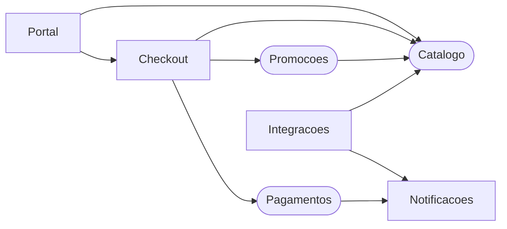
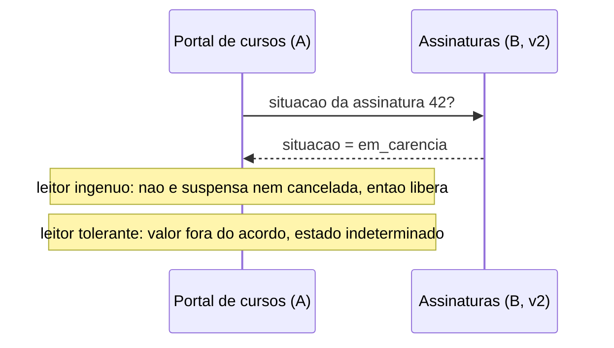
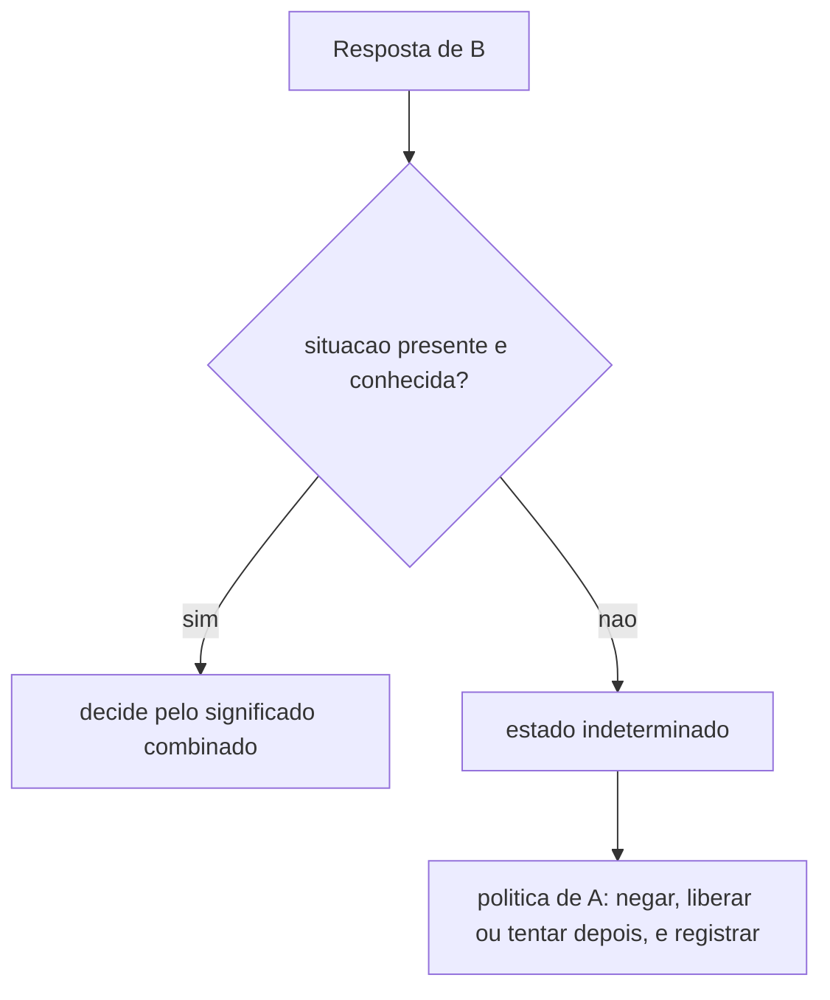
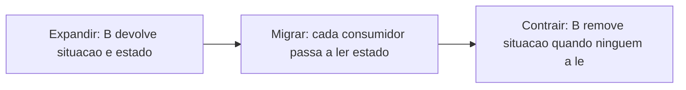

# Aula 18 — Granularidade

## Objetivo e competências

Ao fechar esta aula, conseguimos:

- explicar o que é **granularidade de serviço** e por que a pergunta "de que tamanho?" é mal formulada: a pergunta útil é "onde passa o corte, e o que atravessa";
- separar, num argumento de reunião, as **forças de desintegração** (razões para partir) das **forças de integração** (razões para manter junto), e dizer que evidência sustenta cada uma;
- ler $C_a$, $C_e$ e a connascência como evidência de **custo de corte**, e dizer o que essas métricas não enxergam;
- distinguir uma mudança de contrato que acrescenta de uma que quebra, incluindo a que quebra o **significado** sem tocar o formato;
- explicar o que faz um leitor tolerante, um teste de contrato guiado pelo consumidor e uma regra de evolução de contrato;
- classificar a connascência que atravessa a rede pelos três eixos (força, localidade e grau);
- aplicar tudo isso a um caso: montar a matriz de forças do Orion, ordenar os candidatos e registrar a regra de evolução do contrato de cobrança.

## O que já sabemos

Este capítulo parte de cinco ideias que as aulas anteriores deixaram assentadas. Convém tê-las à mão, porque a granularidade só faz sentido sobre elas.

A primeira é que **separar processos troca uma chamada local por uma chamada remota**, e as duas não se parecem. A chamada local ou devolve um resultado ou levanta um erro. A remota tem um terceiro desfecho, o de que não sabemos se a operação aconteceu: o tempo esgotou, e o outro lado pode ter executado, não ter executado ou ainda estar executando. Além disso, a latência de uma chamada remota tem cauda, e repetir a chamada só é seguro quando a operação aguenta ser repetida (as falácias da computação distribuída, Aula 16).

A segunda é que **a disponibilidade se multiplica quando as partes estão em série**. Dois serviços de 99,9% de disponibilidade, um chamando o outro de forma síncrona, entregam cerca de 99,8% juntos. Cada artefato implantável a mais, no caminho de uma operação, tira um pouco do conjunto (Aula 17).

A terceira é que **a forma do que se implanta é um espectro**. Numa ponta está o monólito modular, com fronteiras lógicas verificadas e um só artefato. No meio está o *service-based*, com poucos serviços grossos, em geral um por domínio. Na outra ponta estão os microsserviços, com muitos serviços finos, cada um com seu dado. Nenhuma forma é a certa em si; cada uma troca autonomia de *deploy* por custo de rede e de operação (Aula 17).

A quarta é que **variação recorrente não exige processo novo**. Numa arquitetura em microkernel (Aula 13), um núcleo que muda pouco define o contrato de um plugin, registra os que existem e compõe o resultado; cada variante nova, como uma regra de desconto, é um plugin que entra sem alterar o núcleo e sem sair do processo. A fronteira existe e é verificada, mas é lógica e não de rede.

A quinta é que **o que cruza uma fronteira vira interface pública**. Dentro de um processo, o verificador de tipos acusa quem usa o contrato errado. Pela rede, o contrato é uma mensagem serializada, lida e escrita por código de cada lado, e os consumidores mudam num ritmo que o produtor não controla.

Três instrumentos de medida acompanham essas ideias desde os módulos anteriores. O fan-in $C_a$ conta quantos componentes dependem de um componente, e o fan-out $C_e$, de quantos ele depende; os dois contam arestas, e uma aresta cortada vira uma chamada remota. A **coesão** (Aula 5) diz se o que está num componente pertence ao mesmo assunto. A **connascência** (Aula 6) diz que tipo de dependência existe entre duas partes e o quanto ela pesa. E o **ADR** registra a decisão com a alternativa descartada e a condição que a desmentiria.

O que essas ideias ainda não respondem é a pergunta que vem antes de todas: se for para separar, **o que se separa**?

## O caso: três candidatos ao corte

O Orion chega a essa pergunta depois da Aula 17. Ficou decidido manter o monólito modular e, se o gatilho da Aula 14 disparar, cortar pouco. Na reunião seguinte, a conversa muda: se for para cortar, **onde**? Três componentes estão na mesa, e o diagrama mostra onde cada um fica no sistema.



Leitura das setas: `A --> B` significa que A depende de B. Os candidatos têm contorno arredondado. O diagrama mostra 9 das 17 dependências do Orion e omite `Pedidos`, `Clientes` e `Logistica`, com as arestas que passam por eles; as demais não mudam a discussão. `Catalogo` tem quatro dependentes (`Portal`, `Checkout`, `Promocoes` e `Integracoes`, este último um componente que ninguém adotou). `Promocoes` é chamada pelo `Checkout` e lê preço de `Catalogo`. `Pagamentos` é chamado pelo `Checkout` e depende só de `Notificacoes`: $C_a = 1$ e $C_e = 1$.

Duas propostas aparecem na mesma tarde. A primeira: separar `Catalogo`, "porque tem quatro dependentes". A segunda: separar `Promocoes`, "porque muda todo trimestre". As duas chegam com a mesma convicção e são discutidas como se fossem o mesmo tipo de argumento, com um placar de quem convenceu mais gente na sala.

Não são. "Quatro dependentes" é uma contagem de quem consome `Catalogo`, e descreve **quanto custa cortar**: cada dependente vira uma chamada remota e um contrato a manter. Como argumento, pesa contra o corte. "Muda todo trimestre" descreve o **ritmo** de uma parte, e esse sim pode ser um motivo para separar. Quem propôs o primeiro usou o número ao contrário.

Há um segundo problema, que só aparece depois do corte. Com `Pagamentos` já separado e chamado pela rede, o time dele publica uma versão que acrescenta um resultado novo de cobrança, `EM_ANALISE`, para valores altos. Nenhum campo mudou de nome e o formato da resposta é idêntico. `Compra`, que não conhece o valor, o trata como cobrança aprovada, emite o pedido e notifica o cliente de uma compra que ninguém cobrou. Os testes dos dois lados passam.

Temos então duas perguntas, na ordem em que o Orion as encontra: onde cortar, e o que passa pelo corte. Para respondê-las falta um vocabulário, e é pelo conceito de granularidade que ele começa. O Orion volta no estudo de caso do final, com a balança montada.

## O que é granularidade

**Granularidade** é o tamanho da unidade que se separa e implanta, medido não em linhas de código, mas em **quanta responsabilidade cabe nela**. Um serviço de grão grosso reúne várias funções de negócio; um de grão fino, uma só. A Aula 17 ordenou as formas (monólito modular, *service-based*, microsserviços) pela quantidade de artefatos. Esta aula trata da pergunta anterior: dado um sistema, **por onde passa cada corte**.

A armadilha é tratar o tamanho como objetivo. "Serviços pequenos" parece uma meta, mas um serviço pequeno demais cria chamadas remotas e transações distribuídas que um serviço maior resolveria dentro do processo, e um serviço grande demais mantém junto o que muda em ritmos diferentes. Nenhum tamanho é bom em si. O que existe é um conjunto de forças que empurra o corte para um lado ou para o outro, e o trabalho do arquiteto é pesá-las com evidência.

## Forças que empurram e forças que seguram

Toda separação é uma troca de forças. **Forças de desintegração** são razões para partir uma parte do resto. **Forças de integração** são razões para mantê-la junta. A classificação vem de Ford, Richards, Sadalage e Dehghani (*Software Architecture: The Hard Parts*, Cap. 7), que a usam justamente para decidir o grão de um serviço. Eles apontam um erro comum: equipes se concentram nos desintegradores e ignoram os integradores, e o grão certo está no equilíbrio entre os dois. A utilidade da classificação é prática: cada argumento da reunião vai para um lado da balança, com a evidência que o sustenta, e o placar de quem fala mais alto deixa de decidir.

Para ver a balança antes de levá-la ao Orion, um cenário de fora. Numa plataforma de reservas de hotéis, o módulo de avaliações de hóspedes recebe leitura em volume muito maior que o resto e ganha campos novos toda semana. O módulo de reserva e depósito muda raramente, mas cada reserva só vale se o depósito for registrado na mesma operação. As avaliações têm duas razões para sair (escala e ritmo de mudança) e nenhuma para ficar. Reserva e depósito têm uma razão forte para ficar juntos, a transação, por maior que seja o volume. Separar os dois pelo critério "quem tem mais tráfego" cortaria a transação; separar as avaliações não corta nada que precise ser atômico.

### As seis razões para separar

O **escopo da função** pergunta se o componente faz coisas de naturezas diferentes. Um serviço que cobra, estorna e concilia em lote reúne atividades com ritmos muito distintos: a cobrança é interativa e imediata, a conciliação é um processamento noturno. A evidência está na descrição das responsabilidades e na coesão (Aula 5): quando metade do código não é tocada por quem mexe na outra metade, há duas funções num lugar só.

A **volatilidade** pergunta se uma parte muda num ritmo diferente do resto. Um módulo que recebe regra nova toda semana, preso ao *deploy* de um módulo que muda uma vez por ano, faz o primeiro esperar o segundo. A evidência não está no grafo de dependências; está no histórico do repositório (quantas mudanças por período) e no tempo que cada uma esperou o *deploy* conjunto. "Muda muito" sem essa medida é impressão.

A **escala e a vazão** perguntam se uma parte recebe carga que cresce por uma causa própria. Um catálogo lido milhares de vezes para cada compra cresce por outro motivo que o checkout. Cuidado com a distinção que a Aula 14 fez: o pico de campanha é carga do sistema inteiro, não de uma parte. A evidência é carga medida por componente, e a solução nem sempre é um serviço novo: uma réplica de leitura pode atender a escala sem criar outra fronteira de falha.

A **tolerância a falha** pergunta se a queda de uma parte deve poupar as outras, ou o contrário. Se o fechamento de compra não pode parar porque a geração de recomendações caiu, a recomendação merece um isolamento que a cobrança talvez não precise. A evidência é o registro de incidentes e as dependências obrigatórias no caminho crítico: separar só ajuda se a parte separada deixar de ser obrigatória para quem a chama. Se continuar obrigatória, a queda dela derruba o chamador do mesmo jeito, agora com uma rede no meio.

A **segurança** pergunta se uma parte guarda ou trafega um dado que exige outro nível de proteção. Dado de cartão é o caso clássico: reduzir o número de componentes que o tocam reduz a superfície de ataque e o escopo de uma auditoria. A evidência é um requisito declarado, não uma suposição.

A **extensibilidade** pergunta se variantes novas chegam com frequência. Um sistema que ganha provedor de pagamento novo a cada trimestre se beneficia de uma fronteira onde o provedor entra sem tocar o resto. Aqui a resposta costuma ser interna ao processo (um ponto de extensão, como o microkernel da Aula 13) antes de ser um serviço, e isso muda o custo da solução.

### As quatro razões para manter junto

A **transação** pergunta se dois passos precisam valer juntos ou não valer. Dentro de um processo, um banco garante isso com um *commit* único. Depois do corte, cada lado tem o seu, e a atomicidade vira um problema de compensação (Aula 20). É a força de integração mais cara de desfazer.

O **fluxo entre serviços** pergunta se uma operação percorre as duas partes em sequência, esperando a resposta de cada uma. Quando o fluxo é síncrono e no caminho crítico, as partes dependem uma da outra em disponibilidade e em latência (Aulas 16 e 17), e separá-las troca uma chamada local por uma remota sem tornar nenhuma das duas independente.

O **código compartilhado** pergunta se as partes dependem da mesma biblioteca de código. Utilitários e infraestrutura compartilhados são corriqueiros e não pesam; o caso que pesa é o de código de **domínio** comum, porque uma mudança nele exige alterar, testar e implantar juntos todos os serviços que o usam, e o ganho de separá-los desaparece. O versionamento da biblioteca atenua, sem eliminar.

As **relações entre dados** perguntam se o dado que o serviço usa também pode ser separado. Se duas partes leem ou escrevem as mesmas tabelas, separar os processos mantém o acoplamento por esquema (tema da Aula 19), e separar o dado cria cópias para manter. É por isso que "quantos leem este dado" é um argumento de integração, e não de desintegração.

### O que a métrica enxerga e o que não enxerga

Cada uma das dez forças pede evidência, e a primeira tentação é buscá-la nas métricas que já usamos desde o Módulo 1, porque são baratas e saem do código. Vale saber o que cada uma entrega antes de apoiar um corte nela.

O fan-in $C_a$ (quantos componentes dependem deste) e o fan-out $C_e$ (de quantos este depende) dizem **quantas arestas** o corte transformaria em chamadas remotas. Isso é informação útil, porque cada aresta cortada traz a cauda e a ambiguidade da Aula 16 e um contrato a manter. Mas as duas contam arestas e dão o mesmo peso a todas. Quatro leituras de um catálogo e quatro cobranças transacionais têm o mesmo $C_a = 4$ e custos de corte muito diferentes: as primeiras toleram uma réplica e um pouco de atraso, as segundas exigem que o *commit* seja único.

A connascência (Aula 6) afina a leitura. Ela diz que **tipo** de dependência cada aresta carrega, e a análise de força, localidade e grau diz o quanto cada uma pesa. Ainda assim, nem a contagem nem a connascência dizem se a aresta fica no caminho de um fechamento de compra, e é isso que decide o preço de cortá-la.

Há também o que nenhuma delas pode ver: três das seis razões para separar (volatilidade, escala e extensibilidade) não aparecem no grafo. Vivem no histórico do repositório e na medição de produção. Uma decisão tomada olhando só o grafo vê metade da balança. Por isso a métrica é sintoma de custo de corte, e não veredito: ela diz onde olhar, e a decisão continua precisando das forças e da evidência de cada uma.

## O que atravessa o corte

Decidido onde cortar, resta o que passa pelo corte. Dentro de um processo, duas partes combinam o que trocam por **tipos**, e o verificador acusa quem passa o campo errado. Pela rede, o que existe é uma mensagem serializada, e cada lado a lê e a escreve com código próprio. O acordo deixa de ser verificado por uma ferramenta e passa a depender de testes, de disciplina ou do cliente em produção. Por isso se diz que o contrato remoto é uma **interface pública**: tem consumidores que o produtor não controla e que mudam num ritmo próprio.

### Três camadas de acordo

Um contrato remoto combina três coisas, e cada uma quebra de um jeito. Para vê-las separadas, um exemplo de fora do Orion, que acompanha esta aula até o fim da discussão sobre contratos.

Um portal de cursos online, que chamaremos de **A**, libera ou bloqueia o conteúdo de um aluno perguntando a um serviço de assinaturas, **B**, mantido por outro time, qual é a situação dele. Na versão 1, a resposta de B é esta:

```json
{ "id": 42, "situacao": "ativa", "plano": "anual" }
```

A só lê o campo `situacao`: o `id` ela já conhece, e o `plano` ela nunca usa. O que os dois times combinaram se divide em três camadas.

| Camada | O que combina | No exemplo | Quem a verifica |
|---|---|---|---|
| **Formato** | quais campos existem, de que tipo, quais são obrigatórios | `situacao` é um texto; `id` é um número | um verificador de esquema |
| **Vocabulário** | os valores que um campo pode assumir | `ativa`, `suspensa` ou `cancelada` | o esquema, se o vocabulário for declarado como enumeração |
| **Significado** | o que cada valor obriga o consumidor a fazer | só `ativa` autoriza liberar o conteúdo | só um teste; nenhum esquema |

Um esquema captura o formato e, quando o vocabulário é declarado como enumeração, também o vocabulário. Nenhum esquema captura o significado. Newman aponta isso ao falar de ferramentas que comparam esquemas: elas pegam as quebras estruturais e deixam passar as semânticas, e para essas é preciso um teste.

A camada do vocabulário é a mais traiçoeira, porque ela cresce. Basta que B passe a devolver também `em_carencia`. Nada se perdeu, e o valor novo tem sentido para o produtor. Para A, escrita quando só existiam três valores, o quarto não está em lugar nenhum da lógica, e o que ela faz com um valor desconhecido é uma decisão tomada meses antes, no dia em que escreveu o `if`. A próxima seção separa as mudanças que quebram das que não quebram, e a seguinte mostra como A pode se proteger.

### O que uma mudança em B quebra em A

B vai mudar a resposta ao longo do ano. Cada mudança possível atinge uma camada diferente do acordo, e por isso aparece de um jeito diferente. O quadro cruza as cinco mudanças mais comuns com o que cada uma faz no portal.

| Mudança em B | No exemplo | O que quebra | Como aparece |
|---|---|---|---|
| Campo novo na resposta | B acrescenta `renovacao_em` | nada, se A ignora o que não conhece | não aparece |
| Campo que A lê é renomeado ou removido | `situacao` vira `estado` | todo consumidor que o lê | **erro na hora**; o teste de contrato acusa |
| Campo obrigatório novo no pedido | B passa a exigir `origem` na consulta | todo consumidor que não o envia | **erro na hora**: B recusa o pedido |
| Valor novo no vocabulário | B devolve `em_carencia` | quem decide pelo que conhece | **nada**; só um teste que declare os valores acusa |
| Significado novo para um valor antigo | `ativa` passa a incluir o período de teste gratuito | quem agia pelo sentido antigo | **nada**; só um teste do comportamento acusa |

As linhas se dividem em dois grupos pela última coluna. Nas duas do meio, o formato mudou, e A falha na hora, alto: o erro aparece, alguém o corrige no mesmo dia, e o custo é de coordenação. Nas duas últimas, o formato é o mesmo, A continua funcionando e **decide errado sem avisar**. É o segundo grupo que custa um aluno liberado sem direito ou um cliente cobrado sem pedido. Resta a primeira linha, o caso que se quer manter barato: acrescentar um campo só é inofensivo se A for escrita de modo a ignorar o que não conhece, e é desse modo que trata a seção seguinte.

### O leitor tolerante

Newman chama de **leitor tolerante** (*tolerant reader*, expressão de Martin Fowler) o consumidor que pega só os campos de que precisa e ignora o resto, para que mudanças que não lhe dizem respeito não o quebrem. É a aplicação ao contrato do princípio de Postel: ser conservador no que envia e liberal no que aceita. A frase é fácil de concordar e difícil de aplicar, porque "aceitar" tem dois sentidos que a prática separa: aceitar um **campo** que não se conhece e aceitar um **valor** que não se conhece. O primeiro é quase sempre seguro. O segundo, não. O portal de cursos mostra a diferença.

Na versão 2, B faz duas mudanças compatíveis, cada uma por boas razões do lado dele. Acrescenta o campo `renovacao_em`, com a data da próxima cobrança. E acrescenta o valor `em_carencia`: o pagamento foi recusado, uma nova tentativa de cobrança está em curso e, enquanto ela não passar, o conteúdo novo deve ficar bloqueado. O time de B avisou no canal de mudanças, e ninguém perdeu nada. O que acontece em A depende de **como A lê a resposta**. Há três maneiras de escrever essa leitura, e todas funcionam com a versão 1.

```python title="Ilustrativo: três maneiras de ler a resposta de B"
CONHECIDAS = {"ativa", "suspensa", "cancelada"}


def ler_rigido(carga):
    # confere a resposta inteira contra o que a v1 descrevia
    if set(carga) != {"id", "situacao", "plano"} or carga["situacao"] not in CONHECIDAS:
        raise ValueError("resposta fora do esquema da v1")
    return carga["situacao"] == "ativa"


def ler_ingenuo(carga):
    # decide pelo que conhece e deixa o resto virar o caso comum
    return carga["situacao"] not in {"suspensa", "cancelada"}


def ler_tolerante(carga):
    situacao = carga.get("situacao")  # campos extras sao ignorados
    if situacao not in CONHECIDAS:
        raise SituacaoDesconhecida(situacao)  # nao saber ler nao e o mesmo que "ativa"
    return situacao == "ativa"
```

O **leitor rígido** desconfia de tudo o que não estava no acordo. O **leitor ingênuo** escreveu a lógica pensando nos casos de bloqueio que conhecia (`suspensa`, `cancelada`) e deixou o resto cair em "libera", porque era isso que a v1 garantia. O **leitor tolerante** ignora os campos que não usa, mas confere o valor do único campo que decide o fluxo.

A tabela cruza os três leitores com quatro mudanças de B, três delas do quadro anterior.

| Mudança em B | Leitor rígido | Leitor ingênuo | Leitor tolerante |
|---|---|---|---|
| Campo novo (`renovacao_em`) | falha, sem necessidade | segue | segue |
| Campo que A não lê é removido (`plano`) | falha, sem necessidade | segue | segue |
| Valor novo (`em_carencia`) | falha, alto | **libera, sem avisar** | falha, alto, e A escolhe o que fazer |
| Campo que A lê é renomeado (`situacao`) | falha, alto | falha, alto | falha, alto |

As duas primeiras linhas mostram o que o leitor tolerante compra: A deixa de depender de coisas que não usa, e o time de B pode evoluir a resposta sem consultar todos os consumidores. O leitor rígido, que parece o mais cuidadoso, é o que mais quebra, e quebra por mudanças que não alteram nada do que A decide. A última linha é o caso fácil: o formato mudou, o erro aparece na hora e alguém corrige no mesmo dia.

A linha que decide a escolha é a terceira. Com o leitor ingênuo, a resposta `em_carencia` chega, não está na lista de bloqueios, e o aluno com pagamento recusado continua assistindo ao conteúdo novo. Nenhum erro, nenhum alerta, nenhum teste vermelho: cada lado, lido sozinho, está correto. O diagrama mostra a diferença no mesmo instante da chamada.



O diagrama mostra uma chamada só e omite o que vem depois: o que A faz com o estado indeterminado, que é o ponto da próxima subseção.

### O limite da tolerância

Ignorar um campo é seguro porque nenhuma decisão de A depende dele. Com um valor não é assim, e a regra que sai do exemplo é: **a tolerância vale para o que não decide o fluxo; para o que decide, o leitor confere**. O leitor tolerante útil aceita o campo extra e **trata o valor desconhecido como falha**: a resposta chegou, mas diz algo que A não sabe ler, e não saber ler não é o mesmo que autorizar.



Campos extras não aparecem no diagrama porque o leitor tolerante os descarta antes da pergunta. O ponto central do desenho está no último nó, e três observações o completam.

A primeira é que **a política é de A, não de B**. Diante do indeterminado, A pode negar o acesso (e arriscar bloquear quem deveria assistir), liberar (e arriscar liberar quem não deveria) ou mostrar "não conseguimos confirmar sua assinatura, tente em instantes". Qual escolher depende do que A sabe e B não: um curso gratuito de introdução pode liberar, uma aula paga com custo de licença por acesso pode negar. B não pode tomar essa decisão por A, porque não sabe o que A faz com o resultado. O que o leitor tolerante garante não é a escolha certa, e sim que **a escolha é feita por quem pode fazê-la**, em vez de ser tomada por acaso por um `if` escrito meses antes.

A segunda é que **o indeterminado precisa de um caminho de aviso**. Um leitor tolerante que nega em silêncio troca um erro invisível por outro: o aluno é bloqueado, o suporte recebe o chamado e ninguém liga a causa à mudança de B. O registro e o alerta de "valor desconhecido" são o que transforma a tolerância em informação. Na prática, o alerta é o primeiro sinal de que o acordo mudou sem que A soubesse.

A terceira é que **a tolerância não resolve a mudança de significado**. Se B passasse a usar `ativa` também para assinaturas em período de teste gratuito, o valor continua conhecido, o formato é o mesmo e A libera um conteúdo que ninguém esperava liberar. Nenhum leitor, por mais tolerante que seja, percebe isso. Esse tipo de quebra só aparece se alguém escreveu, em algum lugar, o que `ativa` obriga A a fazer, e é para isso que serve o teste de contrato da seção seguinte.

Há ainda o excesso contrário: ignorar um campo novo que **deveria** ser lido. Se B acrescentasse `bloqueio_parental` e A o descartasse por ser "um campo que eu não conhecia", a decisão passaria a depender de um dado que A tem à vista e não usa. Por isso a regra distingue o que decide o fluxo do que não decide, e não o que é novo do que é antigo. Quem decide o que entra em cada grupo é o consumidor, que é quem sabe o que o resto do código faz com a resposta.

### Evoluir um contrato que precisa quebrar

Há mudanças que não dá para tornar aditivas. Suponha que o time de B decida, por padronização com os outros serviços da empresa, trocar `situacao` por `estado`. O significado e o vocabulário são os mesmos; só o nome muda, e isso basta para quebrar todo consumidor que o lê. Três consumidores o leem: o portal de cursos (A), o aplicativo móvel e o painel de relatórios do financeiro. Cada um tem o seu time e o seu ritmo, e o aplicativo tem uma particularidade: uma nova versão passa pela revisão das lojas e leva semanas até chegar aos usuários, e as versões antigas seguem instaladas por meses.

Newman descreve três saídas para uma mudança assim. Elas diferem em quanto exigem de coordenação e em quanto custam a quem as adota.

**1. Implantação em passo único** (*lockstep deployment*). B e os três consumidores mudam na mesma janela: B passa a devolver `estado`, e os três passam a lê-lo no mesmo dia. É a mais simples de entender, e anula a independência de *deploy* que justificou o corte, porque os quatro times voltam a se mover juntos. No exemplo ela nem é possível, já que o aplicativo não controla quando os usuários atualizam. Se qualquer um dos quatro falhar na janela, os outros três têm de voltar atrás.

**2. Duas versões lado a lado** (*coexist versions*). B publica as duas versões do endpoint e mantém ambas no ar:

```text
GET /v1/assinaturas/42  ->  { "id": 42, "situacao": "ativa", "plano": "anual" }
GET /v2/assinaturas/42  ->  { "id": 42, "estado": "ativa", "plano": "anual" }
```

Cada consumidor muda para `/v2` quando quiser, e a `/v1` sai quando ninguém mais a chamar. O preço recai sobre B: duas rotas para manter, uma correção de defeito que pode ter de ser feita duas vezes, e um registro de acessos por consumidor para saber quando a `/v1` pode sair. E as duas versões leem os mesmos dados, o que limita o que a `/v2` pode mudar por baixo.

**3. Emular a interface antiga** na nova, o padrão de **expandir e contrair** (*expand and contract*). Em vez de duas rotas, a mesma resposta carrega os dois campos durante um tempo:



Na fase de expansão, a mudança é aditiva (`{ "id": 42, "situacao": "ativa", "estado": "ativa", "plano": "anual" }`), e nenhum consumidor quebra. Na fase de migração, o portal troca o campo nesta semana, o painel no mês seguinte, e o aplicativo quando a nova versão chegar aos usuários. Na de contração, B remove `situacao`: o único passo que quebra, e que a esta altura já não atinge ninguém. O diagrama mostra as fases e omite o que as liga, a evidência de que ninguém mais lê o campo antigo. Essa evidência é o ponto frágil. O registro de acessos mostra quem chamou a rota, mas não quais campos o consumidor lê. O arquivo de contrato do consumidor, que a seção seguinte descreve, mostra. E sem um prazo e um responsável, a contração não acontece, e o campo antigo fica na resposta para sempre.

| Saída | O que resolve | O que custa | Quando não vale |
|---|---|---|---|
| Passo único | mudança simples, sem versão duas vezes | todos os times se movem juntos | consumidores que não controlamos, como o aplicativo |
| Duas versões | cada consumidor migra no seu tempo | B mantém duas rotas e o registro de quem usa cada uma | mudanças que dependem de alterar os dados por baixo |
| Expandir e contrair | migração sem versão nova e sem quebra no meio | uma fase com dois campos, e um prazo para a contração | quando não há como saber quem ainda lê o campo antigo |

A escolha depende de quantos são os consumidores e do quanto o produtor os controla, que é o **grau** da connascência, tema da última seção desta parte. Com um único consumidor do mesmo time, o passo único pode ser o mais barato. Com três, um deles fora do controle de B, a terceira saída é a única que não depende de combinar uma data.

### O teste de contrato guiado pelo consumidor

Um **teste de contrato guiado pelo consumidor** (*consumer-driven contract*) inverte quem escreve a expectativa. O consumidor registra, num arquivo que entrega ao produtor, o que espera de cada resposta: os campos, os tipos, os valores. O produtor roda essas expectativas contra o próprio servidor a cada alteração, e a mudança que as quebra falha na CI do produtor, **antes** de chegar a produção. Newman recomenda que os dois times escrevam essas expectativas juntos, pelo efeito colateral de abrir a conversa que o acordo verbal evita.

Ford e seus coautores (Cap. 13) descrevem o mesmo mecanismo como um modelo de **tração** (*pull*): em vez de o produtor empurrar um contrato a todos os consumidores, cada consumidor monta o contrato do que precisa e o entrega ao produtor, que o mantém verde na sua esteira de entrega. Eles apontam o preço: o mecanismo só funciona com equipes disciplinadas, que rodem os testes de contrato e não ignorem as falhas. O custo é manter o arquivo atualizado: um contrato de consumidor desatualizado dá confiança falsa, porque passa por ignorância do que mudou. Por isso o arquivo declara só o que o consumidor realmente usa e deixa os demais campos livres.

### A connascência que atravessa a rede

A heurística da Aula 6 dizia: a connascência forte fica dentro do componente, a fraca atravessa a fronteira. Olhando o contrato pelos três eixos, o nome de um campo é connascência de nome (a mais fraca), o tipo do campo é connascência de tipo, e o significado de um valor é connascência de significado, a mais forte das três. A **localidade** é o que muda com a rede: a mesma connascência de significado entre duas funções do mesmo módulo é barata, porque o autor das duas está na mesma conversa; entre dois processos, a correção exige coordenação de equipes, e o erro só aparece em produção. A força não mudou; o custo mudou porque a distância cresceu. O **grau** (quantos consumidores) segue baixo enquanto houver um só, e é o que mantém o caso tratável: com dez consumidores, a mesma linha pesaria dez vezes mais.

Disso sai uma alternativa de desenho: rebaixar a connascência de significado antes de cruzar a fronteira, transformando-a em nome ou tipo. Em vez de devolver um vocabulário a interpretar, o produtor devolveria o fato diretamente (por exemplo, um booleano que diz se o dinheiro saiu). O consumidor deixaria de interpretar e leria o fato. É uma boa opção, com o custo de redesenhar o contrato.

## Estudo de caso: o corte de `Pagamentos`

Vamos aplicar o que a aula explicou ao Orion, nas duas perguntas com que ela abriu.

### Onde cortar

Pesamos os três candidatos que a reunião trouxe, `Catalogo` e `Promocoes` das propostas, e `Pagamentos`, o candidato da Aula 14. Para as razões de separar, a evidência de cada um é:

| Força | `Catalogo` | `Promocoes` | `Pagamentos` |
|---|---|---|---|
| Escopo | coeso | coeso | cobrança, estorno e conciliação em lote |
| Volatilidade | acompanha o resto | regra nova quase todo trimestre | contrato de provedor; gatilho ainda não medido |
| Escala | leitura cresce sozinha | — | conciliação acumula em campanha |
| Falha | queda afeta 4 dependentes | pode falhar sem derrubar a compra | provedor externo instável |
| Segurança | — | — | número do cartão em trânsito |
| Extensibilidade | — | regras novas já entram como plugin do microkernel, sem rede | provedores novos sem tocar `Checkout` |

Um traço ("—") significa sem evidência no que o Orion tem hoje, e não que a força não exista. Falta o outro lado da balança. As razões para manter junto recebem a mesma matriz, com as quatro forças de integração:

| Força | `Catalogo` | `Promocoes` | `Pagamentos` |
|---|---|---|---|
| Transação | — | — | cobrar e emitir o pedido num *commit* só |
| Fluxo | consultado no fechamento | consultada no fechamento | chamada síncrona no fechamento, coordenada pelo `Checkout` |
| Código compartilhado | tipos de `nucleo` | tipos de `nucleo` | tipos de `nucleo` |
| Relações entre dados | quatro leitores do mesmo dado | lê preço de `Catalogo` | a conciliação junta cobranças e pedidos |

Algumas células pedem explicação. O pacote `nucleo` do Mini-Orion carrega os tipos de dados (`ChaveIdempotencia`, `Pedido` e outros) usados por `compra`, `pagamentos` e `notificacoes`; por isso o código compartilhado aparece nos três. São tipos, e não regra de negócio, o que reduz o risco, mas uma mudança em um tipo passa a exigir a biblioteca versionada dos dois lados. Nos dados, os quatro leitores de `Catalogo` são `Portal`, `Checkout`, `Promocoes` e `Integracoes` (o componente que ninguém adotou), e a leitura que `Promocoes` faz de `Catalogo` é uma das duas arestas internas do módulo `Vitrine`. A conciliação de `Pagamentos` casa as cobranças com os pedidos por um *join* no banco do Orion, e é o que a Aula 19 examina. E a transação é a única célula de integração que só um candidato preenche: `Pagamentos`, que participa do *commit* que cobra e emite, é o que tem a força de integração mais forte entre os três.

As leituras saem do que a aula explicou. `Catalogo` tem a coluna de separação quase vazia e a de integração cheia, e a única força de separação com evidência (leitura) tem solução sem processo novo, a réplica de leitura; o $C_a = 4$ aparece do lado do custo. `Promocoes` tem uma força de separação forte e quase nenhuma de integração, mas a Aula 13 mostrou que o microkernel isola a regra **dentro** do processo, e "cadência de *release* independente" seria vender o que essa forma não compra. Falta medir a espera pelo *deploy* conjunto; sem a medida, a força é plausível e não comprovada. `Pagamentos` é o único com evidência em quase todas as linhas de separação, e é também o único com uma transação a desfazer. A matriz faz o que a conversa de corredor não faz: mostra ao proponente do corte a força que o contraria. Cortar `Pagamentos` desfaz o *commit* único entre cobrar e emitir, e esse é o preço que a Aula 20 trata com sagas.

A matriz não decide por contagem de células. `Pagamentos` vence porque suas razões estão ancoradas em um sinal que o ADR da Aula 14 já nomeia como mensurável, e o preço está identificado.

### Uma pontuação para a ordem

A matriz mostra as forças, mas uma ordem precisa ser defendida célula a célula, e "tem mais traços preenchidos" é justamente a contagem que a aula rejeitou. A saída é dar **nota por evidência**, e não por presença. Cada força recebe uma de três notas:

| Nota | Critério |
|---|---|
| 2 | há evidência no que o Orion tem hoje: código, descrição das responsabilidades, requisito ou decisão registrada |
| 1 | a força é plausível, mas ainda não foi medida ou declarada |
| 0 | sem evidência, ou a força tem solução que dispensa o corte |

As notas das razões para separar somam; as das razões para manter junto subtraem. O saldo é o resultado, com cada nota justificada na tabela.

| Candidato | Separar (soma) | Manter junto (soma) | Saldo |
|---|---|---|---|
| `Pagamentos` | **7.** Escopo 2: cobrança, estorno e conciliação em lote têm ritmos distintos. Volatilidade, escala, falha, segurança e extensibilidade 1 cada: todas plausíveis, nenhuma medida | **5.** Transação 2: cobrar e emitir são um *commit* só. Fluxo 1: uma chamada síncrona no fechamento. Código 1: os tipos de `nucleo`. Dados 1: a conciliação junta cobranças e pedidos, mas há saída (Aula 19) | **+2**, primeiro |
| `Promocoes` | **2.** Volatilidade 1: "muda todo trimestre", sem a espera por *deploy* medida. Falha 1: pode falhar sem derrubar a compra. Extensibilidade 0: o microkernel já responde, sem rede | **3.** Transação 0. Fluxo 1: consultada no fechamento. Código 1. Dados 1: lê preço de `Catalogo` | **−1**, segundo |
| `Catalogo` | **1.** Escala 1: a leitura cresce sozinha, mas a réplica de leitura resolve sem corte. Falha 0: separar não tira `Catalogo` do caminho dos quatro dependentes | **4.** Dados 2: quatro leitores do mesmo dado. Fluxo 1. Código 1. Transação 0 | **−3**, último |

Dois cuidados mantêm a tabela honesta. O primeiro é que **as notas são julgamento**, e não medida: duas pessoas podem discordar de um 1 ou de um 2, e a tabela serve justamente para mostrar onde. O segundo é testar quanto o resultado depende das notas que ainda não têm medida. Se contarmos apenas as razões para separar que já têm evidência (as notas 2), os saldos passam a $-3$ para `Pagamentos`, $-3$ para `Promocoes` e $-4$ para `Catalogo`. A posição de `Catalogo` não muda, porque ele perde com ou sem medida. A distância entre `Pagamentos` e `Promocoes` desaparece, e é ela que a medição da espera pelo *deploy* e da carga da conciliação decidiria. Pesos diferentes mudam pouco: se a transação valesse o dobro, o saldo de `Pagamentos` cairia a $0$ e ele continuaria à frente de `Promocoes` com $-1$.

### 📐 ADR — Ordem dos candidatos ao corte

| Campo | Conteúdo |
|---|---|
| **Identificador** | ADR — Ordem dos candidatos ao corte |
| **Status** | Aceito. Vale enquanto o ADR-009 e o gatilho da Aula 14 estiverem em vigor; o corte só acontece se o gatilho disparar. |
| **Contexto** | Duas propostas de corte circulam: `Catalogo`, por ter $C_a = 4$, e `Promocoes`, por mudar todo trimestre. A matriz mostra que a primeira é um argumento de custo de corte e a segunda, de volatilidade ainda não medida como espera de *deploy*. |
| **Decisão** | Se houver corte, o primeiro candidato é `Pagamentos`, com a transação entre cobrar e emitir nomeada como o preço. `Promocoes` segue no microkernel da Aula 13 até que a espera pelo *deploy* conjunto seja medida. `Catalogo` não é candidato; a escala de leitura se trata com réplica de leitura. |
| **Alternativas** | (a) Ordenar por $C_a$: parece prudente, mas o $C_a$ mede o custo de cortar, não o motivo. (b) Ordenar por volatilidade: defensável, e passa à frente se a espera por *deploy* for medida e pesar. (c) Ordenar pela matriz, com nota por evidência em cada força (saldos $+2$, $-1$ e $-3$). |
| **Consequências negativas** | Parte da matriz (volatilidade, escala) depende de evidências que o Orion ainda não mediu. O corte de `Pagamentos` desfaz a transação local e cria uma janela de inconsistência sem tratamento por enquanto. |
| **Condição de falseamento** | Errado se a espera pelo *deploy* conjunto de `Promocoes` superar a de `Pagamentos` no mesmo trimestre, ou se o preço da transação desfeita superar o ganho de cadência de `Pagamentos`. |

### O que atravessa o corte

Com `Pagamentos` chamado pela rede, o incidente do início da aula é exatamente o caso do vocabulário que cresce. O formato da resposta não mudou e `EM_ANALISE` é um valor legítimo para o produtor; o consumidor que decide pelo que conhece da v1 trata o desconhecido como aprovação. Em termos da aula, é uma mudança aditiva no vocabulário que quebra o significado. Por esse caminho, a connascência do contrato de cobrança é: o nome `resultado` (a mais fraca), o tipo texto, e o significado "`em_analise` não autoriza emitir o pedido" (a mais forte das três), com localidade distante (dois processos, possivelmente dois times) e grau 1 hoje, porque `Pagamentos` tem $C_a = 1$.

A regra que o Orion adota tem quatro partes. O consumidor, `compra`, lê com um leitor tolerante que trata valor desconhecido como falha (o fechamento devolve `cobranca_indeterminada` e não emite o pedido). O que `compra` espera de `pagamentos` fica em um arquivo de contrato escrito pelo consumidor, e o produtor o roda a cada mudança. Campo novo na resposta vale sem aviso; valor novo, campo renomeado ou removido e campo obrigatório novo no pedido exigem aviso e versão. E um contrato do `import-linter` impede `compra` de importar o lado servidor de `pagamentos`. O custo aceito: o arquivo de contrato precisa de dono, e o fechamento passa a devolver `cobranca_indeterminada` por um valor que o produtor considera legítimo, um caso que a Aula 20 retoma.

### Na prática: Python

O código está no checkpoint `07-remoto/` do repositório de código (<https://github.com/eduardo-da-silva/fundamentos-arquitetura-code>), que a aula estende sem criar pasta nova. O acordo de formato agora mora num módulo de `pagamentos`, `contrato.py`, com o vocabulário das duas versões e as duas maneiras de ler uma resposta:

```python title="07-remoto/mini_orion/pagamentos/contrato.py (recorte)" hl_lines="13 20"
RESULTADOS_V1 = frozenset(
    {"aprovada", "recusada_pelo_emissor", "acima_do_limite", "provedor_indisponivel"}
)
# A v2 so acrescenta um valor. Nenhum campo mudou de nome ou de tipo.
RESULTADOS_V2 = RESULTADOS_V1 | {"em_analise"}


def ler_ingenuo(carga: Carga) -> ResultadoCobranca:
    # Decide pelo que conhece da v1 e deixa o resto virar aprovacao.
    valor = carga["resultado"]
    if valor in RESULTADOS_V1 - {"aprovada"}:
        return ResultadoCobranca(str(valor))
    return ResultadoCobranca.APROVADA


def leitor_tolerante(conhecidos: frozenset[str]) -> Leitor:
    def ler(carga: Carga) -> ResultadoCobranca:
        valor = carga.get("resultado")  # campos extras sao ignorados
        if valor not in conhecidos:
            raise ResultadoDesconhecido(f"resultado {valor!r} fora do acordo")
        return ResultadoCobranca(str(valor))

    return ler
```

A versão do consumidor é o conjunto de valores que ele conhece. `ler_ingenuo` existe para reproduzir o consumidor da v1; em produção ficaria só o tolerante. `ResultadoDesconhecido` herda de `CobrancaIndeterminada`, o terceiro desfecho da Aula 16, que `ServicoCheckout` já sabe tratar.

O consumidor escreve o acordo em `07-remoto/contratos/compra-espera-de-pagamentos.json`, com duas interações (uma cobrança comum e uma de valor alto), e o verificador em `tests/verificador_contrato.py` roda cada uma contra o servidor. A mudança da v2 falha antes do *deploy*:

```text
>>> verificar(ServicoPagamentos(GatewayPagamentoXv2()).tratar_cobranca)
["cobranca de valor alto, ainda dentro do limite do provedor:
  campo 'resultado' com valor 'em_analise' fora do acordo"]
```

E o contrato do `import-linter` fecha a quarta parte da regra:

```ini title="07-remoto/setup.cfg (recorte)"
[importlinter:contract:compra-nao-importa-o-lado-servidor]
name = Compra nao importa o lado servidor de Pagamentos
type = forbidden
source_modules =
    mini_orion.compra
forbidden_modules =
    mini_orion.pagamentos._servidor
```

`_servidor` é o código que, num sistema real, rodaria no processo de outro time. Se `compra` o importasse, o teste de `compra` passaria executando o código do produtor dentro do processo do consumidor, e o acordo de formato nunca seria exercitado.

Para rodar, com o ambiente da Aula 16 preparado:

```bash
cd fundamentos-arquitetura-code/07-remoto
pytest tests/test_contrato.py     # 10 testes
pytest                            # 57 testes, com os herdados
lint-imports                      # 6 contratos
```

O que vale experimentar:

- **Ver o incidente.** `test_leitor_ingenuo_emite_o_pedido_de_uma_cobranca_em_analise` monta o cenário completo: produtor na v2 e consumidor ingênuo. O resultado é `"confirmado"` e o provedor não aprovou nenhuma cobrança. O teste ao lado, `test_leitor_tolerante_trata_o_valor_desconhecido_como_falha`, muda só o leitor, e o resultado passa a `"cobranca_indeterminada"`.
- **Quebrar o acordo de outra forma.** Em `tests/test_contrato.py`, `acrescentando_campo`, `renomeando_campo` e `removendo_campo` são produtores adulterados. Escreva uma quarta (trocar o tipo de `resultado` para número) e preveja o que o verificador diz antes de rodar.
- **Quebrar a fronteira.** Acrescente `import mini_orion.pagamentos._servidor` ao topo de `mini_orion/compra/api.py` e rode `lint-imports`. O sexto contrato quebra, e nenhum teste de comportamento percebe.

## O que ficou decidido e o que a Aula 19 pergunta

Ficou decidido que, se houver corte, o candidato é `Pagamentos`, e que a decisão sai da balança de forças e não de um placar: `Catalogo` perdeu porque o seu $C_a = 4$ é custo de corte, e `Promocoes` aguarda a medida da espera pelo *deploy*. Ficou registrado que a granularidade se decide por forças com evidência, que o contrato remoto é uma interface pública com três camadas, que acrescentar um valor pode quebrar o significado sem tocar o formato, e que o consumidor decide o que fazer com o que não conhece, com o teste de contrato como instrumento que torna a quebra visível antes do *deploy*.

Tudo isso trata do que passa pela chamada. Falta o que fica de cada lado dela. A conciliação de `Pagamentos`, que motivou o corte, hoje casa as transações do provedor com os pedidos por um *join* no banco do Orion. Depois da extração, o *join* deixa de existir, e o relatório do mês fecha com diferença. De quem é a tabela, e o que `pagamentos` guarda para continuar conciliando sozinho? A Aula 19 responde.

## Leitura complementar

- Ford, Neal; Richards, Mark; Sadalage, Pramod; Dehghani, Zhamak. *Software Architecture: The Hard Parts*. O'Reilly, 2021. Cap. 7 — Service Granularity (as seis forças de desintegração e as quatro de integração).
- Ford, Neal; Richards, Mark; Sadalage, Pramod; Dehghani, Zhamak. *Software Architecture: The Hard Parts*. O'Reilly, 2021. Cap. 13 — Contracts (contratos estritos e frouxos, e os contratos guiados pelo consumidor).
- Newman, Sam. *Building Microservices*. 2. ed. Cap. 5 — Implementing Microservice Communication (seção "Handling Change Between Microservices": evitar quebras, leitor tolerante e como gerir uma quebra inevitável).
- Newman, Sam. *Building Microservices*. 2. ed. Cap. 9 — Testing (seção "Contract Tests and Consumer-Driven Contracts").
- Richards, Mark; Ford, Neal. *Fundamentals of Software Architecture*. Cap. 17 — Microservices Architecture (seção "Granularity").
- Page-Jones, Meilir. *What Every Programmer Should Know About Object-Oriented Design*. A origem das formas de connascência usadas na seção "A connascência que atravessa a rede".

## Referências

- FORD, Neal; RICHARDS, Mark; SADALAGE, Pramod; DEHGHANI, Zhamak. *Software Architecture: The Hard Parts*. O'Reilly, 2021.
- NEWMAN, Sam. *Building Microservices*. 2. ed. O'Reilly, 2021.
- RICHARDS, Mark; FORD, Neal. *Fundamentals of Software Architecture: An Engineering Approach*. O'Reilly, 2020.
