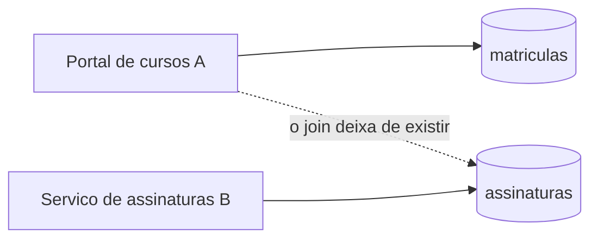
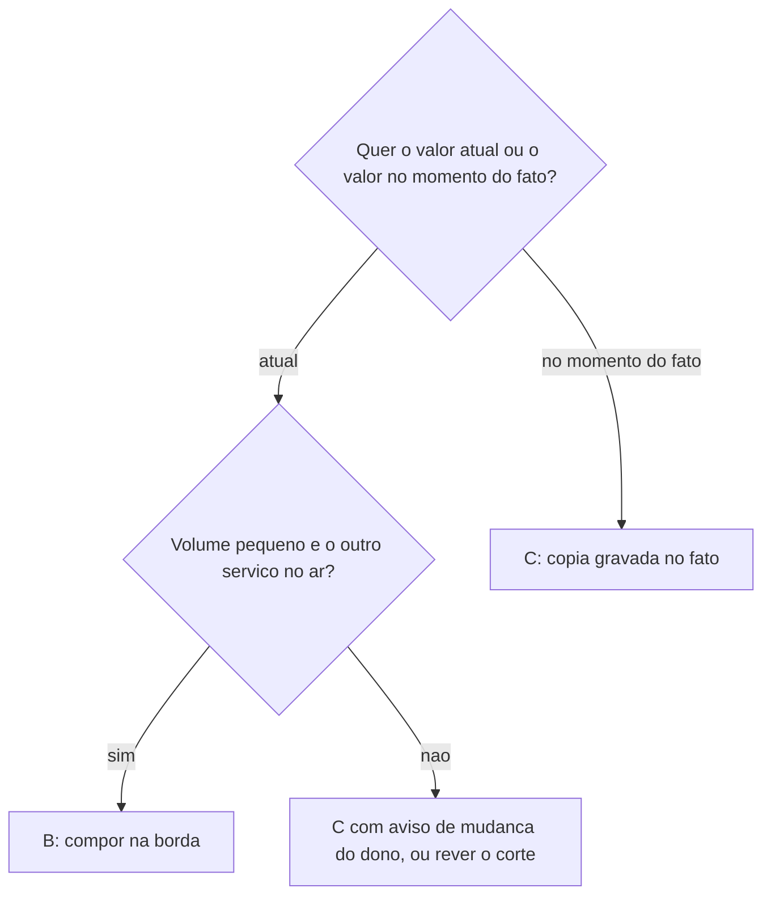
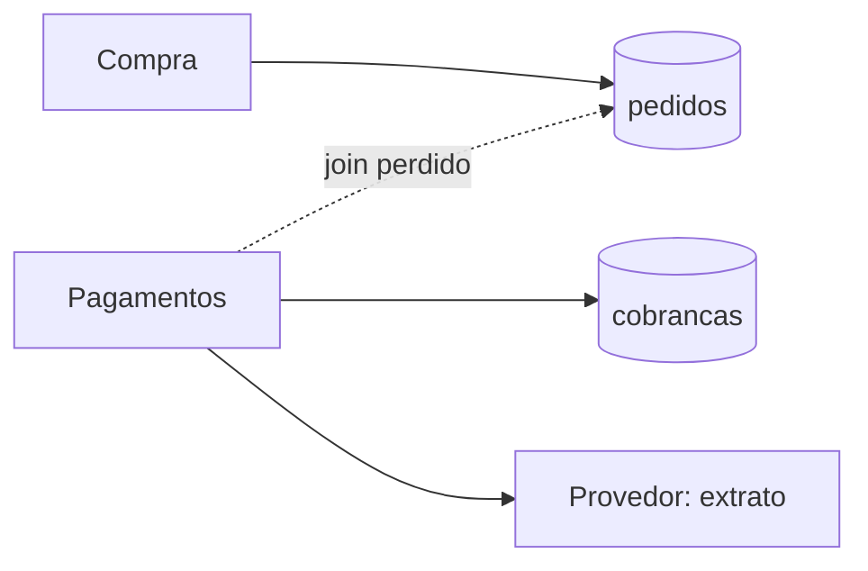

# Aula 19 — Propriedade do dado e acesso entre serviços

## Objetivo e competências

Ao fechar esta aula, conseguimos:

- definir **dono do dado** pela regra de quem o escreve, e distinguir os três cenários de propriedade (única, comum e conjunta) com a saída de cada um;
- explicar por que um banco compartilhado é um acoplamento por esquema, sem verificador e sem versão, e por que ele liga os serviços num quantum só mesmo sem chamada entre eles;
- dizer o que se perde ao dar a cada serviço o seu dado (o *join*, a integridade referencial e a transação) e o que pode substituir cada um;
- comparar três maneiras de ler um dado que mudou de dono (banco compartilhado, composição na borda e cópia local), com o custo de cada uma, e escolher entre elas com um critério explícito;
- decidir quais campos copiar e quais não copiar, e dizer quem corrige a cópia quando ela fica velha;
- distinguir uma pergunta que a cópia local responde de uma que ela deixa sem resposta;
- aplicar tudo isso a um caso: a conciliação de `Pagamentos` do Mini-Orion, que roda sem `compra`, com um contrato do `import-linter` que falha quando a independência é desfeita.

## O que já sabemos

Quatro ideias das aulas anteriores sustentam este capítulo.

A primeira é que **a fronteira lógica verifica `import`s, e não o banco**. As Aulas 11 e 12 separaram módulos e fizeram o `import-linter` acusar quem importava o que não devia. Dois módulos que nunca se importam podem, ainda assim, ler e escrever as mesmas tabelas, e nenhum verificador de dependências de código enxerga isso.

A segunda é que **as relações entre dados são uma força de integração** (Aula 18). Se duas partes usam as mesmas tabelas, separar os processos mantém o acoplamento por esquema, e separar o dado cria cópias para manter. A Aula 18 enunciou a pergunta; esta responde.

A terceira é que **um banco compartilhado liga os serviços num quantum só** (Aula 17). Ele tem a sua própria cadência de *deploy*, a migração de esquema, e todos os serviços atrás dele dependem dela, mesmo sem nenhum chamar o outro.

A quarta é que **uma chamada remota custa** (Aulas 16 e 17). Ela tem um terceiro desfecho, o de não sabermos se a operação aconteceu; a latência tem cauda; e a disponibilidade de serviços em série se multiplica. Tudo o que antes era uma leitura de tabela e passa a ser uma chamada herda esse custo.

A connascência (Aula 6) completa o vocabulário: duas partes que dependem do nome e do significado de uma coluna compartilham connascência de nome e de significado, sem o verificador de tipos para acusar quem esqueceu.

## Ponto de partida: um relatório que deixa de caber numa consulta

Retomamos o cenário da Aula 18, de fora do Orion. O portal de cursos (**A**) e o serviço de assinaturas (**B**) vivem hoje no mesmo banco. O portal guarda as matrículas; o serviço guarda as assinaturas. A cada mês, o financeiro pede um relatório simples: quais alunos têm matrícula em curso mas uma assinatura que não está ativa. Com um banco só, é uma consulta:

```sql
SELECT m.aluno_id, m.curso_id, a.situacao
FROM matriculas m
JOIN assinaturas a ON a.id = m.assinatura_id
WHERE a.situacao <> 'ativa';
```

Três coisas tornam essa consulta possível, e todas vêm do banco único. O ***join*** cruza duas tabelas em uma operação. A **chave estrangeira** (`matriculas.assinatura_id` aponta para `assinaturas.id`) garante que nenhuma matrícula aponte para uma assinatura que não existe. E a **transação** garante que, ao matricular um aluno novo, a assinatura e a matrícula sejam criadas juntas ou nenhuma delas.

Suponha agora que o serviço de assinaturas seja separado e passe a ter o seu próprio banco. O diagrama mostra o que sobra.



Leitura das setas: `X --> Y` significa que X lê e escreve em Y. A seta tracejada é a que existia e deixa de existir. O diagrama omite a rede entre A e B e o que cada um faz além do dado, para mostrar uma ideia só: **cada tabela passou a ter um dono, e o relatório depende de duas**. O que A faz agora para responder à pergunta do financeiro? E quem decide se a coluna `situacao` pode ser renomeada?

## De quem é o dado

### Dono do dado e os três cenários

Chamamos de **dono do dado** o componente que o escreve e que decide a forma como ele é guardado. Ford, Richards, Sadalage e Dehghani (*Software Architecture: The Hard Parts*, Cap. 9) dão a regra de bolso: o serviço que escreve numa tabela é o dono dela. A regra resolve o caso mais simples e se complica quando mais de um serviço escreve na mesma tabela. Por isso o livro distingue três cenários.

| Cenário | Quando ocorre | Saída | No cenário de cursos |
|---|---|---|---|
| **Propriedade única** | só um serviço escreve na tabela | esse serviço é o dono; os demais leem por ele | `matriculas`: só o portal escreve |
| **Propriedade comum** | quase todos os serviços escrevem na mesma tabela | um serviço dedicado é o único dono, e os outros lhe enviam o que querem gravar | uma tabela de auditoria em que todos registram ações |
| **Propriedade conjunta** | dois ou três serviços do mesmo domínio escrevem na mesma tabela | dividir a tabela, juntar os serviços num domínio de dados ou delegar a escrita a um só | `cursos`, escrita pelo portal (título) e por assinaturas (preço) |

Os autores recomendam resolver a propriedade única primeiro, porque ela limpa o terreno para os dois casos difíceis. O Orion, nesta aula, está no caso mais simples: a tabela de cobranças é escrita só por `pagamentos`.

### O banco compartilhado como contrato sem verificador

Um banco compartilhado esconde a pergunta de quem é o dono, porque qualquer módulo com acesso ao banco pode ler (e às vezes escrever) em qualquer tabela. No cenário de cursos, o time de assinaturas renomeia a coluna `situacao` para `situacao_cobranca`, porque descobriu que a palavra também servia a outro sentido. O serviço de assinaturas continua funcionando. O relatório do portal passa a falhar com uma coluna que não existe, e o erro aparece quando alguém reclama.

O nome técnico é **acoplamento por esquema** (*common coupling*, nos termos de Newman): dois componentes dependem da estrutura de um dado comum, e qualquer mudança na estrutura atinge os dois ao mesmo tempo. É o mesmo problema do contrato remoto da Aula 18, com duas diferenças que o pioram: o esquema não tem versão, e não há um arquivo de contrato nem um verificador que acuse a quebra antes do *deploy*. Newman observa que dados compartilhados assim tendem a ser muito difíceis de mudar, justamente por isso.

Daí vem a consequência para a independência. Um banco compartilhado faz todos os serviços atrás dele formarem um quantum só, mesmo sem nenhum chamar o outro, porque a migração de esquema é um *deploy* de que todos dependem. A Aula 17 mostrou que o *service-based* de banco único continua com um quantum nas duas versões, e que só a forma com um banco por serviço passa a dois quanta quando as chamadas síncronas são trocadas por filas. A divisão do dado é a segunda metade da independência. A primeira é a rede.

## O que se perde ao dividir o dado

Dar a cada serviço o seu dado tira três coisas que o banco único dava de graça.

| O que o banco único fazia | Depois da divisão | O que pode substituir |
|---|---|---|
| ***Join*** entre tabelas, em uma consulta | cada serviço enxerga só as suas tabelas | juntar em memória, ou guardar o campo necessário localmente |
| **Integridade referencial** (a chave estrangeira que impede apontar para o que não existe) | o banco de um serviço não sabe o que há no banco do outro | verificação na escrita, tolerância a referência órfã, rotina de conferência |
| **Transação** entre tabelas (tudo vale ou nada vale) | criar a assinatura e a matrícula estão em bancos diferentes | compensação (Aula 20) |

A perda é desigual. O *join* se resolve com engenharia, a um custo conhecido. A integridade referencial se troca por conferência, e é preciso decidir o que acontece quando ela falha: a matrícula que aponta para uma assinatura que sumiu é erro, ou é um estado a tolerar? A transação não tem substituto direto, e é a pergunta da próxima aula. Newman trata das três ao falar de decomposição de dados, e sobre o *join* faz uma observação que usaremos adiante: a junção continua acontecendo logicamente, só que no código da aplicação em vez de no banco, e dificilmente com a mesma eficiência.

## Como ler um dado que mudou de dono

O relatório do financeiro precisa de `situacao`, que o portal não guarda. Há três maneiras de dar a ele o que precisa, e todas têm defensores competentes. Ford e coautores (Cap. 10) tratam as duas últimas como padrões de acesso a dados distribuídos.

**A. Manter o banco compartilhado.** O serviço de assinaturas sai do processo, mas o portal continua lendo a tabela `assinaturas` no banco comum. A consulta acima continua valendo, sem mudança. Cobra o que a seção anterior descreveu: acoplamento por esquema, um quantum só e migrações que passam a exigir os dois times no mesmo dia.

**B. Compor a consulta na borda** (*Interservice Communication*, no vocabulário do livro). O portal chama o serviço de assinaturas e junta o resultado em memória.

```python title="Snippet ilustrativo: composição na borda"
def alunos_com_assinatura_inativa(portal, assinaturas):
    achados = []
    for matricula in portal.matriculas_em_curso():
        assinatura = assinaturas.buscar(matricula.assinatura_id)  # uma chamada remota por linha
        if assinatura.situacao != "ativa":
            achados.append((matricula.aluno_id, matricula.curso_id, assinatura.situacao))
    return achados
```

O custo está visível na linha comentada: `n` matrículas viram `n` chamadas, cada uma com a sua cauda de latência (Aula 16). Uma chamada em lote (`buscar_varias(ids)`) reduz o número de chamadas, se o serviço a oferecer. A composição exige ainda que os dois serviços estejam no ar na hora do relatório (a disponibilidade em série da Aula 17), e o dado que ela devolve é o **atual**, o que às vezes é exatamente o que se quer.

**C. Guardar uma cópia local** (*Column Schema Replication*, no livro). O portal grava, na matrícula, os campos de que o relatório vai precisar, e passa a responder só com eles. Elimina a chamada e a dependência de disponibilidade do outro lado. Cobra **duplicação**: o mesmo fato agora existe em dois lugares, e a cópia pode ficar velha.

| Alternativa | O que resolve | O que custa | Quando não vale |
|---|---|---|---|
| A. Banco compartilhado | o *join* e a integridade continuam | acoplamento por esquema, quantum único, migração coordenada | quando a independência de *deploy* é o motivo do corte |
| B. Composição na borda | nenhum dado duplicado; dado sempre atual | uma chamada por consulta, os dois serviços no ar, lento em lote | quando o volume é grande ou a janela é curta |
| C. Cópia local | leitura sem chamada e sem dependência do outro serviço | dado duplicado que pode envelhecer, e alguém precisa corrigi-lo | quando o campo muda com frequência depois de copiado |

### Escolher entre as três

A escolha não precisa ser de preferência. Duas perguntas a organizam: o relatório quer o valor **atual** ou o valor **do momento do fato**? E o volume e a janela permitem uma chamada por linha?



O diagrama deixa de fora a alternativa A, que não é uma saída do corte, e sim a decisão de não cortar o dado; ela só é a melhor se a independência de *deploy* não for o motivo da separação. Por isso o fluxo termina em "rever o corte" quando nenhuma das outras serve.

### Duplicar é uma decisão, e a cópia tem dono

Os autores de *The Hard Parts* tratam a cópia com cautela para o caso geral de leitura entre serviços: os dois problemas centrais são a sincronização e a dificuldade de governar quem é dono do dado. Reservam-na para situações como relatórios e agregações, grandes volumes ou exigências altas de tolerância a falha. A duplicação que ela cria é **intencional** quando o dado duplicado é escolhido, delimitado e tem um dono que o corrige. Copiar sem esses três cuidados é só uma cópia perdida, e o resultado costuma ser a pior mistura dos dois mundos.

A primeira pergunta é **o quê copiar**. Cada campo copiado é um campo a mais para manter, para proteger e para atualizar, e o critério é o da menor cópia suficiente: só o que a pergunta exige. A segunda é **quando a cópia fica velha**. O cenário de cursos mostra a diferença entre três campos:

| Campo | Muda depois de copiado? | Copiar? |
|---|---|---|
| `assinatura_id` | não | sim: é a chave |
| `plano` contratado na matrícula | só se o aluno trocar de plano, e aí é outro fato | sim, como fato histórico: "o plano na data da matrícula" |
| `situacao` | sim, a cada cobrança recusada ou paga | não, a menos que o dono avise a cada mudança |

Copiar a `situacao` seria o erro típico: a cópia responderia "ativa" a quem já foi suspenso há uma semana, e o relatório do financeiro estaria errado sem acusar nada. O que a cópia ajuda a responder é "qual era o plano na matrícula?"; a pergunta sobre a situação **atual** continua sendo do dono. A terceira pergunta é **quem corrige**. A cópia é do portal: escrita por ele, no momento da matrícula, e lida só por ele. O dono do dado original e o dono da cópia são serviços distintos, e por isso o aviso de mudança, que a Aula 20 trata, é o que mantém a cópia honesta. Uma cópia espalhada em vários serviços, cada um a corrigir do seu jeito, é o banco compartilhado de volta, agora sem o banco.

### O que a cópia responde e o que ela deixa sem resposta

O *join* antigo respondia, com uma consulta, duas perguntas diferentes. A primeira é **histórica**: que plano o aluno contratou ao se matricular? Para essa, o portal tem tudo, e a cópia local responde. A segunda é **atual**: a assinatura dele está ativa hoje? A resposta mora no serviço de assinaturas, e a cópia não a tem nem poderia ter, porque a situação muda **depois** da matrícula.

Esta é uma perda real do corte, e ela aponta para a aula seguinte: a pergunta que o *join* respondia sozinho passa a depender de uma conversa entre dois serviços, com tempo e com falha.

## Estudo de caso: a conciliação de `Pagamentos`

O Orion encontra o mesmo problema pela conciliação, e em sua forma mais simples: a propriedade das tabelas é única. O diagrama mostra o recorte depois do corte de `Pagamentos`.



Leitura das setas: `X --> Y` significa que X lê ou escreve em Y. O diagrama omite `Notificacoes` e os demais componentes do Orion. Mostra uma ideia só: `compra` é dona de `pedidos`, `pagamentos` é dona de `cobrancas`, e a conciliação, que mora em `pagamentos`, precisava dos dois.

### O relatório que fecha com diferença

A conciliação de `Pagamentos` é o motivo pelo qual o Orion considera cortar. Ela cruza o que o Orion registrou de cobranças com o extrato que o provedor reporta, procura diferença e entrega o relatório do mês ao financeiro. Hoje, dentro do monólito, ela faz isso com uma consulta só: lê a tabela de cobranças, junta (*join*) com a tabela de pedidos pelo identificador e compara valores. A consulta fecha, porque os dois dados vivem no mesmo banco e mudam na mesma transação.

Suponha o corte feito. `Pagamentos` agora é um serviço, e a conciliação roda no processo dele, com a janela e o ritmo próprios que motivaram tudo. Quem escreveu o código da conciliação o copiou do monólito e trocou o acesso ao banco pelas chamadas que sobraram. No primeiro ensaio de campanha, o relatório do financeiro fecha com diferença: das 2000 cobranças aprovadas do extrato, nenhuma casa com o que o Orion registrou. O provedor está certo, o dinheiro entrou, e o relatório acusa tudo. Nada falhou no sentido de uma exceção: a consulta antiga dependia de um dado que **mudou de dono** sem que a conciliação percebesse.

### As três alternativas, no Orion

| Alternativa | Na conciliação | Por que cabe ou não |
|---|---|---|
| A. Banco compartilhado | `pagamentos` sai do processo e continua lendo `pedidos` | cabe tecnicamente, mas desfaz o motivo do corte: a independência de *deploy* |
| B. Composição na borda | uma chamada a `compra` por cobrança | a conciliação processa o mês inteiro; 2000 cobranças no ensaio seriam 2000 chamadas, e `compra` teria de estar no ar |
| C. Cópia local | `pagamentos` grava na cobrança o que a conciliação lê | cabe: é relatório em lote, volume grande, e o valor da cobrança não muda depois de gravado |

A alternativa C é o caso que os autores reservam à cópia: relatórios, grandes volumes, tolerância a falha. E o critério da seção anterior a sustenta: a conciliação pergunta pelo valor **no momento do fato**, e esse não muda. A conciliação compara cobranças com o extrato, e para isso precisa da chave, do valor e do resultado. Não precisa do nome do cliente, dos itens do carrinho nem do endereço, e basta o final do cartão (quatro dígitos) para a conferência. Cada campo copiado é um campo a mais para proteger, e a Aula 16 já lembrou o que acontece com o número do cartão em trânsito.

No Mini-Orion, o valor da cobrança não muda depois de gravado, e por isso a cópia dura. No sistema real, um estorno parcial ou um ajuste faria a cópia envelhecer, e o remédio é o dono avisar a cada mudança, matéria da Aula 20. A conciliação tem um sinal para o caso: o relatório separa **valor divergente** de **só no provedor** e de **só no Orion**, e uma cópia velha aparece como divergência de valor.

### A mesma perda, no Orion

A conciliação antiga fazia, com o *join*, duas perguntas diferentes. A primeira é **financeira**: o que o Orion registrou de cobranças bate com o que o provedor reporta? Para essa, `pagamentos` tem tudo: o registro da cobrança e o extrato. A cópia local responde. A segunda é **de negócio**: toda cobrança aprovada tem um pedido emitido? A resposta mora na tabela de pedidos, que é de `compra`, e não está na cópia, porque o pedido só é emitido **depois** da cobrança aprovada. O que `pagamentos` sabe é que cobrou.

O ensaio da Aula 16, com 2000 fechamentos em campanha, tem exatamente esse caso. Dos 2000, 1998 terminaram em pedido confirmado e 2 terminaram em `cobranca_indeterminada`: a cobrança foi aprovada, a resposta se perdeu duas vezes, e o fechamento não emitiu o pedido. O cliente foi cobrado e não tem pedido. Com o *join* antigo, a conciliação apontaria essas duas cobranças. Com a cópia local, o relatório financeiro **fecha**: as 2000 cobranças casam com o extrato, e as duas sem pedido passam despercebidas. A cópia respondeu bem à pergunta que podia responder, e a outra pergunta ficou sem dono. É a mesma perda do cenário de cursos, e é ela que a próxima aula trata.

### Quem é dono de quê

Para o recorte do Mini-Orion, a divisão do dado fica assim:

| Dado | Dono | Quem lê | Como lê depois do corte |
|---|---|---|---|
| Cobranças e seu resultado | `pagamentos` | `pagamentos` (a conciliação) | direto, no repositório próprio |
| Extrato do provedor | o provedor | `pagamentos` | recebido e comparado com o repositório próprio |
| Pedidos emitidos | `compra` | `compra` | direto; `pagamentos` não os enxerga |
| Valor e chave da cobrança, para a conciliação | `pagamentos` | `pagamentos` | cópia gravada na cobrança, com cartão mascarado |

Essa tabela descreve o recorte do Mini-Orion. No Orion Evolution Lab, a tabela equivalente é do grupo.

### 📐 ADR — Dado de pagamentos é de pagamentos: cópia local gravada na cobrança

| Campo | Conteúdo |
|---|---|
| **Identificador** | ADR — Dado de pagamentos é de pagamentos: cópia local gravada na cobrança |
| **Status** | Aceito para o `08-dados`. |
| **Contexto** | A conciliação de `Pagamentos` cruzava cobranças e pedidos por um *join*. Com o corte, a tabela de pedidos é de `compra`. Um porte direto do código antigo faz o relatório acusar diferença em todas as cobranças (2000 de 2000 no ensaio). |
| **Decisão** | `pagamentos` tem repositório próprio e grava, no momento da cobrança, uma cópia com a chave, o valor, os quatro últimos dígitos do cartão e o resultado. A conciliação lê só essa cópia e o extrato do provedor. `compra` não lê os dados de `pagamentos`, e a conciliação não importa `compra`; dois contratos de `import-linter` verificam isso. |
| **Alternativas** | (a) Manter o banco compartilhado: preserva o *join* e deixa o acoplamento por esquema e o quantum único. (b) Compor na borda: sem duplicação, mas uma chamada por cobrança, inviável para a conciliação em lote. (c) Cópia local, como acima. |
| **Consequências positivas** | A conciliação roda sem `compra` e sem depender de outro serviço no ar. O esquema dos dados de `pagamentos` pode mudar sem atingir ninguém de fora. |
| **Consequências negativas** | A cópia pode ficar velha se o valor da cobrança mudar depois de gravado; o Mini-Orion não tem essa mudança e o sistema real terá. A pergunta "toda cobrança tem pedido?" deixa de ser respondida pela conciliação e fica sem dono (2 cobranças sem pedido em 2000, no ensaio). O *join* é perdido de vez. |
| **Reversão** | Cara depois que o esquema próprio estiver em uso: refazer o banco único exige migrar os dados e desfazer os contratos. |
| **Condição de falseamento** | O ADR estaria errado se, em produção, a cópia divergisse do extrato com frequência por mudança posterior do valor (o dado muda mais do que se supôs), ou se o financeiro precisasse da pergunta "cobrança sem pedido" no mesmo relatório e nenhum mecanismo a atendesse. |

### Na prática: Python

O checkpoint `08-dados/` do repositório de código (<https://github.com/eduardo-da-silva/fundamentos-arquitetura-code>) parte de `07-remoto/`. Os testes herdados seguem verdes, e o `setup.cfg` ganha dois contratos. O dado de `pagamentos` mora em um arquivo interno:

```python title="08-dados/mini_orion/pagamentos/_cobrancas.py (recorte)"
@dataclass(frozen=True)
class RegistroCobranca:
    chave: str
    valor: float
    cartao_final: str  # so os quatro ultimos digitos: a conciliacao nao precisa do resto
    resultado: ResultadoCobranca


class RepositorioCobrancas:
    def __init__(self) -> None:
        self._registros: dict[str, RegistroCobranca] = {}

    def gravar(self, registro: RegistroCobranca) -> None:
        self._registros[registro.chave] = registro
```

A cópia é gravada no momento da cobrança, dentro do servidor de `pagamentos`:

```python title="08-dados/mini_orion/pagamentos/_servidor.py (recorte)" hl_lines="3 5"
        if pedido.chave:
            self._respostas_por_chave[pedido.chave.valor] = resultado
            if self._gravar_copia:
                # Copia local, no momento da cobranca: so o que a conciliacao le.
                self.repositorio.gravar(
                    RegistroCobranca(
                        chave=pedido.chave.valor,
                        valor=pedido.valor,
                        cartao_final=pedido.cartao[-4:],
                        resultado=resultado,
                    )
                )
```

O parâmetro `gravar_copia` existe para reproduzir o porte descuidado do início da aula: com `False`, o servidor não grava nada e a conciliação não tem com que comparar. Em produção, ele ficaria ligado. A conciliação em si recebe os registros e o extrato como dados e devolve um relatório com quatro listas:

```python title="08-dados/mini_orion/pagamentos/conciliacao.py (recorte)"
@dataclass
class RelatorioConciliacao:
    conferem: list[str] = field(default_factory=list)
    valor_divergente: list[str] = field(default_factory=list)
    so_no_provedor: list[str] = field(default_factory=list)  # cobrado, sem registro no Orion
    so_no_orion: list[str] = field(default_factory=list)  # registrado como aprovado, sem lancamento

    @property
    def fecha(self) -> bool:
        return not (self.valor_divergente or self.so_no_provedor or self.so_no_orion)
```

Os dois contratos do `import-linter` transformam a decisão do ADR em verificação:

```ini title="08-dados/setup.cfg (recorte)"
[importlinter:contract:conciliacao-nao-importa-compra]
name = A conciliacao roda sem Compra
type = forbidden
source_modules =
    mini_orion.pagamentos.conciliacao
forbidden_modules =
    mini_orion.compra

[importlinter:contract:compra-nao-le-os-dados-de-pagamentos]
name = Compra nao le os dados de Pagamentos
type = forbidden
source_modules =
    mini_orion.compra
forbidden_modules =
    mini_orion.pagamentos._cobrancas
```

O primeiro garante a metade de `pagamentos` na decisão: se a conciliação voltar a importar `compra`, direta ou indiretamente, o contrato quebra. O segundo garante a metade de `compra`: ler `_cobrancas` seria reabrir o acoplamento por esquema com outro nome. Há também um teste que não depende do linter: `test_a_conciliacao_roda_sem_carregar_compra` importa o módulo num processo limpo e confere que nenhum módulo de `compra` foi carregado.

O ensaio que fundamenta as duas faces desta aula, com 2000 fechamentos em campanha, semente 42 e as mesmas hipóteses de rede da Aula 16:

```text
gravar_copia=False   aprovadas: 2000   conferem: 0      so_no_provedor: 2000   fecha: False
gravar_copia=True    aprovadas: 2000   conferem: 2000   so_no_provedor: 0      fecha: True
fechamentos: 1998 confirmados, 2 cobranca_indeterminada (cobrados, sem pedido)
```

A terceira linha é o que o relatório com cópia não vê. O teste `test_a_copia_local_nao_enxerga_a_cobranca_sem_pedido` a fixa: o relatório fecha mesmo com duas cobranças sem pedido.

Para rodar, com o ambiente das aulas anteriores:

```bash
cd fundamentos-arquitetura-code/08-dados
pytest tests/test_dados.py   # 9 testes
pytest                       # 66 testes, com os herdados
lint-imports                 # 8 contratos
```

O que vale experimentar:

- **Ver o relatório de cada lado.** Os testes `test_sem_a_copia_o_relatorio_fecha_com_diferenca` e `test_com_a_copia_o_relatorio_fecha` mudam um único parâmetro. Leia os dois juntos antes de rodar.
- **Provocar uma divergência.** `test_a_conciliacao_aponta_valor_divergente_e_registro_sem_lancamento` monta o caso à mão. Escreva um teste em que o provedor reporta uma cobrança que o Orion não conhece e confira em qual lista ela cai.
- **Desfazer a independência.** Acrescente `import mini_orion.compra.api` ao topo de `mini_orion/pagamentos/conciliacao.py` e rode `lint-imports`. O primeiro contrato quebra, e a conciliação continua funcionando.

## O que ficou decidido e o que a Aula 20 pergunta

Ficou decidido que o dado de `pagamentos` é de `pagamentos`: repositório próprio, cópia local gravada na cobrança, só com os campos de que a conciliação precisa, e dois contratos que impedem a independência de se desfazer sem aviso. Ficou registrado também o que isso custa: o *join* acabou, a cópia pode envelhecer, e a pergunta "toda cobrança tem pedido?" não tem mais quem a responda sozinha.

Essa última perda é a mais séria, porque aponta para algo que o ensaio já mostrou duas vezes em cada 2000 fechamentos. Com os dados separados, cobrar e emitir o pedido já não cabem numa transação. A cobrança é aprovada e a emissão falha, ou o *timeout* acontece depois de a cobrança ter ocorrido, e o cliente foi cobrado e não tem pedido. Hoje alguém do suporte estorna à mão, quando percebe. O que existe entre os dois passos, e como se desfaz o que já foi feito? A Aula 20 responde.

## Leitura complementar

- Newman, Sam. *Building Microservices*. 2. ed. Cap. 2 — How to Model Microservices (seção sobre acoplamento, incluindo o acoplamento por dados comuns).
- Newman, Sam. *Building Microservices*. 2. ed. Cap. 3 — Splitting the Monolith (seção "Data Decomposition Concerns": desempenho do *join* deslocado para a aplicação).
- Richards, Mark; Ford, Neal. *Fundamentals of Software Architecture*. Cap. 17 — Microservices Architecture (o dado por serviço e a observação sobre o banco compartilhado).
- Ford, Neal; Richards, Mark; Sadalage, Pramod; Dehghani, Zhamak. *Software Architecture: The Hard Parts*. O'Reilly, 2021. Cap. 9 — Data Ownership and Distributed Transactions (propriedade única, comum e conjunta do dado).
- Ford, Neal; Richards, Mark; Sadalage, Pramod; Dehghani, Zhamak. *Software Architecture: The Hard Parts*. O'Reilly, 2021. Cap. 10 — Distributed Data Access (os padrões *Interservice Communication* e *Column Schema Replication*, com suas vantagens e desvantagens).

## Referências

- NEWMAN, Sam. *Building Microservices*. 2. ed. O'Reilly, 2021.
- RICHARDS, Mark; FORD, Neal. *Fundamentals of Software Architecture: An Engineering Approach*. O'Reilly, 2020.
- FORD, Neal; RICHARDS, Mark; SADALAGE, Pramod; DEHGHANI, Zhamak. *Software Architecture: The Hard Parts*. O'Reilly, 2021.
