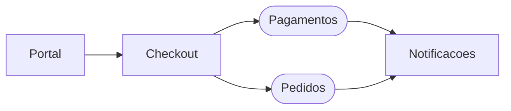
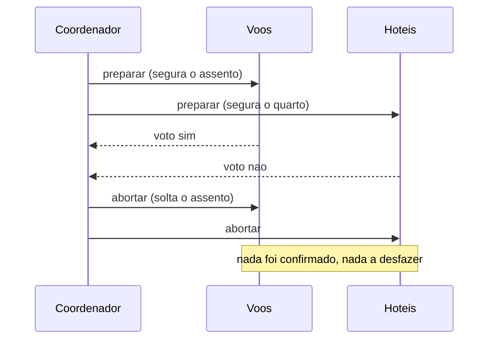
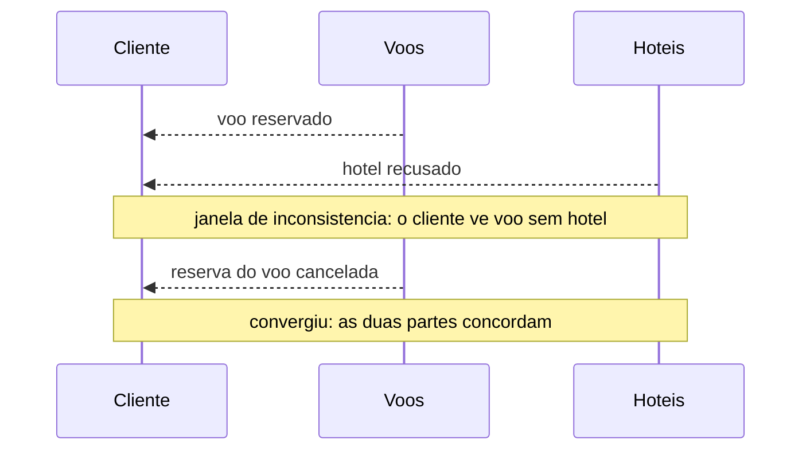
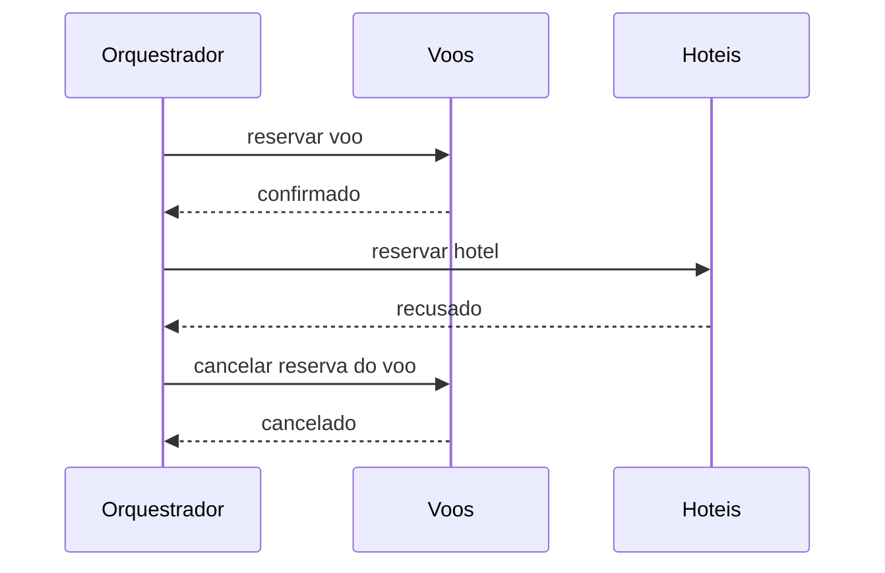
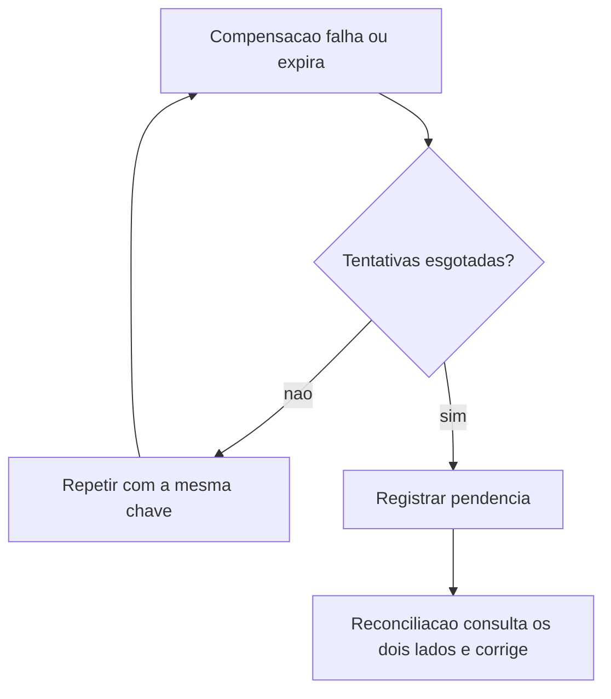
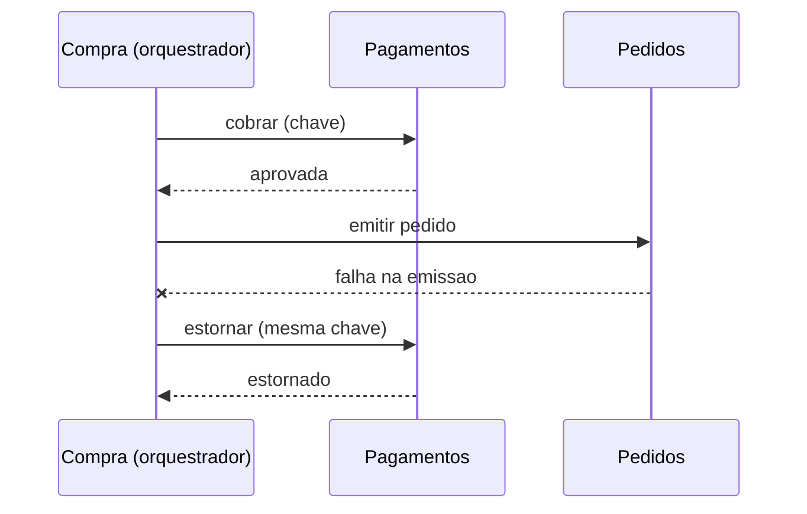

# Aula 20 — Consistência e saga: desfazer o que já foi feito

## Objetivo e competências

Ao fechar esta aula, conseguimos:

- explicar o que uma transação local garante (atomicidade, consistência, isolamento e durabilidade) e o que se perde quando os passos de uma operação passam a viver em bancos diferentes;
- descrever o *two-phase commit*, dizer o que ele garante, o que cobra e em que contextos cabe;
- distinguir consistência forte de consistência eventual e dizer, em segundos e em consequência de negócio, qual a **janela de inconsistência** de uma operação;
- explicar o que é uma saga, por que compensar não é desfazer (*rollback*) e como classificar cada passo como compensável, pivô ou repetível;
- escolher a ordem dos passos para reduzir o que precisa ser compensado;
- tratar a compensação que também falha, apoiando-se na idempotência de cada passo e numa reconciliação;
- rodar a matriz de falhas do orquestrador do Mini-Orion e ler, em cada linha, o estado em que o cliente fica.

## O que já sabemos

Este capítulo parte de quatro ideias que as aulas anteriores deixaram assentadas. A saga é uma resposta a um problema que elas, juntas, criam.

A primeira é que **uma chamada remota tem três desfechos, e o terceiro é a dúvida**. Além de resultado e erro, o tempo pode esgotar, e o outro lado pode ter executado, não ter executado ou ainda estar executando. Repetir a chamada só é seguro quando a operação aguenta ser repetida, isto é, quando é **idempotente**. A chave de idempotência é o mecanismo: quem recebe reconhece que já executou aquela chave e devolve o resultado anterior, sem executar de novo (Aula 16).

A segunda é que **a disponibilidade se multiplica quando as partes estão em série**, e que existe uma forma de implantação que evita o problema na origem: o *service-based* agrupado com banco único mantém a transação local entre os passos, ao custo de ter um quantum só (Aula 17). Separar o dado, em qualquer das outras formas, é uma decisão com preço.

A terceira é que **dividir o dado tira três coisas do banco único: o *join*, a integridade referencial e a transação**. O *join* se resolve com engenharia, a integridade com conferência, e a transação ficou sem substituto, apontada para esta aula (Aula 19).

A quarta é que **a pergunta que o *join* respondia sozinho passa a depender de uma conversa entre dois serviços, com tempo e com falha**. A cópia local de `pagamentos` responde "o que cobramos?", e deixa sem dono a pergunta "toda cobrança aprovada tem um pedido?" (Aula 19). Quanto ao contrato, o consumidor que recebe um valor que não conhece o trata como falha, e não como aprovação; no fechamento, isso se chama `cobranca_indeterminada` (Aulas 16 e 18).

O **ADR** acompanha tudo isso: a decisão registrada com as alternativas consideradas e a condição que a desmentiria. O que ainda falta é o que colocar no lugar da transação.

## O caso: cobrado, e sem pedido

Na Aula 16, o ensaio de campanha com 2000 fechamentos terminou com duas linhas que o texto deixou em aberto: em 2 deles, a cobrança foi aprovada, a resposta se perdeu nas duas tentativas e o fechamento terminou sem emitir o pedido. O cliente foi cobrado e não tem pedido. A Aula 19 mostrou que o relatório de conciliação nem enxerga esses dois casos, porque o *join* que os acusava acabou.

A segunda forma do problema é mais direta. A cobrança é aprovada e logo depois a emissão do pedido falha: o banco de pedidos está indisponível, ou uma regra de negócio recusa a emissão. Nos dois casos o dinheiro saiu e nada de aceito ficou do outro lado. Hoje, alguém do suporte percebe quando o cliente reclama e estorna a cobrança à mão, sem registro de quanto tempo o cliente ficou nessa situação.

O diagrama mostra onde esses passos ficam no sistema.



Leitura das setas: `A --> B` significa que A depende de B. Os dois componentes com contorno arredondado são os que o fechamento percorre em sequência, cada um com o seu dado. O diagrama omite `Catalogo`, `Clientes`, `Promocoes` e `Logistica`, que não participam da discussão, e não mostra a ordem das chamadas, só quem depende de quem.

Enquanto cobrar e emitir moravam no mesmo banco, o problema não existia: se a emissão falhasse, a transação inteira era desfeita e a cobrança não chegava a valer. Depois da Aula 19, cada passo tem o seu banco, e a garantia desapareceu sem que ninguém a tenha removido de propósito. A pergunta desta aula é o que colocar no lugar dela, e a que custo. Para responder, falta um vocabulário, e ele começa pelo que a transação local de fato garantia.

## O que a transação local garantia

Uma **transação** é um conjunto de operações tratado como uma unidade. Os bancos relacionais a definem por quatro propriedades, conhecidas pela sigla ACID. A **atomicidade** diz que ou todas as operações valem, ou nenhuma vale. A **consistência** diz que a transação leva o banco de um estado válido a outro. O **isolamento** diz que quem observa de fora não vê um estado intermediário. A **durabilidade** diz que o que foi confirmado sobrevive a uma queda.

Um cenário de fora do Orion mostra quais delas pesam. Uma agência de viagens online vende pacotes com um voo e um hotel. Com os dois registros no mesmo banco, a compra é uma transação: se a reserva do hotel falha, a do voo é desfeita no mesmo instante, e nenhum cliente jamais vê um voo reservado sem hotel. Duas das quatro propriedades fazem esse trabalho. A atomicidade garante que voo e hotel valem juntos ou não valem. O isolamento garante que ninguém, nem o suporte nem a tela do cliente, enxergue o meio do caminho.

Suponha agora que voos e hotéis passem a ser serviços de times diferentes, cada um com o seu banco. A reserva do voo é confirmada no banco dele. A do hotel falha. Nenhum dos dois bancos sabe do outro, e o voo continua reservado. Newman resume a consequência: ao decompor uma operação em duas transações de bancos diferentes, perde-se a atomicidade da operação como um todo. No Orion, é o que a Aula 19 deixou: cobrar e emitir o pedido são duas transações, e entre elas existe um intervalo em que o cliente está cobrado e sem pedido.

## Duas maneiras de responder à perda da transação

Há duas respostas conhecidas. A primeira é manter a atomicidade, estendendo a transação a mais de um processo: é o *two-phase commit*. A segunda é aceitar que, por um tempo, as partes não concordam, e construir o meio de fazê-las concordar depois: é a consistência eventual. Cada uma tem vantagens e desvantagens, e ambas têm defensores competentes. Esta seção as descreve; a escolha para o Orion fica para o estudo de caso.

### Manter a atomicidade: o *two-phase commit*

O ***two-phase commit*** (2PC) é o algoritmo mais conhecido de transação distribuída. Um coordenador pergunta a todos os participantes se podem confirmar (fase de votação) e, se todos dizem que sim, manda confirmar (fase de efetivação). Entre as duas fases, cada participante mantém bloqueados os recursos que prometeu confirmar.

Na agência de viagens, o coordenador perguntaria ao serviço de voos e ao de hotéis se cada um consegue reservar. Cada um segura o assento ou o quarto, sem confirmar, e responde sim. Só então o coordenador manda confirmar nos dois. Se o hotel responde não, o voo solta o assento e nada aconteceu. O diagrama mostra esse caminho.



As setas são mensagens. Perceba que, até o coordenador decidir, nenhum dos dois confirmou nada: os participantes só seguram o recurso, e por isso abortar não precisa de compensação. O diagrama mostra a falha por voto e omite o caso em que o coordenador cai entre a votação e a efetivação, em que os dois ficam com o recurso preso. É a atomicidade de volta, e funciona bem entre dois bancos do mesmo fornecedor, numa operação de milissegundos. A vantagem é forte: ninguém vê o estado intermediário, e não é preciso escrever compensações.

O preço aparece quando os participantes são serviços independentes. O 2PC cobra três coisas. Cobra **disponibilidade**: se o coordenador cai depois que um participante votou sim, esse participante fica bloqueado, sem saber se confirma ou desfaz, e alguns desses casos só se resolvem à mão. Na agência, o assento fica preso, sem que ninguém possa vendê-lo, até alguém decidir. Cobra **latência**: cada fase é uma volta pela rede, e a cauda de cada volta é a da Aula 16. E cobra **acoplamento**: todos os participantes precisam falar o protocolo e segurar bloqueios enquanto a mais lenta das partes responde. Há ainda uma condição de partida: todos os participantes precisam implementar o protocolo, e um serviço externo, como o provedor de um pagamento, em geral não o implementa. Newman aconselha evitá-lo entre microsserviços; a alternativa que ele coloca primeiro é não separar o dado que precisa ser atômico, que no Orion corresponde ao *service-based* agrupado com banco único da Aula 17.

### Aceitar a divergência temporária: consistência eventual

Chamamos de **consistência forte** a garantia de que, depois de uma escrita, todo mundo lê o valor novo. **Consistência eventual** é a garantia mais fraca de que, se ninguém escrever mais, todo mundo acabará lendo o valor novo. Entre uma e outra existe um intervalo em que as partes discordam, e a ele damos o nome de **janela de inconsistência**.

Na agência, imagine que o voo foi reservado e o hotel recusou. Se o sistema cancela o voo em centésimos de segundo, a janela é invisível: o cliente nem chega a ver a reserva. Se o cancelamento depende de um processo periódico, que roda de tempos em tempos, o cliente recebe um e-mail de confirmação de voo e, até a próxima rodada, o suporte atende ligações sobre uma reserva que deixou de existir. O mecanismo é o mesmo nos dois casos, e as consequências de negócio, muito diferentes. O diagrama mostra o que o cliente enxerga ao longo do tempo.



As setas são o que o cliente recebe, e o diagrama omite quem dispara o cancelamento e como, que é o assunto da saga. Ao contrário do 2PC, o voo foi confirmado de verdade antes de o hotel responder: o estado intermediário existe e é visível, e o que se promete é que ele **termina**.

A janela é o conceito que torna a escolha discutível. "Consistência eventual" sem janela é uma promessa sem prazo. Com a janela, a pergunta vira mensurável: durante quantos segundos o cliente pode ficar cobrado sem pedido, e o que isso custa ao negócio?

A vantagem da consistência eventual é que nenhum participante espera pelo outro: não há bloqueio, a latência de um passo não segura os demais, e um serviço externo participa sem implementar protocolo nenhum. A desvantagem é que alguém precisa construir o meio de convergir (compensar, repetir, reconciliar) e aceitar que, durante a janela, o cliente e o suporte enxergam um estado que ainda vai mudar.

Há dois nomes que costumam entrar aqui, e os usamos só como vocabulário. O **teorema CAP** diz que, diante de uma partição de rede, um sistema distribuído escolhe entre responder (disponibilidade) e responder certo (consistência). O **PACELC** acrescenta que, mesmo sem partição, há uma troca entre latência e consistência. Servem para nomear o que o fechamento já faz: cada chamada remota da Aula 16 é uma pequena escolha entre esperar mais para ter certeza e responder já com o que se tem.

A tabela põe as duas respostas lado a lado.

| Resposta | O que oferece | O que custa | Quando cabe |
|---|---|---|---|
| *Two-phase commit* | atomicidade e isolamento entre os participantes | bloqueio se o coordenador cai, uma volta de rede por fase, todos falando o protocolo | poucos participantes sob o mesmo controle, operação curta |
| Consistência eventual | sem bloqueio; aceita participantes externos | janela de inconsistência; compensação e reconciliação a construir | quando a janela tolerada é maior que zero e cada passo tem desfazer |

## Saga

Uma **saga** é uma sequência de transações locais, cada uma confirmada no seu próprio banco, acompanhada do modo de desfazer o efeito de cada uma. Em vez de bloquear tudo até o fim, cada passo vale assim que termina, e uma falha adiante aciona o desfazer dos que já valeram. A ideia vem de um artigo de 1987 de Garcia-Molina e Salem, sobre transações longas, e Newman a retoma para serviços. Nas palavras dele, a saga evita o bloqueio prolongado de recursos e, de quebra, obriga a modelar o processo de negócio de forma explícita.

A agência de viagens acompanha o resto da seção, porque o pacote dela tem quatro passos com naturezas bem diferentes: reservar o voo, reservar o hotel, emitir o bilhete e enviar o roteiro por e-mail. Ela é uma das maneiras de construir a consistência eventual: o diagrama mostra o caminho em que o hotel recusa, com o voo já confirmado e depois compensado.



As setas são mensagens, e não dependências. O diagrama mostra uma falha e omite o que acontece se o cancelamento também falhar, que é tratado mais adiante.

### Compensar não é desfazer

A palavra *rollback* sugere voltar ao estado anterior como se nada tivesse acontecido. A compensação não faz isso. Na agência, a reserva do voo existiu durante o intervalo, e cancelá-la pode ter um custo, que depende do acordo com a companhia aérea: pode ser nenhum, se a reserva ainda estiver dentro do prazo de cancelamento gratuito, ou uma tarifa. Quem arca com a tarifa é uma decisão de negócio. O cliente não causou a falha do hotel, então repassá-la a ele é, em geral, inaceitável, e a agência a absorve como custo da própria arquitetura. O cancelamento é um fato novo que anula o efeito do anterior, e não apaga o anterior. No Orion, quando a cobrança é estornada, o cliente **foi** cobrado, viu a cobrança por um tempo e agora vê um estorno. O intervalo entre os dois fatos é a janela de inconsistência, e há coisas que uma compensação não reverte (um e-mail enviado não volta; um estoque já reservado para outro cliente não se recupera sem custo).

Compensar custa, e o custo tem formas diferentes: **monetário** (a tarifa de cancelamento, quando existe), de **tempo** (a janela em que o cliente enxerga o estado intermediário), de **efeito visível** (o e-mail de confirmação já enviado) e de **irreversibilidade** (o bilhete emitido). Quem paga cada um é decisão de negócio, e o custo que a empresa absorve é um motivo para desenhar os passos de modo a pagar menos. O custo orienta duas decisões sobre os passos. Quanto mais cara a compensação, mais tarde o passo deve ficar na ordem, depois dos que costumam falhar, e mais vale trocá-lo por uma versão mais barata de desfazer, como uma reserva provisória que expira sozinha. Se desfazer é impossível, o passo vira o pivô, e os que o precedem precisam ser os mais seguros. Uma tarifa de cancelamento, portanto, não mostra que a saga não serve; mostra onde cada passo deve ficar. A saga deixa de servir em dois casos: quando a compensação de algum passo é impossível e esse passo não pode ser o pivô, ou quando a janela tolerada é zero. Então a resposta é não separar o dado ou, se todos os participantes estiverem sob o nosso controle e a operação for curta, usar o *two-phase commit*.

### Três papéis para um passo

Nem todo passo de uma saga é tratado do mesmo jeito. A classificação que usamos tem três papéis. Um passo **compensável** tem uma ação que desfaz o seu efeito. O **passo pivô** é o ponto sem volta: depois dele, a saga só avança, e a falha dele aciona a compensação dos anteriores. Um passo **repetível** pode falhar e ser tentado de novo sem que ninguém precise desfazer nada, porque a falha dele não invalida o que veio antes.

| Passo da agência | Papel | Por quê |
|---|---|---|
| Reservar o voo | compensável | o cancelamento desfaz o efeito, com um custo que a agência pode absorver |
| Reservar o hotel | compensável | idem |
| Emitir o bilhete | pivô | emitido o bilhete, o pacote é um fato para a companhia aérea; a saga só avança |
| Enviar o roteiro por e-mail | repetível | se falha, o pacote continua valendo e o envio é tentado de novo |

Essa classificação responde a uma pergunta de desenho: **para onde a saga recupera quando falha**. Newman distingue a recuperação para trás (*backward recovery*, compensar o que foi feito) da recuperação para frente (*forward recovery*, retomar de onde parou, o que exige repetir com segurança). Uma saga pode misturar as duas. Se o bilhete já foi emitido e só falta enviar o roteiro, cancelar o pacote por causa de um e-mail seria absurdo; o envio se tenta de novo.

### A ordem dos passos reduz o que se compensa

Quanto mais cedo falha o passo que costuma falhar, menos coisa precisa ser desfeita. Na agência, se o hotel recusa com muito mais frequência que o voo, reservar o hotel primeiro evita cancelar voos com tarifa. Newman lembra que, às vezes, é suficiente mover um passo para o fim da sequência, onde ele nunca precisa ser revertido, ou puxar para o início o passo mais provável de falhar. É uma decisão de desenho barata e que evita escrever compensações: a melhor compensação é a que não é necessária.

### Cada passo precisa aguentar repetição

A Aula 16 mostrou que repetir uma operação só é seguro quando ela é idempotente. O mesmo vale aqui, passo a passo. Se a resposta do cancelamento do voo se perde, o orquestrador repete o cancelamento; se ele não for idempotente, a companhia devolve o valor duas vezes, ou cobra a tarifa de cancelamento duas vezes. A chave de idempotência da reserva serve também ao cancelamento e à consulta: quem recebe reconhece que já executou aquela chave e devolve o resultado anterior, sem executar de novo.

### A compensação também falha

O passo de compensar também atravessa a rede, e a rede falha. O que fazer quando o cancelamento não obtém resposta? Repetir em laço, até conseguir, é um desenho perigoso, porque um serviço fora do ar vira uma fila infinita de repetições. O desenho mais sóbrio tem dois movimentos, e o diagrama os mostra.



Tenta-se um número pequeno de vezes, com a idempotência garantindo que repetir é seguro. Esgotadas as tentativas, a saga **registra uma pendência** e deixa para uma rotina de **reconciliação** (um processo que roda de tempos em tempos, consulta o estado real dos dois lados e corrige o que estiver divergente). A pendência torna o problema visível: deixa de ser "o suporte percebeu" e passa a ser uma linha de um registro, com quando começou e quando foi corrigida. O diagrama não mostra o intervalo da reconciliação, que é a janela de inconsistência desse caminho.

A reconciliação também cobre o **estado ambíguo** da Aula 16. Quando a cobrança expira sem resposta, não se sabe se ela ocorreu; a reconciliação consulta o serviço pela chave. Se a cobrança existe, estorna. Se não existe, só fecha a pendência. Um aviso de Newman vale como limite: uma saga lida com falhas de negócio (cartão sem saldo), e as falhas técnicas (um *timeout*) precisam de tratamento à parte; é isso que a idempotência e a reconciliação fazem.

### Orquestração

Uma saga pode ser **orquestrada**, com um coordenador central que define a ordem dos passos, dispara as compensações e guarda o estado do processo, ou **coreografada**, em que cada serviço reage aos eventos dos outros, sem coordenador. Na agência, o diagrama acima é uma orquestração: o orquestrador sabe em que passo cada pacote está. Na coreografia, o serviço de voos publicaria "voo reservado", o de hotéis reagiria a esse evento, e o estado de um pacote estaria espalhado nas mensagens de quatro serviços. A orquestração dá visibilidade: o estado de cada fechamento está num lugar só. A coreografia desacopla mais e torna o acompanhamento mais difícil. Neste módulo usamos só a orquestrada; a coreografia entra no Módulo 4, junto com eventos, onde o par de alternativas é tratado por inteiro.

## Estudo de caso: o fechamento do Orion como saga

Com o vocabulário montado, voltamos ao fechamento. O que a agência fez em quatro passos o Orion faz em três.

### Os três passos

O fechamento do Orion tem três passos, e a classificação da aula os separa. **Cobrar** é compensável: o estorno desfaz o efeito. **Emitir o pedido** é o passo pivô: com o pedido emitido, o fechamento só avança, e se a emissão falha, compensa-se a cobrança. **Notificar** é repetível: se o aviso falha, o pedido continua valendo, e o aviso fica guardado para reenvio. A ordem já é a que reduz compensação: o passo que mais pode falhar sem custo (o aviso) está no fim.

O diagrama mostra os dois caminhos de falha que a aula tratou, na ordem em que acontecem.



As setas são mensagens. A linha com `x` é uma falha, e o diagrama omite o ramo em que o estorno também não obtém resposta, tratado na matriz de falhas mais adiante.

### Três alternativas

| Alternativa | O que resolve | O que custa | Quando não vale |
|---|---|---|---|
| *Two-phase commit* entre `compra` e `pagamentos` | atomicidade de verdade | provedor externo não participa; cauda de latência multiplicada; bloqueio se o coordenador cai | quando um dos participantes é um serviço externo, que é o caso |
| Manter como está: o suporte estorna à mão | nenhum código novo | janela sem limite conhecido; nenhum registro; depende de o cliente reclamar | quando o volume de casos passa de uns poucos por campanha |
| Saga orquestrada com compensação e reconciliação | janela limitada e medida; pendência visível | estado explícito a manter; compensação que também pode falhar; um job a operar | quando a janela tolerada é zero (então a resposta é não separar o dado) |

O *two-phase commit* não cabe aqui por duas razões de contexto: o fechamento tem um provedor de pagamento externo, que não participa de protocolo nenhum, e uma cauda de latência que as duas fases multiplicariam. Em outro contexto (dois bancos do mesmo fornecedor, operação de milissegundos), a resposta poderia ser outra. Cada alternativa tem defensores. Quem prefere manter como está aposta que o volume é baixo (2 casos em 2000) e que o código novo custa mais do que o suporte, e isso é verdade enquanto o volume se mantiver baixo e não houver exigência de prazo. A saga ganha quando o negócio precisa saber quanto tempo o cliente fica nessa situação.

### Medindo a janela

O que a saga muda se mede. No Mini-Orion, a janela de inconsistência tem dois valores conforme o caminho. Quando a emissão falha e o estorno responde, o cliente fica cobrado e sem pedido por cerca de **0,01 s** de relógio simulado, dentro do orçamento de 3 s do fechamento. Quando a cobrança expira sem resposta e só a reconciliação pode corrigir, a janela é da ordem do intervalo do job, que supomos de 15 minutos: cerca de **900 s**. A diferença é de duas ordens de grandeza, e ela é o argumento para compensar na hora quando a resposta existe e deixar a reconciliação para o que ficou ambíguo. O intervalo de 15 minutos é uma hipótese de trabalho, como os parâmetros de rede da Aula 16, e o Orion ainda não mediu o seu.

### 📐 ADR — Fechamento como saga orquestrada com reconciliação

| Campo | Conteúdo |
|---|---|
| **Identificador** | ADR — Fechamento como saga orquestrada com reconciliação |
| **Status** | Aceito para o `09-saga`. Vale para a rede simulada e para o intervalo de 15 minutos como hipótese. |
| **Contexto** | Com o dado de `pagamentos` separado, cobrar e emitir o pedido não cabem numa transação. No ensaio de campanha, 2 de 2000 fechamentos terminam com cliente cobrado e sem pedido, e hoje o suporte estorna à mão, sem registro e sem prazo. |
| **Decisão** | O fechamento é um orquestrador com estado explícito. Cobrar é compensável (estorno idempotente por chave); emitir é o passo pivô; notificar é repetível. A falha na emissão compensa imediatamente. A compensação ou a cobrança sem resposta, quando esgotam as tentativas, abrem uma pendência. Uma reconciliação, a cada 15 minutos, consulta a situação da cobrança pela chave e estorna se existir. |
| **Alternativas** | (a) *Two-phase commit*: descartado, pelo provedor externo e pela cauda. (b) Manter o estorno manual: janela sem limite e sem registro. (c) Saga, como acima. |
| **Consequências positivas** | A janela passa a ter um limite conhecido (segundos na compensação imediata, ordem do intervalo na reconciliação) e a pendência fica registrada. O cliente não paga por um pedido que não existe. |
| **Consequências negativas** | O orquestrador guarda estado e vira ponto único do fluxo. A compensação pode falhar e exige a reconciliação, mais um processo a operar. Durante a janela, o cliente vê a cobrança. O estorno é um fato novo na fatura, não o apagamento do anterior. |
| **Reversão** | Cara depois que a reconciliação e as pendências forem usadas pelo financeiro; barata antes. |
| **Condição de falseamento** | Estaria errado se, com os parâmetros reais, a janela da reconciliação gerasse mais reclamações do que o estorno manual, ou se o custo de operar o job superasse o do suporte para o volume observado. |

### Na prática: Python

O checkpoint `09-saga/` do repositório de código (<https://github.com/eduardo-da-silva/fundamentos-arquitetura-code>) parte de `08-dados/`. As Aulas 20 e 21 compartilham a pasta. O coração é o orquestrador, em `mini_orion/compra/fechamento.py`:

```python title="09-saga/mini_orion/compra/fechamento.py (recorte)" hl_lines="7 14 17"
    def fechar_pedido(self, carrinho: Carrinho, cliente: Cliente) -> ResultadoFechamento:
        chave, correlacao = self._gerar_chave(), self._gerar_correlacao()
        cobranca = PedidoCobranca(
            valor=carrinho.total, cartao=cliente.cartao, chave=chave, correlacao=correlacao
        )
        try:
            resultado = self._gateway.cobrar(cobranca)
        except CobrancaIndeterminada:
            self._abrir_pendencia(chave, correlacao, MotivoPendencia.COBRANCA_INDETERMINADA)
            return ResultadoFechamento("cobranca_indeterminada", chave, correlacao)
        ...
        cobrado_em = self._agora()
        try:
            pedido = self._pedidos.emitir(carrinho, cliente, cobranca.valor)
        except FalhaDeEmissao:
            return self._compensar(chave, correlacao, cobrado_em)
        self._notificar(evento_de_confirmacao(pedido), correlacao)
        return ResultadoFechamento("confirmado", chave, correlacao, pedido.numero)
```

A compensação trata a falha dela mesma abrindo uma pendência, sem repetir em laço:

```python title="09-saga/mini_orion/compra/fechamento.py (recorte)" hl_lines="4 5 6"
        try:
            self._gateway.estornar(chave, correlacao)
        except OperacaoIndeterminada:
            # A compensacao tambem pode falhar. Nao a repetimos em laco: abrimos pendencia.
            self._abrir_pendencia(chave, correlacao, MotivoPendencia.ESTORNO_PENDENTE)
            return ResultadoFechamento("compensacao_pendente", chave, correlacao)
        janela = self._agora() - cobrado_em
```

O lado de `pagamentos` ganhou duas operações, `estornar` e `consultar`, ambas idempotentes pela chave: estornar uma cobrança já estornada devolve o mesmo resultado, sem estornar de novo. A matriz de testes de `tests/test_saga.py` injeta uma falha por vez e confere o que o orquestrador responde, quanto o cliente pagou no fim e o que a reconciliação encontra:

| Falha injetada | Resposta do orquestrador | Cliente pagou (líquido) | Depois da reconciliação |
|---|---|---|---|
| nenhuma | `confirmado` | 1 cobrança | sem pendência |
| emissão falha, estorno responde | `compensado` | 0 | sem pendência |
| emissão falha, resposta do estorno se perde | `compensado` (repetição reconhecida) | 0 | sem pendência |
| emissão falha, estorno não chega | `compensacao_pendente` | 1 (por enquanto) | 0 |
| cobrança perdida na ida | `cobranca_indeterminada` | 0 | 0 (só fecha a pendência) |
| cobrança perdida na volta | `cobranca_indeterminada` | 1 (por enquanto) | 0 |
| notificação falha | `confirmado` (aviso guardado) | 1 | aviso reenviável |

Os testes de janela fixam os dois valores da seção anterior: `test_a_janela_da_compensacao_imediata_cabe_no_timeout_do_fechamento` e `test_a_janela_ate_a_reconciliacao_e_a_ordem_do_intervalo`. E o teste que reproduz o início da aula, `test_sem_saga_a_falha_na_emissao_deixa_o_cliente_cobrado_sem_pedido`, monta o `ServicoCheckout` das aulas anteriores com um repositório que falha na emissão e mostra o cliente cobrado, sem estorno.

Para rodar, com o ambiente das aulas anteriores:

```bash
cd fundamentos-arquitetura-code/09-saga
pytest tests/test_saga.py     # 12 testes
pytest                        # 82 testes, com os herdados
lint-imports                  # 9 contratos
```

O que vale experimentar:

- **Ler a matriz antes de rodar.** Para cada linha da tabela acima, preveja o que `liquidas(cenario)` vale no fim e depois confira no teste correspondente.
- **Mudar o papel de um passo.** Mova `_notificar` para antes de `emitir` e rode a matriz: qual compensação passa a ser necessária, e o que ela desfaz que um e-mail não consegue desfazer?
- **Encurtar a janela.** Reduza `INTERVALO_RECONCILIACAO` e veja a janela do teste de reconciliação acompanhar. O que o intervalo menor custa, em operação, que o teste não mostra?

## O que ficou decidido e o que a Aula 21 pergunta

Ficou decidido que o fechamento é uma saga orquestrada: cobrar é compensável, emitir é o pivô, notificar é repetível, e a compensação que falha vira pendência para a reconciliação. O *two-phase commit* ficou descartado pelo provedor externo e pela cauda de latência. Ficou registrado também que compensar não é desfazer, e que a janela de inconsistência tem dois valores no Orion (centésimos de segundo na compensação imediata e a ordem do intervalo do job na reconciliação), ambos medidos em teste e o segundo dependente de uma hipótese.

Tudo isso presume que alguém consiga ver o que aconteceu. Depois da campanha, clientes reclamam de cobrança sem pedido e ninguém diz em que serviço o fechamento parou: os registros estão em dois lugares, sem identificador em comum. Quanto custa **operar** tudo isso, e o que seria preciso para reconstruir a história de um fechamento que falhou? A Aula 21 responde.

## Leitura complementar

- Newman, Sam. *Building Microservices*. 2. ed. Cap. 6 — Workflow (seções sobre transações de banco, "Distributed Transactions—Two-Phase Commits", "Sagas", "Saga Failure Modes" e "Implementing Sagas").
- Ford, Neal; Richards, Mark; Sadalage, Pramod; Dehghani, Zhamak. *Software Architecture: The Hard Parts*. O'Reilly, 2021. Cap. 9 — Data Ownership and Distributed Transactions (transações distribuídas e padrões de consistência eventual) e Cap. 12 — Transactional Sagas (variantes de saga classificadas por comunicação, consistência e coordenação).
- Garcia-Molina, Hector; Salem, Kenneth. "Sagas". *ACM SIGMOD Record*, 1987 (o artigo original, sobre transações longas).
- Richards, Mark; Ford, Neal. *Fundamentals of Software Architecture*. Cap. 17 — Microservices Architecture (a observação de que a transação distribuída é um dos custos do dado separado).
- Kleppmann, Martin. *Designing Data-Intensive Applications*. Cap. 9 — Consistency and Consensus (consistência forte e eventual, e as garantias que a atomicidade distribuída exige).

## Referências

- NEWMAN, Sam. *Building Microservices*. 2. ed. O'Reilly, 2021.
- FORD, Neal; RICHARDS, Mark; SADALAGE, Pramod; DEHGHANI, Zhamak. *Software Architecture: The Hard Parts*. O'Reilly, 2021.
- GARCIA-MOLINA, Hector; SALEM, Kenneth. Sagas. *ACM SIGMOD Record*, v. 16, n. 3, 1987.
- RICHARDS, Mark; FORD, Neal. *Fundamentals of Software Architecture: An Engineering Approach*. O'Reilly, 2020.
- KLEPPMANN, Martin. *Designing Data-Intensive Applications*. O'Reilly, 2017.
