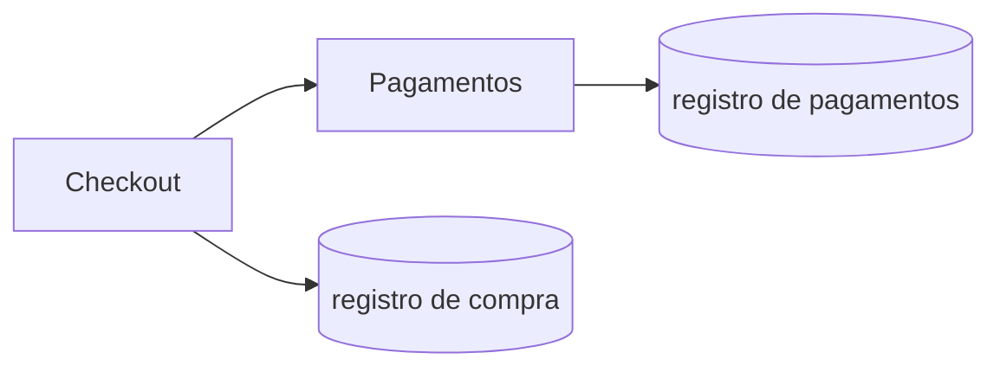
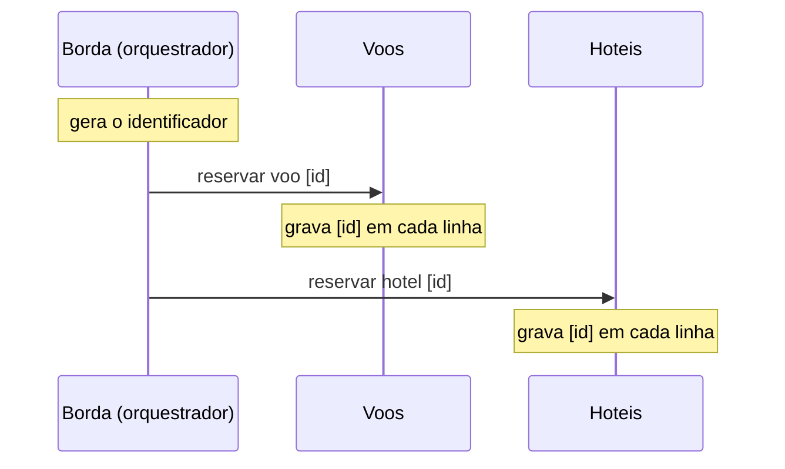

# Aula 21 — O custo real: operação, observabilidade e times

## Objetivo e competências

Ao fechar esta aula, conseguimos:

- explicar o que significa **operar** um artefato a mais e por que esse custo não aparece no grafo de dependências;
- distinguir monitoramento de observabilidade e descrever o que registro, métrica e rastro respondem, cada um;
- explicar o **identificador de correlação**, onde ele nasce, como se propaga e o que ele não resolve;
- relacionar a disponibilidade composta da Aula 17 ao tempo de diagnóstico, que a observabilidade reduz sem alterar a frequência da falha;
- aplicar a **Lei de Conway** a uma proposta de extração, perguntando que time seria dono de cada artefato;
- montar um balanço de ganho e custo de uma extração em que **todo item tem número ou a marca "não medido"** com a forma de medir;
- rodar o Mini-Orion e reconstruir, a partir de dois registros, o caminho de um fechamento que falhou.

## O que já sabemos

Este capítulo parte de quatro ideias que as aulas anteriores deixaram assentadas. Os números do balanço do final vêm delas.

A primeira é que **extrair um componente tem um custo que a conta da Aula 14 listou numa frase só**, "mais um artefato para operar", e que o gatilho de extração é um sinal medido, como a espera por *deploy* conjunto. Enquanto o gatilho não dispara, separar é rede sem ganho comprovado (Aulas 14 e 17).

A segunda é que **a disponibilidade se multiplica quando as partes estão em série**. Dois artefatos de 99,9% de disponibilidade, um chamando o outro de forma síncrona, entregam cerca de 99,8% juntos, e a Aula 17 concluiu que a forma certa para o Orion é cortar pouco.

A terceira é que **um campo novo e opcional numa mensagem é uma mudança aditiva**: o leitor tolerante o ignora, e quem ainda não o conhece continua funcionando (Aula 18).

A quarta é que **a saga transforma a falha em registro**. O fechamento do Orion é um orquestrador: cobrar é compensável, emitir é o pivô, notificar é repetível, e a compensação que falha vira pendência para a reconciliação. A janela de inconsistência tem dois valores, cerca de 0,01 s quando o estorno responde e cerca de 900 s quando só a reconciliação corrige, o segundo ainda uma hipótese sobre o intervalo do job (Aula 20).

O que essas ideias ainda não respondem é uma pergunta que vem depois da falha: **onde, exatamente, ela aconteceu**, e quanto custa ter pessoas e instrumentos capazes de responder.

## O caso: cobrança sem pedido, e ninguém sabe onde parou

Depois da campanha, o suporte recebe reclamações de clientes cobrados sem pedido. A Aula 20 deu ao fechamento a compensação e a reconciliação, e elas corrigem o que podem. Mas a pergunta que o time de plataforma recebe é outra: **em que passo e em que serviço aquele fechamento parou?**

O diagrama mostra o que existe hoje para respondê-la.



Leitura das setas: `A --> B` significa que A depende de B, e que `Checkout` e `Pagamentos` escrevem cada um no seu registro. O diagrama omite `Pedidos` e `Notificacoes`, que também escrevem registros, e mostra uma ideia só: os dois registros são separados e nada liga uma linha de um a uma linha do outro.

`Checkout` (o módulo `compra`, no Mini-Orion) tem o seu registro. `Pagamentos` tem o dele. Cada um escreve uma linha por evento, com horário e mensagem. Nenhuma linha de um tem algo em comum com uma linha do outro. Para juntar a história de um cliente, alguém compara horários, valores e e-mails nos dois arquivos, e a campanha produziu milhares de linhas por minuto.

Esta é a parte do custo da distribuição que o grafo não mostra e que o orçamento raramente considera: a **operação**. A conta da Aula 14 listou, entre os custos de extrair, "mais um artefato para operar". Esta aula olha para essa frase e a desdobra em itens que se possam contar.

## O que significa operar

Um artefato implantável, antes de entregar valor, precisa de tudo o que o mantém no ar. Um cenário de fora mostra o tamanho disso. Uma agência de viagens online tem um sistema só, com um painel de saúde, um caminho de entrega e uma escala de plantão. Quando a equipe extrai o serviço de hotéis, cada um desses itens passa a existir duas vezes: o novo serviço tem o seu caminho de entrega, o seu painel, os seus alertas e o seu banco, e alguém precisa atender o plantão dele, que pode cair de madrugada por um motivo que o outro serviço não tem. O código dos hotéis não mudou de tamanho. O que cresceu foi o que o cerca.

A tabela lista os itens e o que cada um passa a exigir depois da extração.

| Item | No sistema único | Com um artefato a mais |
|---|---|---|
| **Caminho de entrega** | compilar, testar, publicar e subir uma vez | uma segunda esteira, com os seus testes e a sua janela |
| **Monitoramento e alertas** | um painel, um conjunto de limites | um segundo painel e a decisão de quem é avisado |
| **Versões e contratos** | internos, verificados pelo compilador | contrato remoto a manter e a evoluir (Aula 18) |
| **Dado** | um banco, uma cópia de segurança, uma migração | dois bancos, duas migrações, e a cópia a manter correta (Aula 19) |
| **Plantão** | uma escala | uma escala a mais, ou a mesma escala com mais motivos para acordar |

O custo de operar é de tempo da equipe (horas em cada item) e de pessoas (quem atende o plantão), e quem o paga é uma decisão de organização, que a seção sobre Conway retoma. Ele cresce com o número de artefatos, e não com o número de linhas de código. Dez serviços pequenos têm dez caminhos de entrega, dez painéis e dez dados a salvar. Por isso a conclusão da Aula 17 (cortar pouco) é também uma conclusão sobre operação: cada artefato evitado é uma cópia a menos de tudo isso. O Orion, no entanto, **ainda não mediu** esse custo. Nem o tempo que o time gasta com cada item, nem o número de pessoas de plantão. A aula marca esses itens como "não medido" e diz como medi-los, em vez de inventar um número.

## Ver o que acontece: monitoramento e observabilidade

**Monitoramento** responde a perguntas que alguém já previu: a CPU passou de um limite? A fila está maior que o normal? É preciso decidir antes quais perguntas importam. **Observabilidade** é a propriedade de um sistema que permite entender o que ele está fazendo a partir do que ele emite para fora, inclusive para perguntas que ninguém previu. Newman a define nesses termos, e acrescenta um aviso: ela é uma propriedade, não uma lista de ferramentas; o foco deve estar em tornar o sistema compreensível, e não em instalar mais ferramentas.

Na agência, o monitoramento do serviço de hotéis dispara às três da manhã: a taxa de recusa passou do limite. Foi previsto, e o alerta cumpriu o papel. O que o alerta não diz é qual pacote ficou com voo e sem hotel, nem por quê, e é uma pergunta que ninguém programou. Responder a ela exige que o sistema tenha emitido informação suficiente para ser interrogado depois.

Três tipos de informação costumam sustentar essa capacidade, e cada um responde a uma pergunta diferente.

| Tipo | O que é | Responde | Na agência |
|---|---|---|---|
| **Registro** (*log*) | uma linha por evento, com instante e mensagem | o que aconteceu, em detalhe | "hotel recusou a reserva do pacote 7" |
| **Métrica** | um número agregado ao longo do tempo | quanto, e se está piorando | taxa de recusa de hotéis, por hora |
| **Rastro** (*trace*) | a trilha de uma requisição atravessando vários serviços | por onde passou e quanto demorou em cada trecho | o pacote 7: voo reservado, hotel recusado, voo cancelado |

Newman nota que os três se sobrepõem (é possível guardar métricas em arquivo de registro, ou construir um rastro a partir de linhas de registro), e é isso que permite começar pequeno.

### O identificador de correlação

Um **identificador de correlação** (*correlation ID*) é um valor gerado quando uma requisição entra no sistema e carregado em toda chamada que ela provoca. Cada serviço o grava em todas as linhas de registro que escreve por causa dela. Na agência, o pacote 7 passaria a ter um código, e uma busca por esse código nos registros de voos e de hotéis devolveria a história inteira. Com ele, juntar os registros de serviços diferentes deixa de ser comparar horários e passa a ser uma busca por um valor.



As setas são mensagens, e o `[id]` é o campo que viaja com cada uma. O diagrama mostra o caminho de ida e omite o que cada serviço faz com o pedido, para ficar com os três movimentos que tornam o identificador útil. Ele **nasce na borda**, no começo do fluxo, e não em cada serviço (senão há um por serviço e nenhum em comum). Ele **viaja em toda chamada**, como campo da mensagem. E ele é **gravado em toda linha**. Esquecer qualquer um dos três faz o rastro ter buracos justamente onde a falha aconteceu.

A Aula 18 já deu a ferramenta que torna a propagação barata: um campo novo e opcional na mensagem é uma **mudança aditiva**, e um leitor tolerante o ignora. Um serviço que ainda não grava o identificador continua funcionando; apenas aparece como buraco no rastro. Newman recomenda introduzir o identificador cedo: ele não parece útil no começo, mas é caro de acrescentar depois.

Uma limitação conhecida: reconstruir a ordem dos eventos entre serviços exige confiar nos relógios. No simulador, o relógio é um só e a ordem é exata. Num sistema real, cada serviço tem o seu relógio, e a ordem entre serviços é uma inferência, com uma margem de erro. É por isso que ferramentas de rastro guardam, além do horário, a relação de quem chamou quem.

## Disponibilidade composta e tempo de diagnóstico

A Aula 17 calculou que dois artefatos em série, cada um com 99,9% de disponibilidade, entregam cerca de 99,8%: 86 minutos fora do ar por mês, contra 43 de um só. Esse número descreve a **frequência** com que o fechamento falha, e a observabilidade não o altera. O que ela altera é a **duração do diagnóstico**: o tempo entre alguém perceber o problema e saber onde ele está. Em um sistema de dois registros sem identificador em comum, esse tempo é o de comparar à mão. Com o identificador, é o de uma busca.

Vale não prometer mais do que isso. A observabilidade não corta nenhum dos 43 minutos adicionais; ela encurta a parte de cada incidente que se gasta procurando. Quanto isso vale depende de quantos incidentes e de quanto custa cada hora de busca, e o Orion ainda não mediu nenhum dos dois.

## Conway: quem é dono de quê

A **Lei de Conway**, formulada por Melvin Conway em 1968, diz que as organizações que projetam sistemas produzem projetos que são cópias das suas estruturas de comunicação. O corolário prático é que a fronteira de um serviço tende a acompanhar a fronteira de um time.

Três arranjos na agência de viagens mostram o que isso implica. No primeiro, o serviço de hotéis e o de voos pertencem à mesma equipe. A fronteira entre eles tende a custar mais do que rende: a autonomia que ela promete é a de um time em relação a si mesmo, e cada contrato remoto é uma negociação da equipe consigo. No segundo, o serviço de hotéis é de uma equipe que fala com os fornecedores hoteleiros e entrega no ritmo deles, e o de voos é de outra, com outro ritmo e outros fornecedores. Aqui a fronteira acompanha a divisão do trabalho, e a autonomia que ela dá é real. Num terceiro arranjo, um serviço atravessa dois times, e cada mudança vira uma negociação entre eles.

| Arranjo | O que a extração entrega | O que ela custa |
|---|---|---|
| Mesmo time dono dos dois lados | isolamento de processo e de entrega | operar dois artefatos sem ganho de autonomia |
| Times diferentes, cada um dono de um lado | autonomia de entrega e de decisão | contrato remoto e coordenação entre times |
| Um serviço dividido entre dois times | nenhuma clareza de dono | cada mudança é uma negociação |

A consequência para o Orion é uma pergunta a fazer antes de extrair: **que time seria dono de `Pagamentos`**, e esse time tem plantão, ritmo de entrega e conhecimento de provedores para sustentá-lo? O Orion tem uma equipe de plataforma de porte médio. Se a mesma equipe fosse dona do monólito e de `Pagamentos`, estaríamos no primeiro arranjo: a extração entregaria isolamento de processo e de entrega, e não autonomia de time, que é um dos motivadores mais citados dos microsserviços e o que menos se aplica aqui. Existe também a **manobra inversa de Conway** (*Inverse Conway Maneuver*), expressão atribuída a Jonny Leroy, da ThoughtWorks: evoluir a estrutura dos times junto com a arquitetura, para favorecer a arquitetura desejada. Qualquer das duas leituras é defensável, e nenhuma é sem custo: a segunda custa uma reorganização que a diretoria precisa aprovar.

## Estudo de caso: o balanço da extração de `Pagamentos`

A Aula 14 deixou a conta em aberto: o que a extração de `Pagamentos` ganha e o que ela custa. Com as Aulas 16 a 20, cada item tem agora um número ou uma forma de medi-lo. A tabela abaixo é o balanço. A coluna "Valor" traz o número do ensaio ou da hipótese de trabalho, e a coluna "Como medir" diz o que substituiria a hipótese por uma medição do Orion.

| Item | Ganho ou custo | Valor | Como medir |
|---|---|---|---|
| Arestas remotas | custo | 2 no grafo do Orion (1 no Mini-Orion) | extrair as dependências do código |
| Falha por chamada remota | custo | 2% em campanha (hipótese) | contagem de *timeouts* por destino |
| Disponibilidade do fechamento | custo | 99,8%, contra 99,9% (86 contra 43 min/mês) | fechamentos concluídos sobre tentados, na borda |
| Cobrança duplicada | custo, mitigado | 1% sem chave; 0 com chave | extrato do provedor contra os fechamentos |
| Cobrança sem pedido | custo, mitigado | 2 em 2000 (0,1%) | conciliação entre cobranças e pedidos |
| Janela de inconsistência | custo | 0,01 s com compensação; ~900 s sem resposta (hipótese) | tempo entre cobrança e estorno, no registro |
| Artefatos para operar | custo | 2, contra 1 | contagem direta |
| Esforço de operação (entrega, alertas, plantão) | custo | **não medido** | horas por semana por artefato, registradas por um trimestre |
| Tempo de diagnóstico | custo, mitigado | **não medido** | tempo entre alerta e causa identificada |
| Transação local, deploy único, teste sem rede | custo (perdido) | 3 itens que deixam de existir | já identificados na Aula 14 |
| Cadência de release própria | ganho | **não medido** (gatilho da Aula 14) | releases fora do trem compartilhado, por sprint |
| Janela própria para a conciliação | ganho | **não medido** | deploys bloqueados por janela de conciliação |
| Autonomia de time | ganho | **não medido**; depende de quem seria o dono | quem é dono e quem faz plantão |

A tabela é o ponto principal da aula. Duas colunas dela merecem leitura. Os **custos** têm quase todos algum número, porque vieram do ensaio e da conta das aulas anteriores: a rede foi simulada, e simulado é mensurável. Os **ganhos**, ao contrário, estão quase todos marcados "não medido", porque dependem do que o Orion ainda não observou: o gatilho da Aula 14 não disparou, e ninguém mediu a espera por *deploy*. Isso muda o peso do que a tabela diz. Ela não condena a extração; mostra que o lado do custo tem evidência e o do ganho, ainda não.

### 📐 ADR — Registrar o identificador de correlação de ponta a ponta

| Campo | Conteúdo |
|---|---|
| **Identificador** | ADR — Identificador de correlação de ponta a ponta |
| **Status** | Aceito para o `09-saga`. |
| **Contexto** | Depois da campanha, clientes cobrados sem pedido não podem ser rastreados: `compra` e `pagamentos` têm registros separados, sem identificador em comum. |
| **Decisão** | O orquestrador gera um identificador por fechamento, na entrada. Ele viaja num campo opcional da mensagem para `pagamentos` (mudança aditiva, ignorada por quem não o conhece) e é gravado em toda linha de registro dos dois lados, inclusive nas pendências e na reconciliação. |
| **Alternativas** | (a) Comparar horários, valores e e-mails à mão: sem código novo, e inviável em campanha. (b) Usar a chave de idempotência como identificador: já existe, mas mistura dois papéis (evitar repetição e rastrear) e uma chave pode ser reusada em outro contexto. (c) Uma ferramenta de rastro distribuído completa: mais capacidade, com um custo de operação que o Orion não mediu e que seria mais um artefato. |
| **Consequências positivas** | O caminho de um fechamento que falhou se reconstrói por uma busca. A pendência e a reconciliação entram na mesma história. |
| **Consequências negativas** | O campo é mais uma regra a respeitar em toda chamada futura: um serviço que esqueça o identificador deixa um buraco. A ordem entre serviços só é exata no simulador. O registro continua em memória por serviço; reunir os registros num lugar é outro custo. |
| **Reversão** | Barata: o campo é opcional. |
| **Condição de falseamento** | Estaria errado se, em produção, uma fração relevante dos fechamentos que falham não pudesse ser reconstruída (identificador perdido em algum trecho). |

### Na prática: Python

O checkpoint é o mesmo `09-saga/` da Aula 20. A observabilidade mora em um módulo próprio, `mini_orion/observabilidade/api.py`, que não conhece nenhum módulo de domínio (um contrato do `import-linter` verifica isso). Cada módulo tem o seu registro, como dois serviços teriam dois arquivos. O que os liga é a função que filtra pelo identificador e ordena:

```python title="09-saga/mini_orion/observabilidade/api.py (recorte)"
class Registro:
    def __init__(self, origem: str, agora: Callable[[], float]) -> None:
        self._origem = origem
        self._agora = agora
        self.eventos: list[Evento] = []

    def registrar(self, mensagem: str, correlacao: str | None = None) -> None:
        self.eventos.append(
            Evento(next(_SEQUENCIA), self._agora(), self._origem, correlacao, mensagem)
        )


def reconstruir(correlacao: str, *registros: Registro) -> list[Evento]:
    """Junta, em ordem, os eventos de todos os registros que levam o identificador."""
    todos = [e for r in registros for e in r.eventos if e.correlacao == correlacao]
    return sorted(todos, key=lambda e: (e.instante, e.sequencia))
```

O identificador viaja como campo opcional do pedido de cobrança, o que é a mudança aditiva da Aula 18. O servidor de `pagamentos` o lê com `carga.get("correlacao")` e o grava em cada linha. O teste `test_sem_identificador_os_dois_registros_nao_se_juntam` reproduz o início da aula: os dois registros têm linhas, nenhuma com identificador, e a busca devolve uma lista vazia. O teste ao lado, `test_com_o_identificador_o_caminho_do_fechamento_que_falhou_se_reconstroi`, mostra a história inteira de um fechamento cuja emissão falhou:

```text
compra       fechamento iniciado: cobrar
pagamentos   cobranca recebida
pagamentos   cobranca aprovada
compra       emissao falhou: compensar
pagamentos   estorno executado
compra       compensado: cobranca estornada
```

E o caso mais difícil, de uma cobrança que expirou e só a reconciliação resolveu, aparece com o intervalo que separa os eventos:

```text
   0.0 s  compra       fechamento iniciado: cobrar
   0.0 s  pagamentos   cobranca recebida
   0.0 s  pagamentos   cobranca aprovada
   1.0 s  pagamentos   repeticao reconhecida
   2.0 s  compra       pendencia aberta: cobranca_indeterminada
 902.0 s  pagamentos   consulta: aprovada
 902.1 s  pagamentos   estorno executado
 902.1 s  compra       pendencia corrigida pela reconciliacao
```

Perceba o que o rastro mostra e as métricas não mostrariam: a cobrança foi aprovada às 0,0 s, a resposta não chegou, e o cliente ficou cerca de 900 s cobrado e sem pedido. O número 900 é a hipótese do intervalo do job, e o rastro é o instrumento que o mediria em produção.

```bash
cd fundamentos-arquitetura-code/09-saga
pytest tests/test_observabilidade.py     # 4 testes
pytest                                   # 82 testes
lint-imports                             # 9 contratos
```

O que vale experimentar:

- **Ver o buraco.** Em `montar_saga`, passe `gerar_correlacao=lambda: None` e rode a reconstrução de um fechamento que falhou. O que o rastro mostra e o que ele perdeu?
- **Esquecer um ponto.** Em `_servidor.py`, retire o `correlacao` de uma das chamadas a `_registrar`. Qual evento some do rastro, e em que ponto da história a falta dele atrapalharia mais?
- **Preencher o balanço.** Escolha uma linha "não medido" da tabela do estudo de caso e escreva, em duas frases, como o Orion mediria o item em um trimestre.

## O que ficou decidido e o que a Aula 22 pergunta

Ficou decidido que cada fechamento carrega um identificador de correlação de ponta a ponta, gravado dos dois lados, e que o balanço da extração de `Pagamentos` tem um número ou a marca "não medido" em cada item. Ficou registrado também que a observabilidade encurta o diagnóstico sem reduzir a frequência da falha, que a Lei de Conway pergunta que time seria dono do serviço antes de extraí-lo, e que o lado do custo tem mais evidência do que o do ganho.

Temos a conta inteira, com seus buracos à vista. Falta o que o módulo inteiro vinha preparando: decidir sob orçamento. Se a diretoria aprovar "extrair com critério", o que sai primeiro, o que fica e quando parar? A Aula 22 pede essa proposta, e pede também que o grupo defenda a alternativa de não extrair nada como opção real.

## Leitura complementar

- Newman, Sam. *Building Microservices*. 2. ed. Cap. 10 — From Monitoring to Observability (a definição de observabilidade, registros, métricas, rastro distribuído e a recomendação de adotar o identificador de correlação cedo).
- Conway, Melvin E. "How Do Committees Invent?". *Datamation*, abril de 1968.
- Richards, Mark; Ford, Neal. *Fundamentals of Software Architecture*. Cap. 8 — Component-Based Thinking (quadro "Conway's Law": a lei e a manobra inversa de Conway).
- Ford, Neal; Parsons, Rebecca; Kua, Patrick; Sadalage, Pramod. *Building Evolutionary Architectures*. 2. ed. Cap. 9 — Putting Evolutionary Architecture into Practice (seção "Don't Fight Conway's Law": times organizados em torno das fronteiras de serviço).
- Ford, Neal; Parsons, Rebecca; Kua, Patrick; Sadalage, Pramod. *Building Evolutionary Architectures*. 2. ed. (observabilidade e métricas como base de funções de aptidão, tema do Módulo 4).

## Referências

- NEWMAN, Sam. *Building Microservices*. 2. ed. O'Reilly, 2021.
- CONWAY, Melvin E. How Do Committees Invent? *Datamation*, v. 14, n. 4, 1968.
- RICHARDS, Mark; FORD, Neal. *Fundamentals of Software Architecture: An Engineering Approach*. O'Reilly, 2020.
- FORD, Neal; PARSONS, Rebecca; KUA, Patrick; SADALAGE, Pramod. *Building Evolutionary Architectures*. 2. ed. O'Reilly, 2023.
