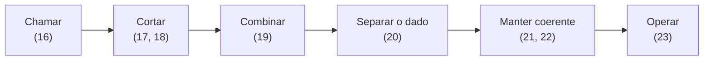

# Módulo 3 — Arquiteturas Distribuídas

## A tese do módulo

O Módulo 2 terminou com um candidato e uma conta em aberto. O candidato é `Pagamentos`: a conciliação precisa de janela e de ritmo próprios, tem $C_a = 1$ e $C_e = 1$, e a fronteira lógica já existe em `05-modular/`, verificada na CI. A conta é tudo o que a rede cobra quando essa fronteira vira física: latência, falha parcial, transação sem commit único, dado que muda de dono, mais um artefato para operar. A Aula 9 nomeou esses custos. Nenhuma aula os mediu.

Este módulo mede. Cada aula transforma um item da conta em número ou em teste, e só depois disso o módulo se permite recomendar alguma coisa. A recomendação pode ser extrair. Pode ser não extrair nada. O que o módulo não aceita é uma resposta que não tenha passado pela conta.

Isso inverte o hábito comum. Quem vem de POO costuma tratar "serviço" como uma classe maior, e a chamada remota como uma chamada de método com mais latência. A primeira aula desfaz essa equivalência, e as demais deixam de poder usá-la.

## As cinco semanas

| Semana | Aulas |
|---|---|
| 9 | **16** — Falácias da computação distribuída · **17** — Do *service-based* aos microsserviços |
| 10 | **18** — Granularidade: o que desintegra e o que integra · **19** — Contratos entre serviços |
| 11 | **20** — Dados: de quem é a tabela · **21** — Transação distribuída e consistência |
| 12 | **22** — Saga orquestrada · **23** — O custo real: operação, observabilidade e times |
| 13 | **24** — Oficina: o que extrair primeiro (dois encontros) |

O módulo tem nove aulas, não dez: com a oficina ocupando os dois encontros da semana 13, dez encontros comportam oito aulas conceituais e a oficina.

## O percurso

O diagrama ordena as perguntas que uma extração obriga a responder, na sequência em que cada uma depende da anterior: não se versiona um contrato que ainda não existe, e não se compensa uma transação cujo dado ainda é compartilhado.

O que ele **não** mostra: não é um roteiro de migração. Nenhum time extrai um serviço percorrendo as seis etapas em ordem, e várias delas acontecem ao mesmo tempo. É a ordem em que o argumento se constrói, e a oficina da Aula 24 reordena tudo sob orçamento.

## O Mini-Orion neste módulo

O recorte executável parte de `06-microkernel` e ganha três estados: `07-remoto` (Aulas 16 a 19), `08-dados` (20) e `09-saga` (21 a 23). Não há socket nem thread. Distribuir é ensinado com um transporte simulado em processo, que injeta latência, timeout e falha parcial com valores fixados no enunciado de cada aula (hipóteses de trabalho, não medições do Orion) e uma semente fixa. O teste reproduz a falha sempre, e a aula diz o que essa simulação mostra (a **forma** do problema) e o que ela esconde (a física da rede real).

Cada aula fecha a decisão sobre o Orion com uma subseção **Na prática: Python**. Ela mostra o recorte real do checkpoint e o teste que serve de evidência. O conceito é o centro da aula, e o código existe para mostrar que ele se sustenta quando executado.

## O Orion Evolution Lab

Cada grupo aplica o percurso ao seu recorte: identificar quais arestas atravessariam a rede, classificar cada força de granularidade, escrever o contrato de uma aresta, dizer quem é dono de cada dado, escolher a consistência de uma operação crítica e fechar com a proposta de extração. A proposta tem de defender "não extrair nada" como alternativa real. Formato, artefatos e critérios em [Orion Evolution Lab](../orion/index.md).

## Aulas

1. [Falácias da computação distribuída](aula16-falacias-da-computacao-distribuida.md) — a chamada remota tem um desfecho que a local não tem; repetição, idempotência e a cauda que o percentil 95 não vê.
2. [Do *service-based* aos microsserviços](aula17-service-based-e-microsservicos.md) — o espectro de granularidade, o *architectural quantum* e a conta de cada forma sobre o grafo do Orion; o ADR da forma do *deployable*.

Exercícios de fixação: [Aulas 16 e 17](exercicios-fixacao-aulas-16-17.md).

As demais aulas entram nesta lista conforme são publicadas.
